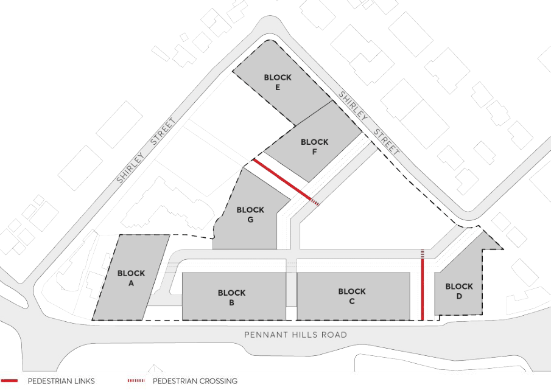

#### 8.5.12.17 STREET NETWORK AND FOOTPATHS

The streets and footways on-site are accessible to the public, whilst being under private ownership. The elements in the street such as footpaths and paving widths and vegetation should be designed to suit the street network and meet Council’s public domain requirements where possible.

Objectives

O.01 Provide a safe, efficient, and generous network for pedestrian, bicycle and vehicular movements for a site of this density.

O.02 Maximise two way traffic flow and to allow for on street parking on one side of Shirley Street. O.03 Integrate with the existing street network with new internal roadways that represent an extension of the existing network.

O.04 Create attractive and comfortable streetscapes for the local community.

Controls

C.01 The road and pedestrian network is to be generally in accordance with Figure 8.5.12.5. C.02 Developments on the southern side of Shirley Street must widen the carriageway of the road by 0.8m. This is to occur by reducing the naturestrip width and does not require boundary changes.

263-281 PENNANT HILLS ROAD, CARLINGFORD

C.03 The design of the internal roads, any shared zones or other traffic facilities should be in accordance with the relevant Australian Standards, Austroads Guidelines and TfNSW Technical Directions.

C.04 On-street parking is to be provided where available within the proposed road network. C.05 All new streets may be privately owned but must be publicly accessible at all times and be integrated with the surrounding street network.

C.06 Public footpaths and pedestrian kerb ramp crossings are to be provided as required to provide safe pedestrian access to all buildings and open space areas. Path widths are to be in accordance with the Parramatta Public Domain Guideline requirements.

C.07 Basement car parking is permitted under the new privately owned internal streets and must allow for appropriate soil depth for medium to large tree vegetation.

C.08 Development Applications must clearly document proposed basement structure and surface level differences.

C.09 Street trees are required at regular centres, maximum 15m, preferably 8-10m for both sides of the new internal street.

C.10 New street trees, signage and furniture are to be provided to improve the comfort and safety of the public domain.

> [Picture on page 712: a picture, saved as a picture (images/part-08-centres-precincts-special-character-areas-specific-page-712-19.gif, 150 dpi).]

Figure 8.5.12.5 - Indicative Road Network

263-281 PENNANT HILLS ROAD, CARLINGFORD
