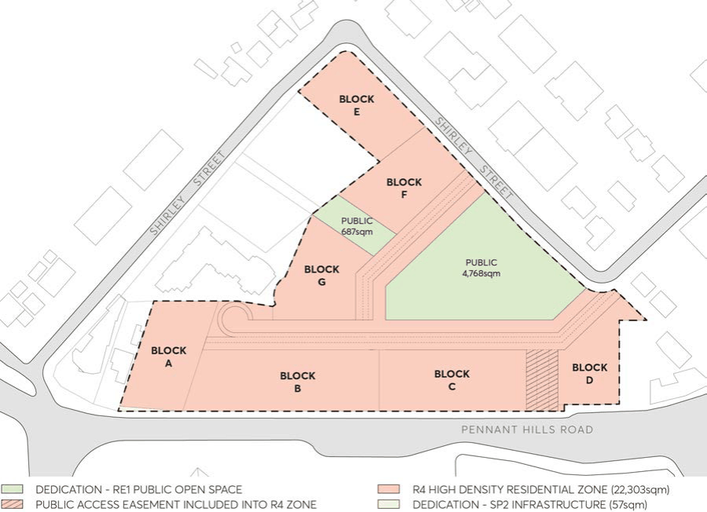

#### 8.5.12.19 PUBLIC OPEN SPACE AND PEDESTRIAN CONNECTIONS

There are numerous benefits created through the provision of public open spaces and pedestrian connections, including greater connectivity, increased frontage for entries and business opportunities, spatial intimacy and variety in the public domain. The site is well-suited to accommodate high quality public open spaces and pedestrian connectivity, capable of linking Carlingford Light Rail Station to the surrounding locality.

Objectives

O.01 Provide high quality public spaces and pedestrian connections that will improve the quality of the site and its relationship to the surrounding locality.

O.02 Deliver a useable, central open space which is capable of supporting a variety of uses and activities.

O.03 Provide for through-site links which are activated, improve walkability and permeability, and relate to the surrounding locality.

O.04 Provide an attractive, green and environmentally sensitive new park with significant large tree canopy planting.

O.05 Maximise the interface between the development and public open space to ensure amenity, activation and casual surveillance.

263-281 PENNANT HILLS ROAD, CARLINGFORD

Controls

General C.01 Public open spaces are to be provided in accordance with Figure 8.5.12.6. This includes the central open space addressing Shirley Street, east-west link (adjacent Block F) and north-south through-site link (Pennant Hills Road). The total areas are as follows:

a) Public open space - a minimum of 4,768m2 (Central Open Space) 687m2 (east west through site link with public access easement) connected to Shirley Street.

b) A minimum of 595m2 (north south through site link) connected to Pennant Hills Road.

C.02 The designs for the public open spaces are to be developed in consultation with Council. They are to be designed to:

a) Incorporate a palette of high quality and durable materials, and robust and drought tolerant landscaping species.

b) Include clear, accessible, safe, and convenient linkages to each other and to the surrounding public open space network.

c) Integrate stormwater management and urban tree canopy.

d)  Include design elements, furniture, and infrastructure to facilitate active and passive recreation and community gatherings.

e) Maximise the safety and security of users consistent with ‘Safety by Design’ principles.

f) Provide deep soil throughout, with no car parking or infrastructure underneath.

g) Encourage pedestrian use through the design of open space pathways and entrances.

h) Clearly delineate private and publicly accessible open space.

i) Provide access to both sunlight (minimum 4 hours winter solstice) and shade.

j) Incorporate appropriate levels of lighting to maximise hours of use but do not create a nuisance to surrounding residents.

k) Accommodate high levels of use.

l) Be accessible 24/7.

m) Be capable of being well maintained within reasonable costs.

C.03 Soft landscaping areas are to be irrigated. C.04 Pedestrian connections should be publicly accessible 24/7 and open to the sky.

263-281 PENNANT HILLS ROAD, CARLINGFORD

> [Picture on page 715: a picture, saved as a picture (images/part-08-centres-precincts-special-character-areas-specific-page-715-2.gif, 150 dpi).]

Figure 8.5.12.6 - Public Open Space Plan

Central Public Open Space C.05 The central public open space is to have a minimum area of approximately 4,768m2. This is to be orientated towards Shirley Street.

C.06 Provide a seperated cycle path connection. C.07 The open space design shall follow the existing topography as much as possible. C.08 This space is to accommodate a range of key user groups including children, young people, the elderly and people with a disability.

C.09 The space is to include a variety of active and passive uses, including mixture of soft and hard surfaces, outdoor spaces, and seating areas.

C.10 This space is to utilise durable materials and high quality landscaping, including a variety of indigenous, native and exotic species.

C.11 Facilitate cross site and internal pedestrian connections and promote equitable access to all members of the public.

C.12 The space is to demonstrate ecological values. Large canopy specimen trees (15-20m at maturity) are to be provided in the park design mix contributing to summer shade and urban heat mitigation. Minimum 100L at planting.

C.13 The space is to be attractive and memorable with high levels of amenity that consider climate, saftety, activity, circulation, seating, lighting, and enclosure.

East-West Through-Site Link

263-281 PENNANT HILLS ROAD, CARLINGFORD

C.14 The east-west through-site link to Shirley Street is to be a minimum area of approximately 687m2. This is to provide access between the central public open space and the entrance to the Library/Community Facility.

C.15 The through-site link is to be designed to cater for movement through the site, including passive recreational uses such as seating and the like.

C.16 Provide a separated cycle path connection. C.17 This space should include a variety of indigenous, native and exotic species. C.18 Promote equitable access to all members of the public. North-South Through-Site Link C.19 The north-south through-site link to Pennant Hills Road is to be an area of approximately 595m2. This is to provide access between the central public open space and Pennant Hills Road to the south.

C.20 The through-site link is to be designed to cater for movement through the site, including passive uses, such as seating and outdoor dining.

C.21 This space should include a variety of indigenous, native and exotic species. C.22 Promote equitable access to all members of the public. C.23 This land is to be provided with a public access easement, allowing reasonable access at all times whilst remaining under private ownership.
