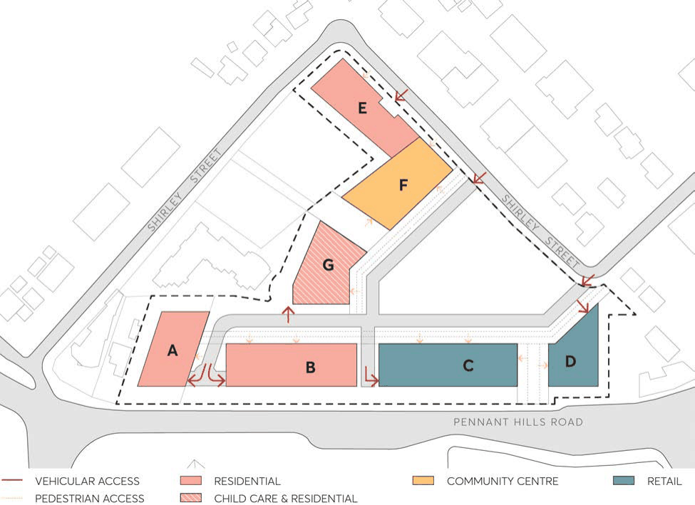

#### 8.5.12.25 VEHICULAR ACCESS

The design and location of vehicle access to developments should give priority to pedestrian movement and to minimise conflicts between pedestrians and vehicles on footpaths. Vehicle access should also be designed to minimise visual impact and disruption of the public domain and should be integrated into built form.

Objectives

O.01 Ensure the amount, location and design of car parking caters for the needs of residents, workers and visitors.

O.02 Encourage active transport such as walking and cycling, and the use of public transport. O.03 Create a high-quality streetscape outcome that provides a safe, convenient and comfortable pedestrian environment.

O.04 Minimise the impact of vehicle access points and driveways on streetscape, pedestrian safety and quality of the public domain.

Controls

C.01 Indicative vehicular and pedestrian access is to be consistent with Figure 8.5.8.11.7. C.02 Vehicle access and servicing should not be located within the Pennant Hills Road setback. C.03 Where practicable, entry points should be minimised and shared between adjoining buildings. C.04 Vehicular access doors should be fitted behind the façade and finished of a material that will integrate into the building.

C.05 Vehicle access should be designed to minimise the visual impact to the street. C.06 All vehicles should enter and exit the site in a forward direction. C.07 Vehicle and pedestrian access should be appropriately separated to remove conflict. C.08 Loading dock and waste collection should be incorporated within the building envelopes. C.09 Parking and access should be in accordance with the relevant Australian Standards.

263-281 PENNANT HILLS ROAD, CARLINGFORD

> [Picture on page 720: a picture, saved as a picture (images/part-08-centres-precincts-special-character-areas-specific-page-720-2.gif, 150 dpi).]

Figure 8.5.12.7 – Indicative Vehicle and Pedestrian Access Points
