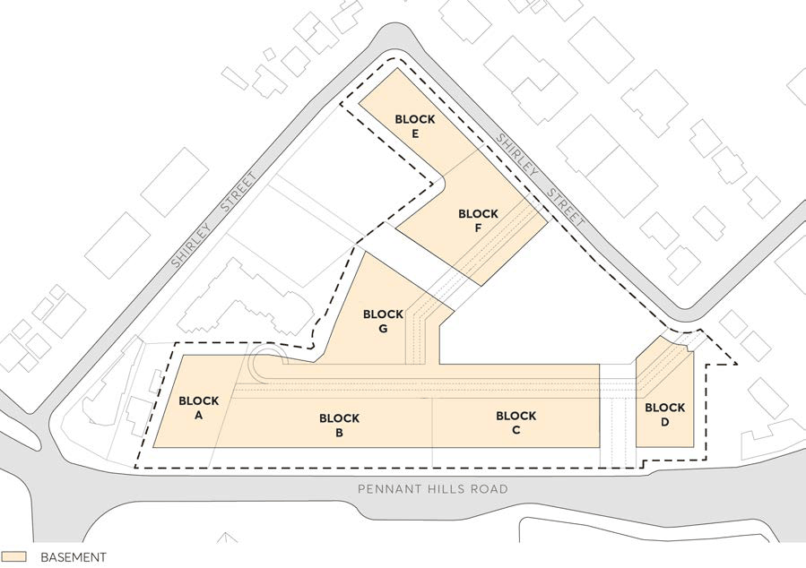

#### 8.5.12.26 ON-SITE PARKING

Objectives

O.01 Facilitate an appropriate amount of parking on the subject site. O.02 Minimise the impact of on-site parking. O.03 Provide adequate space for parking and manoeuvring of vehicles. O.04 Maximise the use and benefit of public transport and active transport, such as walking and cycling.

Controls

C.01 The layout and area of basements are to be generally in accordance with Figure 8.5.8.11.8. C.02 Where variations are proposed to the basement footprints, development is to demonstrate how the objectives for this Section are achieved.

C.03 Car parking should be provided in basements. C.04 Parking is permitted below the private road network.

263-281 PENNANT HILLS ROAD, CARLINGFORD

C.05 Adequate landscaped area must be maintained around the basement footprints. C.06 On-site parking should meet the relevant Australian Standards. C.07 Accessible parking should be designed and provided to meet the Australian Standards. C.08 Pedestrian pathways to car parking areas are to be provided with clear lines of sight and safe lighting.

> [Picture on page 721: a picture, saved as a picture (images/part-08-centres-precincts-special-character-areas-specific-page-721-7.gif, 150 dpi).]

Figure 8.5.12.8 - Indicative Basement Layouts

C.09 Car parking for residential uses should be provided as set-out below.

| Dwelling Type | Maximum Parking Rate |
|---|---|
| 1 Bedroom | 1 |
| 2 Bedroom | 1 |
| 3 Bedroom | 2 |
| 4 Bedroom | 2 |
| Visitor | 0.1 |

C.10 Car parking for non-residential uses are to be provided as set-out below.

| Dwelling Type | Maximum car parking rates |
|---|---|
| Supermarket | 1 space per 25m2 |
| Other Retail Premises | 1 space per 40m2 |
| Centre-based Childcare | 1 space per 6 children 1 space per 1 employee A reduction in the parking rate may be considered if sufficiently justified through a Traffic and Transport assessment and there being spare capacity at relevant times within the car park. |
| Community Facility | 20 spaces |

263-281 PENNANT HILLS ROAD, CARLINGFORD

C.11 Where not listed above, car parking is to be provided in accordance with Parramatta DCP 2023 or The Guide to Traffic Generating Developments, whichever is greater.

C.12 Car parking rates are a maximum and any excess parking may be counted as gross floor area. C.13 Car parking rates should be rounded-up to the nearest whole number.
