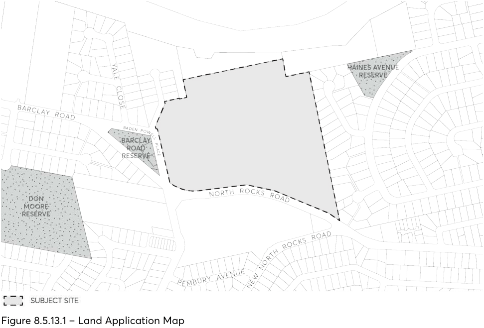

#### 8.5.13 NORTH ROCKS VILLAGE PRECINCT

This Section applies to 361-365 North Rocks Road, North Rocks as shown in Figure 8.5.13.1. Land application map and must be read in conjunction with any relevant Parts of the Parramatta DCP 2023. Where there are inconsistencies between the controls contained within this section and any other controls within this DCP, the North Rocks Village Precinct DCP provisions will prevail to the extent of the inconsistency.

> [Picture on page 725: a picture, saved as a picture (images/part-08-centres-precincts-special-character-areas-specific-page-725-8.gif, 150 dpi).]

Figure 8.5.13.1 – Land Application Map
