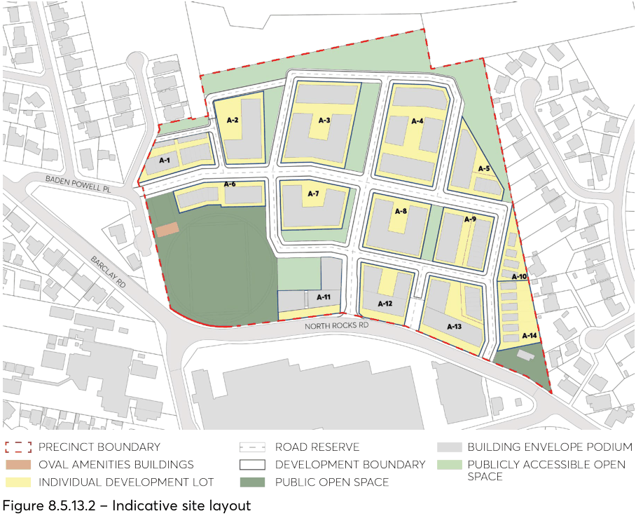
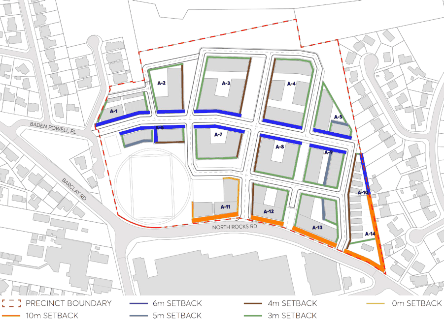
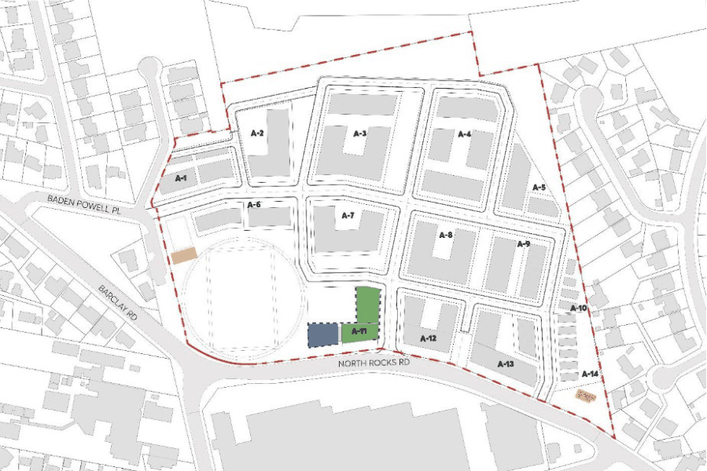

#### 8.5.13.2 SPATIAL STRUCTURE AND BUILT FORM

#### 8.5.13.2.1 INDICATIVE SITE STRUCTURE

Objectives

O.01 Create a legible, pedestrianised public domain by sitting buildings to define the street network, open spaces and through-site links.

O.02 Create attractive, comfortable and inviting streetscapes for the local community. O.03 Integrate the new streets and buildings within the existing street network, with a logical street hierarchy.

O.04 Minimise cut and fill across the site to maximise tree retention and to minimise impacts to adjoining properties, disruption to natural drainage lines and the need for retaining walls.

O.05 Ensure that FSR is equitably distributed across the precinct. O.06 Ensure that the ground floor of buildings interface relates directly to adjacent street level. O.07 Respond to the site’s unique bushland setting, retain existing mature trees and provide deep soil to plant new trees.

NORTH ROCKS VILLAGE PRECINCT

Controls

C.01 The street layout, through-site links, open space, development sites and building footprints are to be consistent with the plan shown in Figure 8.5.13.2 and the established street hierarchy in Figure 8.5.13.5.

C.02 The street layout and building footprints must demonstrate viable retention of existing trees where possible, including clusters of significant trees.

C.03 A site wide Landscape Plan is required and demonstrate that the overall site can achieve a minimum of 40% tree canopy.

C.04 Building courtyards must prioritise a northern orientation for solar access. C.05 A Concept and Stage 1 Infrastructure Development Application must confirm site levels, infrastructure and concept lot designs for the entire development site as a framework for future individual development lot assessments including:

a) vertical and horizontal alignments for road reservation, park and development lot boundaries,

b) a site wide earthworks, grading and stormwater design that minimises cut and fill, provides suitable gradients for street and block development and confirms existing individual tree retention,

c) how retention of significant existing trees is maximised, and

C.06 Indicative building envelopes and lot by lot FSR. C.07 Individual development lot applications must demonstrate consistency with the above approved Concept and Stage 1 Development Application confirming:

a) proposed site and road levels follow natural ground level as much as possible,

b) where retaining walls are proposed there is no alternative,

c) levels disparity across and between adjacent blocks and buildings is minimised,

d) ground floor units are not below the adjacent street level,

e) building floor levels and entries interface smoothly with all street frontages, and

f) development on the subject lot does not compromise the ability of neighbouring lots and the rest of the site to achieve the same objectives.

NORTH ROCKS VILLAGE PRECINCT

> [Picture on page 728: a picture, saved as a picture (images/part-08-centres-precincts-special-character-areas-specific-page-728-2.gif, 150 dpi).]

Figure 8.5.13.2 – Indicative site layout

#### 8.5.13.2.2 SETBACKS

Objectives

O.01 Provide adequate setbacks that provide for a comfortable public domain, with adequate sunlight, and an appropriate scale relationship with the street.

O.02 Create a clear and consistent delineation between public and private spaces and landscape interface between building and streets.

O.03 Maximise the area for landscape embellishment and buffer to all buildings fronting public streets.

O.04 Confirm a consistent alignment of buildings and basement car parks for all streets. O.05 Provide a deep soil zone around the periphery of all development sites that are contiguous with road reservations and open space areas.

NORTH ROCKS VILLAGE PRECINCT

Controls

C.01 Minimum ground level building and basement setbacks are to be provided in accordance with Figure 8.5.13.3.

C.02 Council’s preferred setback on the east west road is 6m; however a reduced setback may be considered to not less than 4m provided it can be demonstrated that the existing trees will be retained, and new trees can grow to their full capacity; and overshadowing of oval is not reduced.

C.03 Provide understorey planting to all landscape setback zones. C.04 Provide small trees (6-8m), and medium sized trees (10-12m) in all landscape setback zones that are 4m wide, or more than 4m wide, respectively. Small trees minimum 3m from the building line, medium trees minimum 4m away from the building line.

C.05 Basements are not to encroach into setback areas. C.06 Design buildings in a way that minimises the need for structures such as ramps, retaining walls, steps and other hardscape elements within the landscape setback zone.

C.07 Basement ramps and entries are to be wholly located within the building footprint and not within the setback zone.

C.08 Electrical pillars, fire hydrants and other services are to be carefully designed so that they are visually recessive in the building façade and/or landscape setbacks and that do not pose an obstruction to pedestrians. All Development Application drawings must clearly demonstrate how the placement and design of these elements has been thoughtfully and successfully resolved.

C.09 The provision of upper level building setbacks is based on streetscape analysis to determine what is appropriate to reduce perceived bulk and height of buildings. Where proposed, the minimum upper level setback must be 3m.

NORTH ROCKS VILLAGE PRECINCT

> [Picture on page 730: a picture, saved as a picture (images/part-08-centres-precincts-special-character-areas-specific-page-730-2.gif, 150 dpi).]

Figure 8.5.13.3 – Minimum basement and ground level building setbacks

#### 8.5.13.2.3 BUILDING HEIGHT

Objectives

O.01 Building heights that respond to the topography and deliver appropriate transitions to surrounding development.  Taller buildings are to be located at the centre of the site transitioning in height down to existing lower scale, surrounding built form, bushland areas and street interfaces.

O.02 Ensure that building forms allow for a high level of solar access to buildings and the public domain within and outside the development site.

Controls

C.01 The maximum building height must correspond in storeys as follows:

| Metres (as per the LEP) | Maximum number of storeys |
|---|---|
| 9m | 2 |
| 12m | 3 |
| 14m | 3 |
| 23m | 6 |

NORTH ROCKS VILLAGE PRECINCT

C.02 Roof plant, services and rooftop structures (such as pergolas or shelters) which provide protection to the communal open spaces are to be excluded from the calculation of storeys. These elements must be integrated into the design of the building.

#### 8.5.13.2.4 BUILDING DESIGN

Objectives

O.01 Ensure sites are of a sufficient width to achieve a safe and efficient pedestrian and vehicular access.

O.02 Deliver high amenity, interest and visual appeal in the street environment with views between buildings to the bushland and open spaces

O.03 Minimise the perception of visual bulk and scale of the development. O.04 Ensure building materials contribute positively to the streetscape, are sustainable, durable, and easy to maintain.

Controls

C.01 For new subdivisions for dwelling houses a development must have a minimum site frontage width of 12 metres.

C.02 Provide minor breaks in the built form to reduce perceived building bulk and provide views and to and from internal courtyards.

C.03 A maximum of one step in the built form between any podium and upper-level typology is to be provided.

C.04 Any part of a basement or sub-floor that projects more than 1m above natural ground level comprises a storey.

C.05 Buildings are to incorporate a range of high-quality, sustainable and durable materials in a range of compatible colours and textures.

C.06 The building  must:

a) be modulated vertically in segments that relate to a fine-grain subdivision pattern where the site frontage is more than 25m.

b) be of predominantly masonry character with lightweight panel construction or curtain walling.

c) be articulated with depth, relief and shadow on the street facade. A minimum relief of 150mm between the masonry finish and glazing face must be achieved.

d) utilise legible architectural elements and spatial types – doors, windows, pilasters, sills, plinths and infill etc, not necessarily expressed in a literal traditional manner.

C.07 The following buildings are to have splayed corners:

a) SW corner Lot A-4

b) NW corner Lot A-8, and

NORTH ROCKS VILLAGE PRECINCT

c) NE corner Lot A-Z

#### 8.5.13.2.5 BUILDING RESPONSE TO TOPOGRAPHY

Objectives

O.01 Site designs to avoid the need for excessive cut and fill, boundary walls or other retaining walls in setback areas, and/or excessive vertical circulation between ground floor and external areas.

O.02 Deliver a ground floor that achieves amenity and privacy for residents while providing passive surveillance and engagement with the street.

O.03 Locate apartments at or above the street level to facilitate sunlight access, safety, privacy and a suitable streetscape interface.

O.04 Seamlessly integrate accessibility into the design of buildings and landscaping in a way that does not dominate the setback areas.

O.05 Maximise deep soil and green landscape area in the setback areas providing a dominant landscape setting for new buildings.

Controls

C.01 Match building design to suit the degree of slope, using split slab construction to either take up the slope of the site with additional half levels or step to complement the slope.

C.02 Ground floor apartments must be between 500mm and 900mm above street level where there is a narrow 3m setback.

C.03 Only a small proportion of ground floor apartments are permitted below ground level to address the slope of the land. These apartments are to be a maximum 500mm below street level only.

C.04 Where apartments are located below the street level, the following applies:

a) Adequate solar access to habitable rooms and private open space must be demonstrated. A minimum floor-to-ceiling height of 3.1 metres must be provided to ensure adequate solar access.

b) Adequate privacy screening and landscaping must be demonstrated.

C.05 Ground floor apartments facing the street must have individual apartment entries where feasible.

C.06 Buildings must be designed to provide passive surveillance to open space and through site links by minimising blank walls and non-habitable uses to these spaces.

C.07 Public and privately owned land must be clearly delineated at all interfaces with streets and open spaces.

C.08 Where a basement breaches the natural ground level, it must be contained within the building footprint.

NORTH ROCKS VILLAGE PRECINCT

C.11 Where appropriate, vertical circulation must be located within the building envelope to prevent impacts on landscaping and ensure a clear relationship between the building entry and the street.

C.12 Retaining walls within the development site shall be avoided or minimised. Where they are required, retaining walls must have a maximum height of 1m, designed to blend with the individual development including materials and expression, and be built of high quality, robust and durable materials. Suitable materials include natural stone and/or concrete – natural concrete or, with integral colour.

#### 8.5.13.2.6 RETAIL GROUND FLOOR FRONTAGE

Objectives

O.01 Ensure retail frontages provide comfort, shelter and amenity for pedestrians. O.02 Provide an active ground floor frontage that is visually interesting, accessible and integrated with the design of the public domain.

O.03 Maintain complementary architectural detail.

Controls

C.01 Ground floor retail space and active frontages are to be generally located per Figure 8.5.13.4. C.02 Ground floor commercial and retail uses must be appropriately located to activate the public domain.

C.03 Services, substations, loading docks and driveways on building frontages must be minimised to reduce inactive walls.

C.04 Electrical pillars, fire hydrants and other services are to be designed so that they are visually recessive in the building façade.

C.05 Awnings must be provided where active non-residential frontages are proposed. C.06 Awnings must complement the architectural character of the building. C.07 Awnings must have a minimum depth of 2m, unless street trees are provided.

NORTH ROCKS VILLAGE PRECINCT

> [Picture on page 734: a picture, saved as a picture (images/part-08-centres-precincts-special-character-areas-specific-page-734-2.gif, 150 dpi).]

Figure 8.5.13.4 – Indicative Non Residential Use and Active Frontage

#### 8.5.13.2.7 RESIDENTIAL DESIGN APARTMENT QUALITY

Objectives

O.01 Ensure development achieves good amenity standards for residents.

Controls

C.01 Where practicable, balconies must be rectangular in shape with the longer side parallel to the facade of the building.

C.02 Apartment design must incorporate suitable spaces that can be utilised as a work-from-home space.

C.03 Minimum floor-to-floor heights for residential apartments are to be 3.2m for all levels.

NORTH ROCKS VILLAGE PRECINCT

#### 8.5.13.2.8 COMMUNITY CENTRE

Objectives

O.01 Provide a prominent, accessible, and appropriately located community facility that meets the needs of the North Rocks community and visitors.

O.02 Create a vibrant facility that is integrated into the adjacent public domain areas. O.03 Ensure all levels of the community facility overlook the Village Square. O.04 Ensure that floor heights support a range of uses and provide appropriate amenity. O.05 The building is to be designed to have access to daylight. O.06 Ensure the interior layout is programmable, flexible and open plan. O.07 Incorporate best practice sustainability principles and standards into the design of the building and operation of the facility.

Controls

C.01 The facility is to be located in the building generally as shown in Figure 8.5.13.4 C.02 The facility must provide a primary, clearly identifiable entry addressing the new village square. A secondary entry must also be provided, either facing the oval or along North Rocks Road.

C.03 Building services and fire exits are to be minimised. Where practical, services are to be located away from the Village Square and not directly facing it.

C.04 Provide an outlook to the Village Square and oval to all levels of the Community Centre. C.05 Minimum floor-to-floor heights shall be provided as follows:

a) Ground floor 4.5m and a minimum of 3.8m for all levels above.

C.06 No portion of the community centre is to be below ground level except for the basement carparking.

C.07 The interior spaces of the community centre are to be open plan and free from columns where possible.

C.08 Building design must incorporate high-quality materials and finishes including masonry highlights using natural materials and be of high sustainability value.

#### 8.5.13.2.9 EXISTING COTTAGE

Objectives

O.01 Provide a prominent, accessible, and appropriately located community facility that meets the needs of the North Rocks community and visitors.

O.02 Incorporate best practice sustainability principles and standards into the design of the building and operation of the facility.

NORTH ROCKS VILLAGE PRECINCT

Controls

C.01 The facility is to be located in the building per Figure 8.5.13.4. C.02 The existing cottage community facility is to open out onto a garden with passive seating. C.03 Building design must incorporate high quality materials and finishes including masonry highlights using natural materials and be of high sustainability value.

#### 8.5.13.2.10   LANDSCAPE DESIGN AND PLANTING

Objectives

O.01 Improve amenity of new neighbourhoods through the provision of landscaping on development lots.

O.02 Establish a variety of vegetation types and species, especially tree canopy cover. O.03 Provide successful landscaped boundary setbacks and communal open space to enhance and soften street presentation, screen buildings, provide ground level amenity and suitable separation to neighbours.

O.04 Assist with the management of water and urban cooling.

Controls

C.01 A minimum 15 % of all land zoned R4 High Density Residential is to be provided as deep soil. C.02 A minimum dimension of 6 metres is required for part of the deep soil zone, equal to at least 7% of the total site area.

C.03 The remaining deep soil zone may be provided with a minimum dimension of 4 metres x 4 metres.

C.04 A Landscape Plan must be provided for all landscape areas including landscape setbacks, courtyards and other communal open spaces and must demonstrate that the overall site achieves 40% canopy cover.

C.05 Canopy vegetation must be provided in the street frontage setbacks. C.06 Built form configurations should allow for the embellishment of ground level communal courtyard open spaces with 40% canopy tree cover and generous understorey landscaping that is healthy, thriving , sustainable and easy to maintain over the long term.

C.07 For residential flat buildings, each development lot must provide a central courtyard communal open space at ground level.

C.08 Where basements extend beneath communal courtyards, the top of slab must be below ground level allowing for a minimum soil depth of 1.2 metres to support landscaping including trees. This area will not contribute to deep soil zone calculations and must provide appropriate soil conditions, including automatic irrigation and drainage, for planting above structures.

C.09 Tree planting and landscaping located on a slab must achieve soil depth and volume per Apartment Design Guidelines requirements. Canopy trees are to be planted at ground level.

NORTH ROCKS VILLAGE PRECINCT

C.10 Soft landscape embankment gradients must be no more than 1:5. C.11 All open space shall reflect the principles of ‘Safer by Design’ (Crime Prevention through Environmental Design – CPTED)  by minimising high retaining walls, dense planting and ensuring casual surveillance of communal areas from both residential and non-residential uses.

C.12 Augment existing tree planting in the 10m landscape buffer fronting North Rocks Road to serve as street trees and to screen the new development. Minimise earthworks and level changes for the full width of this zone. Duplication of road access or any major hard landscaping including underground utility services is not permitted.

C.13 Minimise impervious surfaces and major earthworks or level changes in all landscape setback areas.
