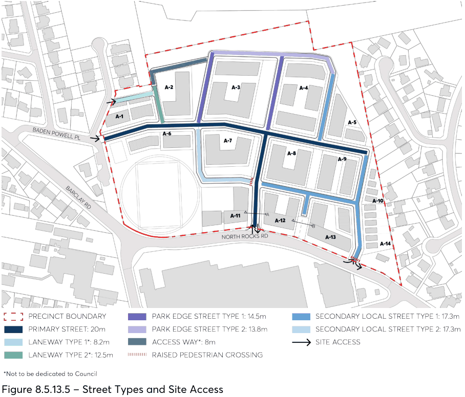
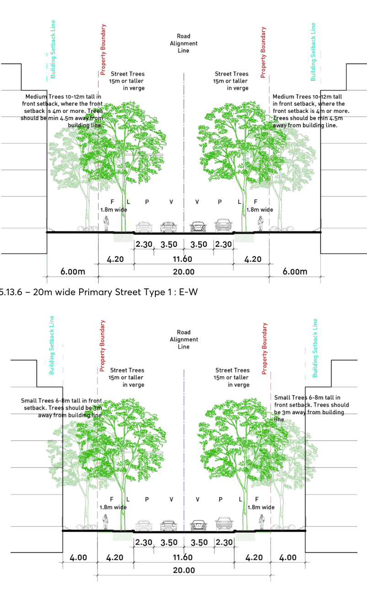
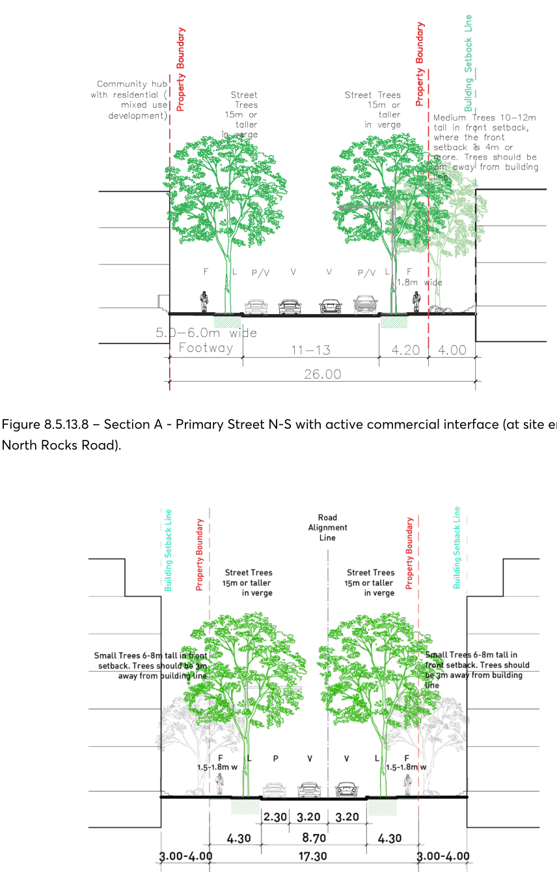
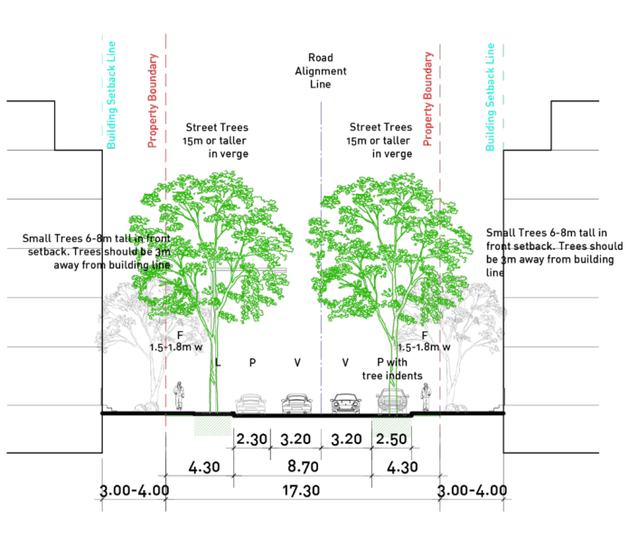
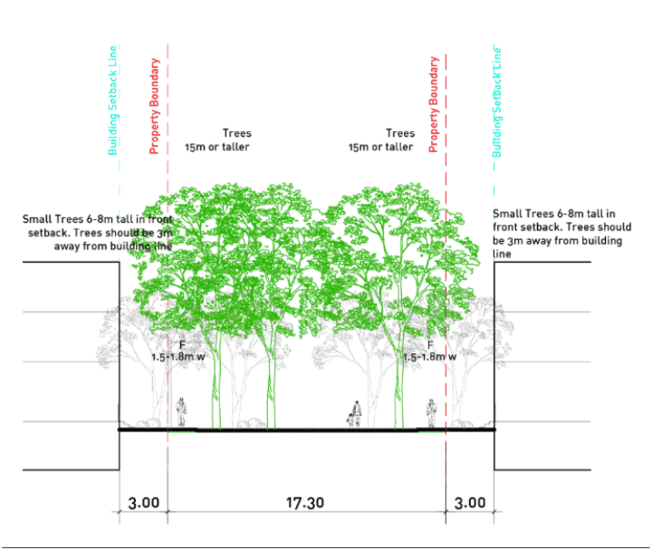
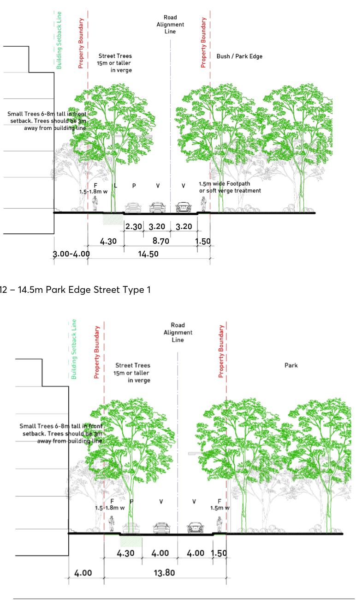
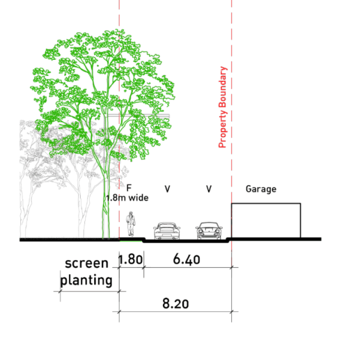
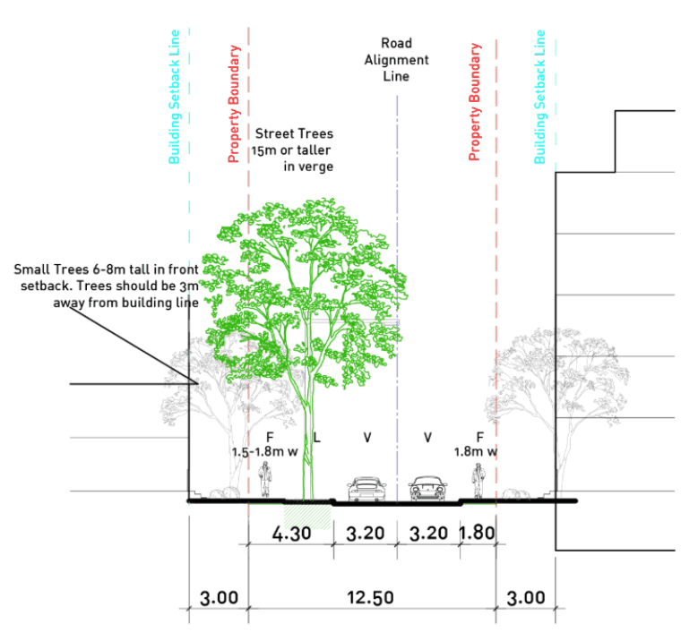
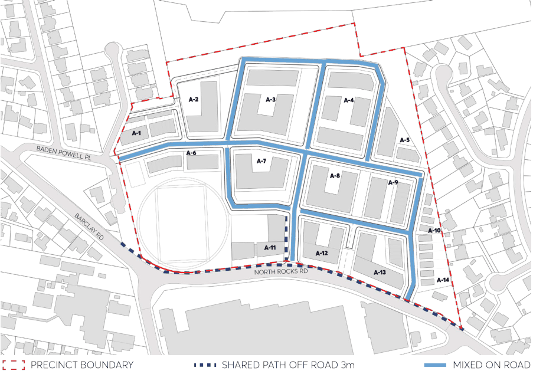
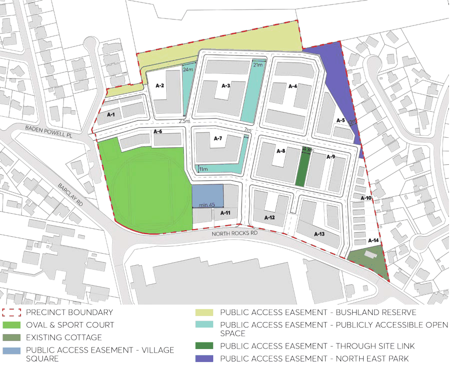

#### 8.5.13.3 PUBLIC DOMAIN

#### 8.5.13.3.1 STREET NETWORK, SITE ACCESS AND FOOTPATHS

Objectives

O.01 Provide a safe, efficient, and generous network for pedestrian and bicycle movements as well as vehicular access.

O.02 Create shady, attractive and comfortable streetscapes for the local community. O.03 Maximise two-way vehicular traffic flow and to allow for on-street parking. O.04 Directly integrate the new development with the existing street network. O.05 Ensure that Council’s design and construction requirements for public streets are met. O.06 Ensure consistency with Parramatta Bike Plan and Parramatta Ways Walking Strategy.

Controls

C.01 Public Domain Alignment plans are to be submitted with any development application detailing proposed alignments and works on land owned by, or to be dedicated to Council. The scope of work must include the North Rocks Road public footpath fronting the development. The plans are to be prepared in accordance with the requirements of the Parramatta Public Domain Guidelines.

C.02 The design of the internal roads must be in accordance with Council's design and construction standards, the relevant Australian Standards, Austroads Guidelines and TfNSW Technical Directions.

C.03 On-street parking is to be provided where available within the proposed road network. C.04 Public footpath widths are to be minimum 1.5m-1.8m wide consistent with street sections. C.05 Footpaths are to be provided in front of all residential apartment buildings at the interface with a proposed publicly accessible open space. Paths should be located outside the landscaped building setback, to aid in wayfinding and to delineate between private and public spaces.

C.06 Raised pedestrian/cycle priority crossings are required to access community and retail facilities.

NORTH ROCKS VILLAGE PRECINCT

C.07 Street trees are required at regular centres, typically 8-10m, for both sides of new internal streets.

C.08 The proposed extent and type of cycle access throughout the development is to be generally in accordance with Figure 8.5.13.16. Provide on-road mixed traffic cycle access on all internal streets in the development.

C.09 Provide a 3m shared path on North Rocks Road public footpath measured from back of kerb.

> [Picture on page 738: a picture, saved as a picture (images/part-08-centres-precincts-special-character-areas-specific-page-738-8.gif, 150 dpi).]

Figure 8.5.13.5 – Street Types and Site Access

NORTH ROCKS VILLAGE PRECINCT

Street Cross-Sections

Legend: F - FOOTPATH     L- LANDSCAPE    P - PARKING    V - VEHICULAR LANE

> [Picture on page 739: a picture, saved as a picture (images/part-08-centres-precincts-special-character-areas-specific-page-739-4.gif, 150 dpi).]

Figure 8.5.13.6 – 20m wide Primary Street Type 1 : E-W

Figure 8.5.13.7 – 20m wide Primary Street Type 1 : N-S

NORTH ROCKS VILLAGE PRECINCT

> [Picture on page 740: a picture, saved as a picture (images/part-08-centres-precincts-special-character-areas-specific-page-740-2.gif, 150 dpi).]

Figure 8.5.13.8 – Section A - Primary Street N-S with active commercial interface (at site entrance from North Rocks Road).

Figure 8.5.13.9 – 17.3m Secondary Street Type 1

NORTH ROCKS VILLAGE PRECINCT

> [Picture on page 741: a picture, saved as a picture (images/part-08-centres-precincts-special-character-areas-specific-page-741-2.gif, 150 dpi).]

Figure 8.5.13.10 – 17.3m Secondary Street Type 2

> [Picture on page 741: a picture, saved as a picture (images/part-08-centres-precincts-special-character-areas-specific-page-741-4.gif, 150 dpi).]

Figure 8.5.13.11 – Section B - Part of 17.3m Secondary Street

NORTH ROCKS VILLAGE PRECINCT

> [Picture on page 742: a picture, saved as a picture (images/part-08-centres-precincts-special-character-areas-specific-page-742-2.gif, 150 dpi).]

Figure 8.5.13.12 – 14.5m Park Edge Street Type 1

Figure 8.5.13.13 – 13.8m Park Edge Street Type 2

NORTH ROCKS VILLAGE PRECINCT

> [Picture on page 743: a picture, saved as a picture (images/part-08-centres-precincts-special-character-areas-specific-page-743-2.gif, 150 dpi).]

Figure 8.5.13.14 – 8.2m Laneway Type 1

> [Picture on page 743: a picture, saved as a picture (images/part-08-centres-precincts-special-character-areas-specific-page-743-4.gif, 150 dpi).]

Figure 8.5.13.15 – 12.5m Laneway Type 2

NORTH ROCKS VILLAGE PRECINCT

> [Picture on page 744: a picture, saved as a picture (images/part-08-centres-precincts-special-character-areas-specific-page-744-2.gif, 150 dpi).]

Figure 8.5.13.16 – Bike Plan

#### 8.5.13.3.2 PUBLIC AND PUBLICLY ACCESSIBLE OPEN SPACE

Objectives

O.01 Provide high quality public spaces and pedestrian connections that improve the quality of the site and its relationship with the surrounding locality.

O.02 Deliver sustainable, robust, useable, flexible and adaptable open spaces which have the capacity to support a variety of recreational uses and activities.

O.03 Provide a network of publicly accessible open spaces that allow preservation of substantial existing significant tree vegetation and to maximise the amenity of the new development.

O.04 Provide through-site links which improve walkability and permeability and relate to the surrounding locality.

O.05 Provide a fit-for-purpose full size multi-use playing field with a suitable playing surface, associated sporting infrastructure, play spaces and other community facilities and amenities suitable to service the new development.

O.06 Provide a new village square associated with the community centre and retail precinct. O.07 Augment existing large trees and establish a substantial tree canopy across the site in line with State Government canopy targets.

O.08 Create development interfaces to public open spaces that are safe, accessible, activated and offer a high level of casual surveillance.

NORTH ROCKS VILLAGE PRECINCT

Controls C.01 Public and publicly accessible open spaces are to be provided in accordance with Figure 8.5.13.17.

C.02 The designs for the public and publicly accessible open spaces are to be developed in consultation with Council. They are to be designed to:

a) Incorporate a palette of high quality and durable materials, and robust and drought tolerant landscaping species.

b) Include clear, accessible, safe, and convenient linkages to each other, to surrounding buildings, and to the public open space network.

c) Integrate stormwater management and water sensitive urban design that protects recreational functionality.

d) Include design elements, furniture, and infrastructure to facilitate active and passive recreation, relaxation and social interaction.

e) Maximise the safety and security of users consistent with ‘Safety by Design’ (CPTED) principles.

f) Encourage pedestrian use through the design of open space pathways and entrances.

g) Clearly delineate private and publicly accessible open spaces where there is a direct interface.

h) Incorporate appropriate levels of lighting to maximise hours of use in a way that does not create nuisance to surrounding residents or impact nocturnal ecology.

i) Accommodate high levels of use and diverse recreational needs.

C.03 Where retaining walls are required, they must have maximum height of 1m and be built of high quality robust and durable materials. Suitable materials include natural stone or other masonry, or concrete, preferably in-situ concrete. For Council parks applied external facings, render or painted finishes are not permissible.

C.04 Solar access to public open spaces:

a) 100% solar access to the oval for a minimum of 5 hours daily at the winter solstice (excluding shade from trees) is to be achieved. Minor overshadowing will only be considered where it does not adversely impact the playing surface.

b) 50% solar access to all other public park spaces for a minimum of 5 hours daily at the winter solstice (excluding shade from trees) is to be achieved.

c) 4 hours solar access to playgrounds in the winter solstice (excluding shade from trees) is to be achieved.

d) Solar access to all other community open spaces is to be maximised.

C.05 Shade:

a) Tree planting must include numerous large canopy trees (15-20m mature height, minimum 100L at planting) contributing to summer shade and urban heart mitigation.

b) Achieve 20% protection from direct sunlight at the summer solstice to reduce ultraviolet radiation exposure (excluding the oval).

NORTH ROCKS VILLAGE PRECINCT

> [Picture on page 746: a picture, saved as a picture (images/part-08-centres-precincts-special-character-areas-specific-page-746-2.gif, 150 dpi).]

Figure 8.5.13.17 – Public Open Space Plan (Note: Bushland area is subject to an Asset Protection Zone and Rural Fire Service requirements).

Oval C.06 The oval must be set at a level to reduce retaining walls and cut and fill. C.07 The oval must have a visible accessible path access from North Rocks Road between the oval and the Community Centre to the internal street network, and from the north west corner of the oval.

C.08 The oval must have floodlighting and irrigation to maximise capacity and allow for extended hours of community use as per Council’s Sportsground Strategy.

C.09 Provide multi-purpose courts in the area adjoining the oval, which can be used for sports including pickleball, basketball, futsal, netball, tennis at a size of 32m x 40m with a 1.5m buffer.

C.10 The multisport courts must be serviced by a clear accessible path from the local street network. C.11 Provide a pedestrian footpath and 3m wide screen planting to clearly delineate the western and southern boundaries of the residential development lot A-6.

C.12 Provide a minimum 6m separation/setback between the boundary of lot A-6 and the multisport courts. (Note: Lot A-6 includes the terrace housing on the northern perimeter of the oval).

NORTH ROCKS VILLAGE PRECINCT

C.13 The space is to be attractive and provide high levels of amenity that consider climate, safety, activity, circulation, seating, lighting, and enclosure.

C.14 The oval must be provided with a circuit path around the circumference for walking and access as required to service future maintenance and operations.

Village Square C.15 Provide a visible, prominent, accessible path from the Village Square to the oval. Publicly Accessible Open Spaces Including Through-Site Links C.16 Privately owned but publicly accessible open spaces include linear parks and through-site links that are proposed as part of the development. Proposed publicly accessible open spaces must allow for the retention of significant existing trees, amenity and general embellishment of the development

C.17 Publicly accessible open spaces must provide a 24/7 public access easement. C.18 Provide safe, equitable pedestrian access whilst also incorporating passive recreational uses such as seating, lighting, and general landscape embellishments.

C.19 Provide clear delineation of public and privately accessible land at the edges of the links and community open spaces. Provide a pedestrian footpath delineation and fencing where community open spaces interface with private properties. Provide suitable privacy for any ground floor residential interface at the edges.

North East Park C.20 Parkland area to include a passive seating area and may incorporate community gardening opportunities and appropriate supporting infrastructure where feasible and appropriate to the context.

C.21 Provide a vegetated buffer screen to the residential interface. C.22 Structures below existing high voltage powerlines to be restricted in height. Bushland Reserve C.23 Provide a bushwalking track to provide opportunities for interaction with nature.

#### 8.5.13.3.3 OVERHEAD POWERLINES

Objectives

O.01 Provide a desirable outlook for all above ground dwellings in the development and maximise opportunity for tree planting.

Controls

C.01 New power supply servicing the development, including street lighting, is to be undergrounded. C.02 Existing overhead power lines on the north side of North Rocks Road are to be undergrounded as part of the development.

NORTH ROCKS VILLAGE PRECINCT

#### 8.5.13.3.4 STREET TREES

Objectives

O.01 Include the provision of new street trees to improve the character of the public domain. O.02 Improve and enhance environmental biodiversity, provide shade, and mitigate temperature at ground level.

O.03 Improve visual amenity of the public domain and from the buildings.

Controls

C.01 Street trees are required at regular centres, preferably 8-10m for both sides of each new internal street.

C.02 Street trees to be a minimum 100L at planting. C.03 Design drawings must identify a zone below ground level, free of new services, reserved for tree planting, in all new streets.

C.04 Street trees along North Rocks Road are to be planted in the private setback in a consistent ‘avenue’ alignment to augment existing tree planting. Existing trees are to be retained. Tree size are to be large (15-20m at maturity) and minimum 200L at planting.
