#### 8.5.14 LAND IDENTIFIED WITH ADDITIONAL MATTERS FOR

#### CONSIDERATION

This Section includes site-specific controls relating to residential subdivision patterns, proposed roads (including road widening), and setbacks for land identified in the following areas:

• Carlingford

• Northmead

• North Parramatta

• North Rocks

• Parramatta and Granville The controls are shown in the Figure 8.5.14.1 to Figure 8.5.14.16 as part of this Section of this DCP.

Controls

C.01 Ensure the development outcome is in accordance with detailed controls as shown in the Figure

8.5.14.1 to Figure 8.5.14.16 as part of this Section of this DCP.

LAND IDENTIFIED WITH ADDITIONAL MATTERS FOR CONSIDERATION

CARLINGFORD

Detailed controls for land within Carlingford are shown in the Figures below.

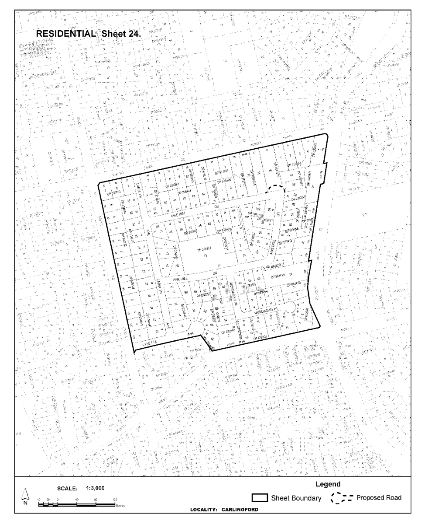

> [Picture on page 751: a picture, saved as a picture (images/part-08-centres-precincts-special-character-areas-specific-page-751-4.gif, 150 dpi).]

Figure 8.5.14.1 – Land within Carlingford Central (Carlingford Local Centre).

LAND IDENTIFIED WITH ADDITIONAL MATTERS FOR CONSIDERATION

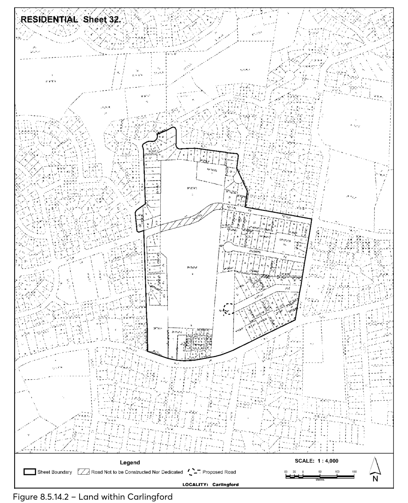

> [Picture on page 752: a picture, saved as a picture (images/part-08-centres-precincts-special-character-areas-specific-page-752-2.gif, 150 dpi).]

Figure 8.5.14.2 – Land within Carlingford

LAND IDENTIFIED WITH ADDITIONAL MATTERS FOR CONSIDERATION

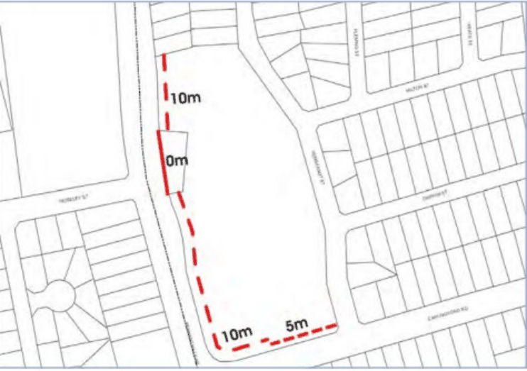

> [Picture on page 753: a picture, saved as a picture (images/part-08-centres-precincts-special-character-areas-specific-page-753-2.gif, 150 dpi).]

Figure 8.5.14.3 – Setback provisions for land on the corner of Pennant Hills Road and Carlingford Road, Carlingford.

LAND IDENTIFIED WITH ADDITIONAL MATTERS FOR CONSIDERATION

NORTHMEAD

Detailed controls for land within Northmead are shown in the Figures below.

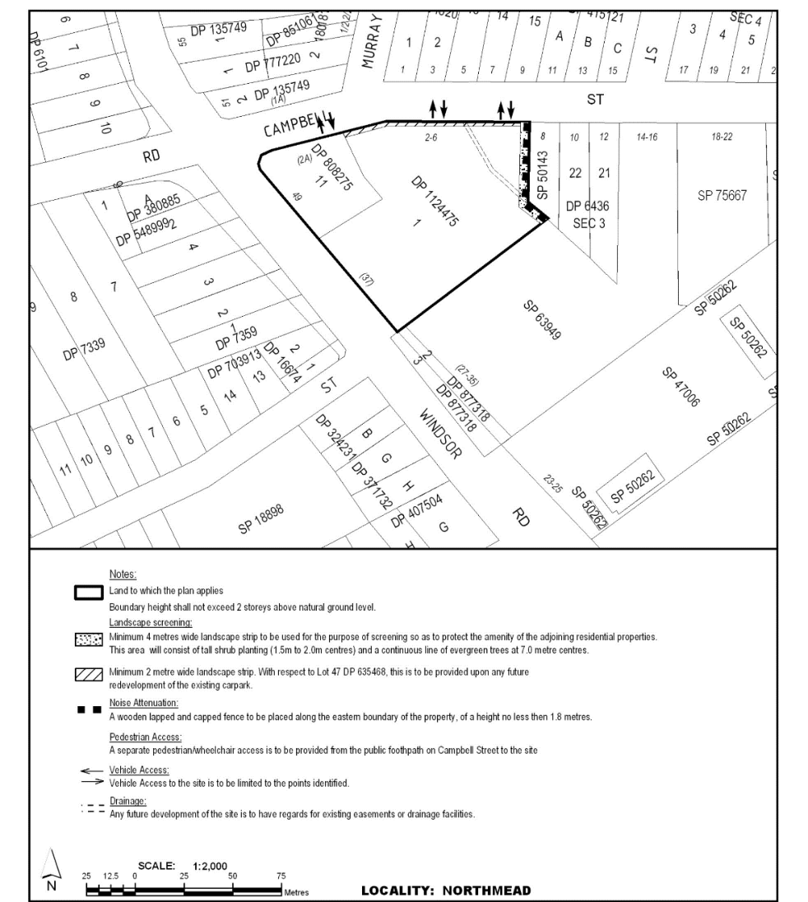

> [Picture on page 754: a picture, saved as a picture (images/part-08-centres-precincts-special-character-areas-specific-page-754-4.gif, 150 dpi).]

Figure 8.5.14.4 – Land at 2-3 and 2A Campbell Street, Northmead

LAND IDENTIFIED WITH ADDITIONAL MATTERS FOR CONSIDERATION

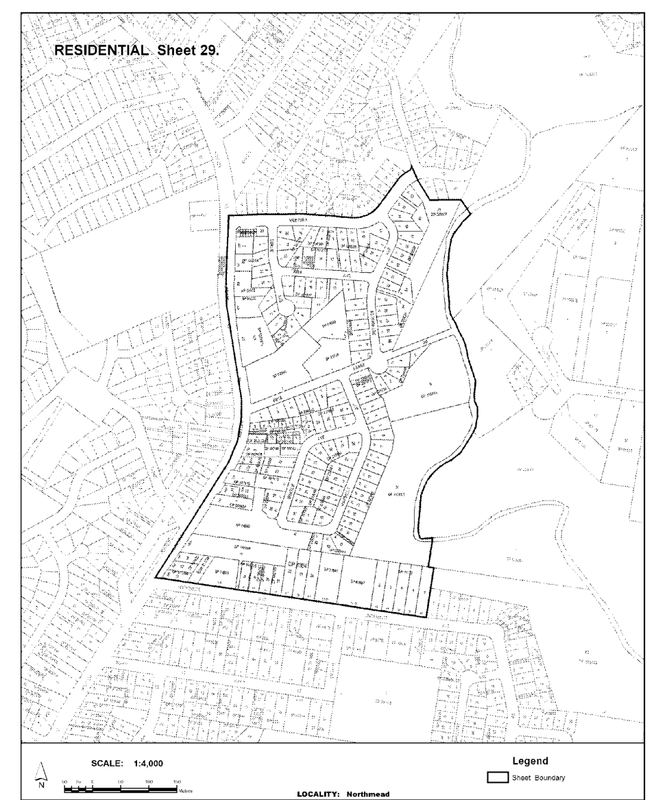

> [Picture on page 755: a picture, saved as a picture (images/part-08-centres-precincts-special-character-areas-specific-page-755-2.gif, 150 dpi).]

Figure 8.5.14.5 – Land bound by Ventura Road and Windermere Avenue, Northmead.

LAND IDENTIFIED WITH ADDITIONAL MATTERS FOR CONSIDERATION

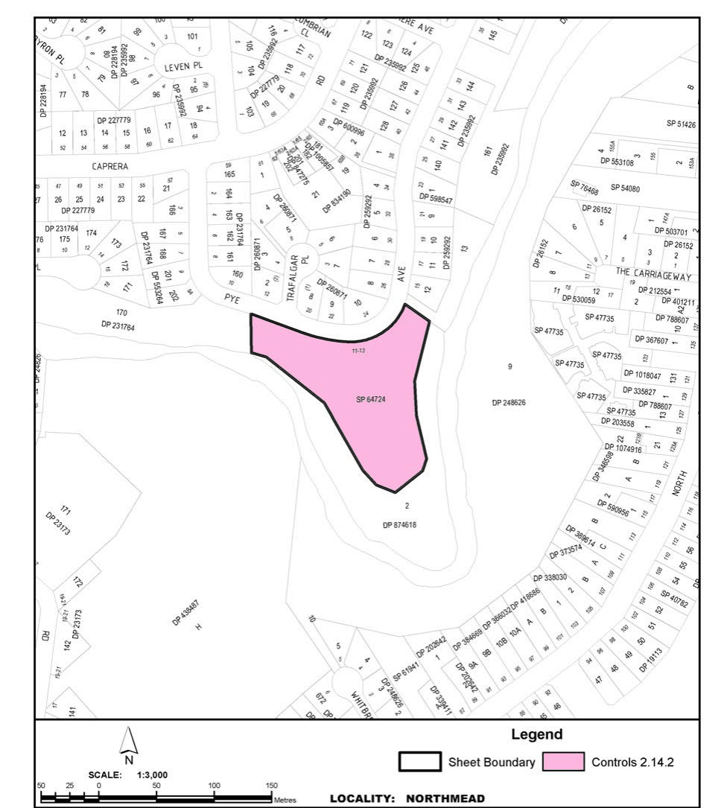

> [Picture on page 756: a picture, saved as a picture (images/part-08-centres-precincts-special-character-areas-specific-page-756-2.gif, 150 dpi).]

Figure 8.5.14.6 – Land at 11-13 Pye Avenue, Northmead

LAND IDENTIFIED WITH ADDITIONAL MATTERS FOR CONSIDERATION

NORTH PARRAMATTA

Detailed controls for land within North Parramatta are shown in the Figures below.

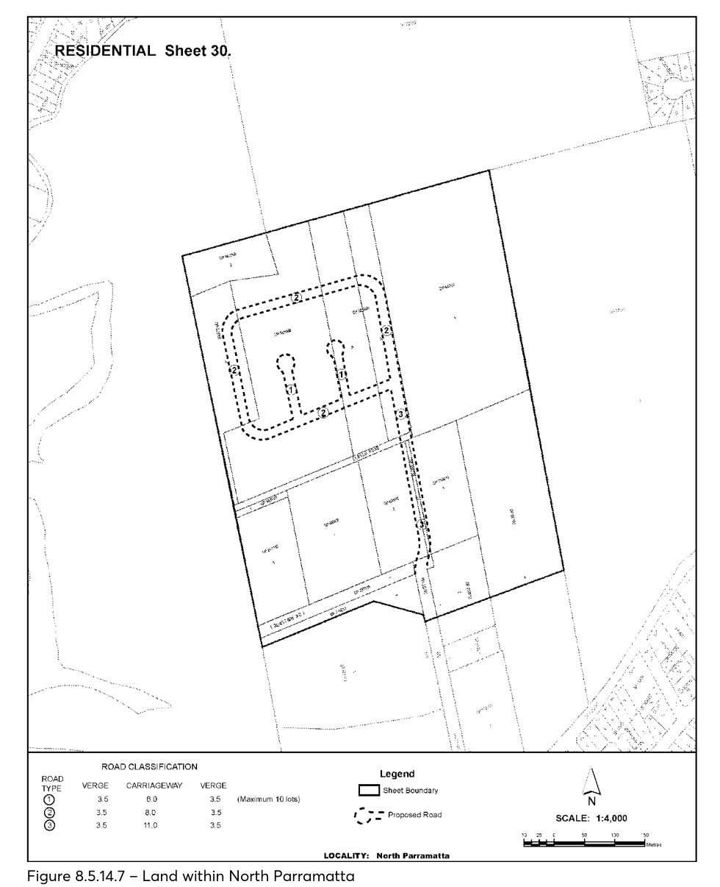

> [Picture on page 757: a picture, saved as a picture (images/part-08-centres-precincts-special-character-areas-specific-page-757-4.gif, 150 dpi).]

Figure 8.5.14.7 – Land within North Parramatta

LAND IDENTIFIED WITH ADDITIONAL MATTERS FOR CONSIDERATION

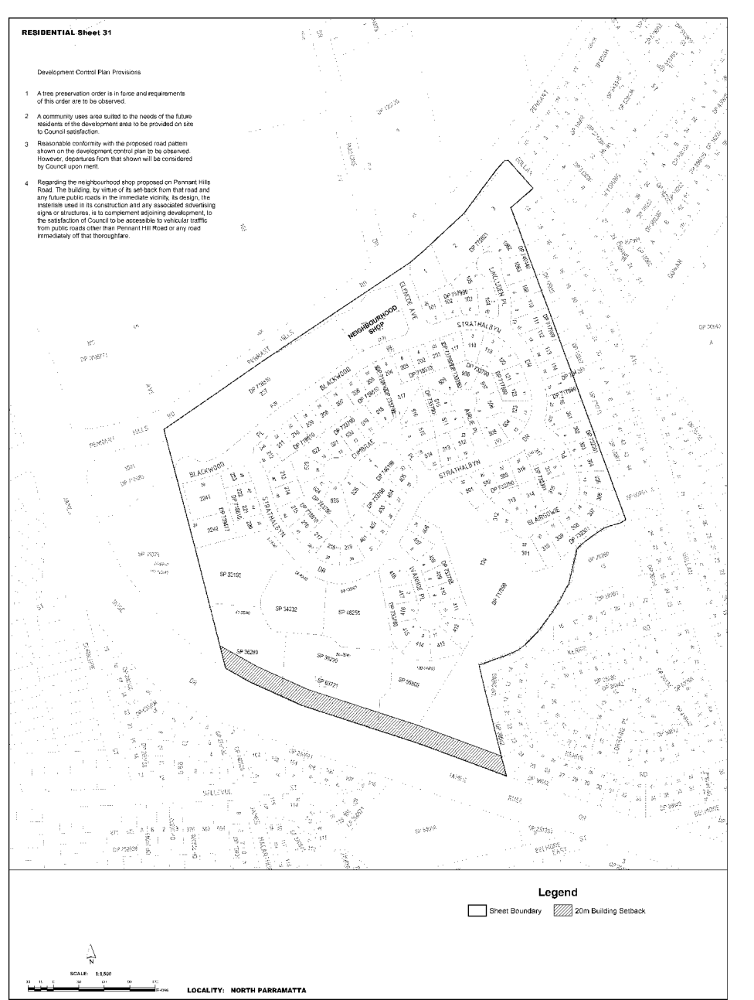

> [Picture on page 758: a picture, saved as a picture (images/part-08-centres-precincts-special-character-areas-specific-page-758-2.gif, 150 dpi).]

Figure 8.5.14.8 – Land south of Burnside Homes and bound by James Ruse Drive, North Parramatta

LAND IDENTIFIED WITH ADDITIONAL MATTERS FOR CONSIDERATION

NORTH ROCKS

Detailed controls for land within North Rocks are shown in the Figures below.

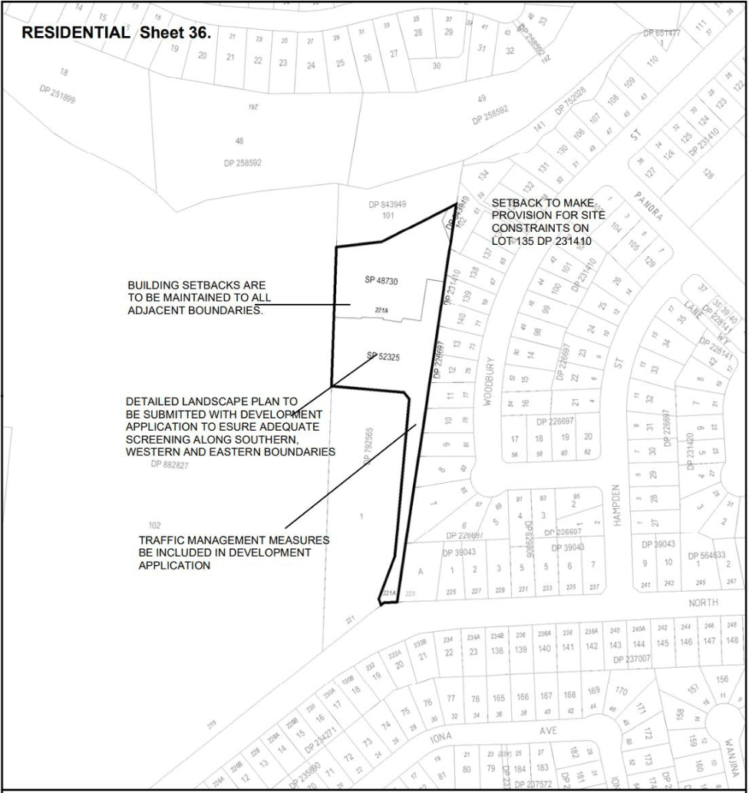

> [Picture on page 759: a picture, saved as a picture (images/part-08-centres-precincts-special-character-areas-specific-page-759-4.gif, 150 dpi).]

Figure 8.5.14.9 – 221A North Rocks Road and part of 61 Woodbury Street, North Rocks

LAND IDENTIFIED WITH ADDITIONAL MATTERS FOR CONSIDERATION

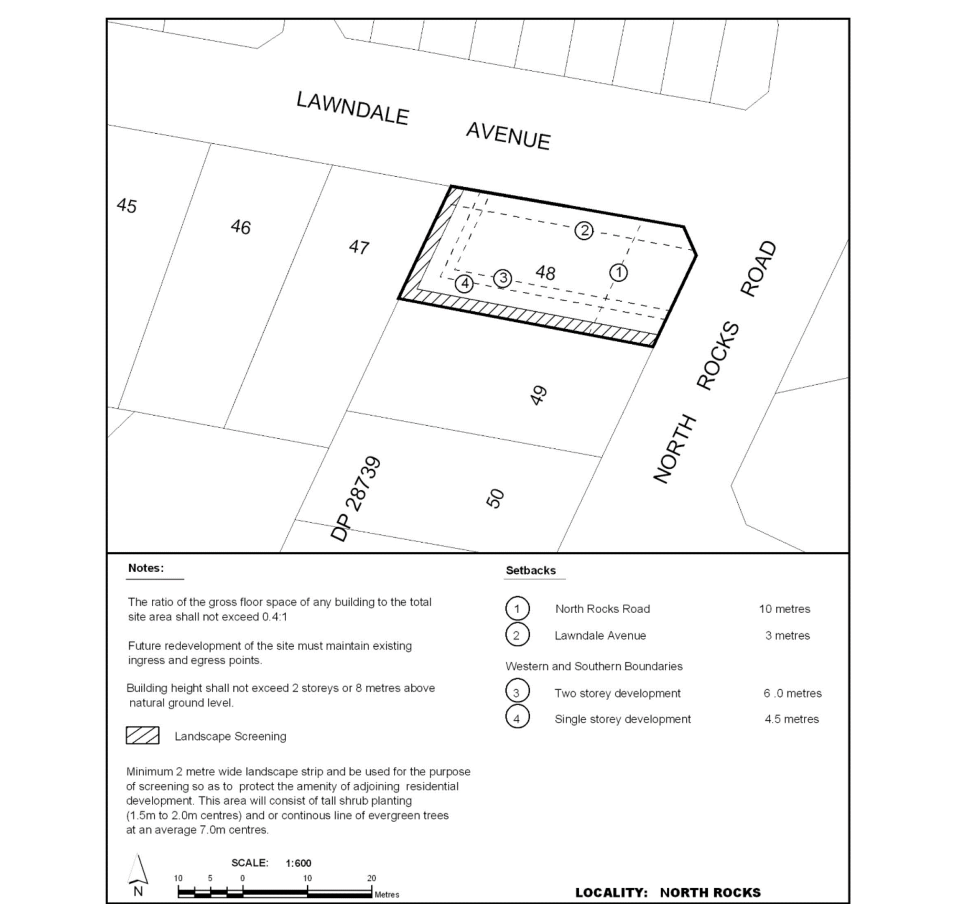

> [Picture on page 760: a picture, saved as a picture (images/part-08-centres-precincts-special-character-areas-specific-page-760-2.gif, 150 dpi).]

Figure 8.5.14.10 – Setback requirements for land on the corner of Lawndale Avenue and North Rocks Road, North Rocks (355 North Rocks Road, North Rocks)

LAND IDENTIFIED WITH ADDITIONAL MATTERS FOR CONSIDERATION

NORTH ROCKS INDUSTRIAL AREA

Detailed controls for land within North Rocks Industrial Area are shown in the Figures below.

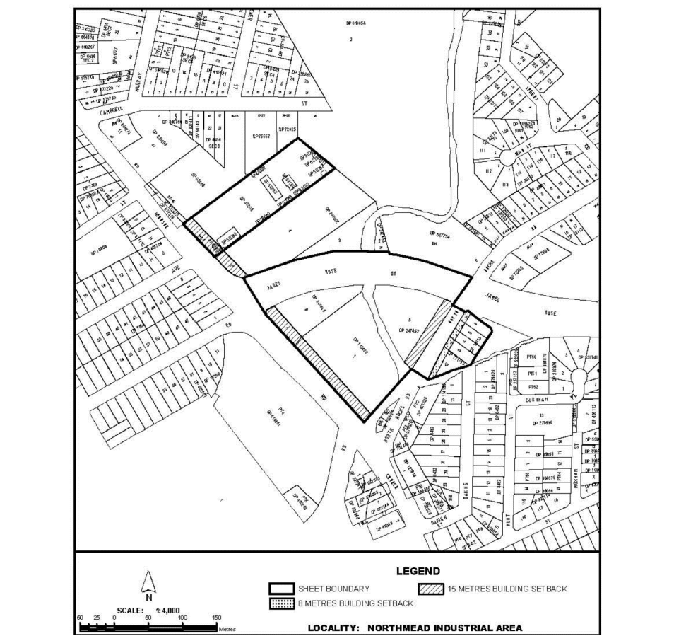

> [Picture on page 761: a picture, saved as a picture (images/part-08-centres-precincts-special-character-areas-specific-page-761-4.gif, 150 dpi).]

Figure 8.5.14.11 – Setback requirements for land on the corner of Windsor Road and North Rocks Road, Northmead

LAND IDENTIFIED WITH ADDITIONAL MATTERS FOR CONSIDERATION

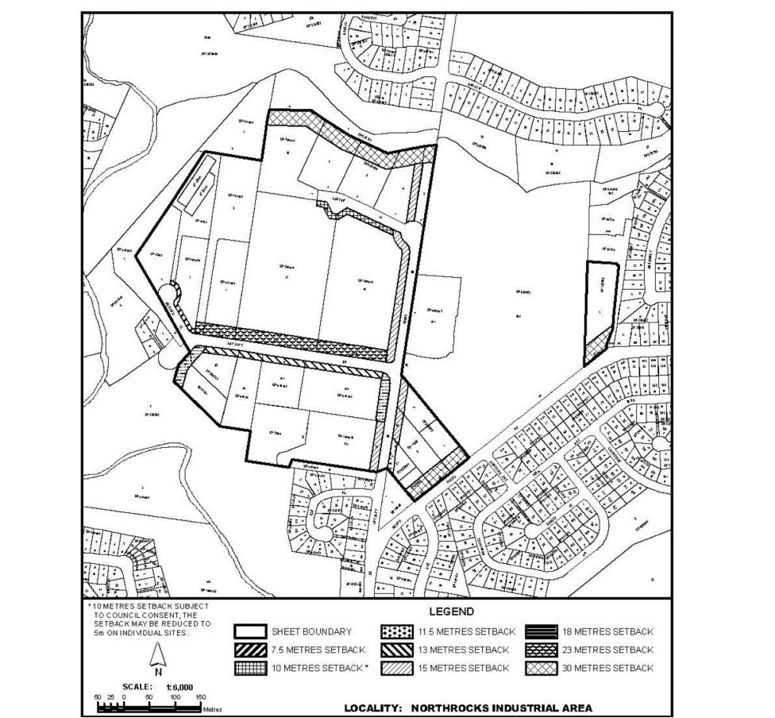

> [Picture on page 762: a picture, saved as a picture (images/part-08-centres-precincts-special-character-areas-specific-page-762-2.gif, 150 dpi).]

Figure 8.5.14.12 – Setback requirements for land within North Rocks Industrial Area

LAND IDENTIFIED WITH ADDITIONAL MATTERS FOR CONSIDERATION

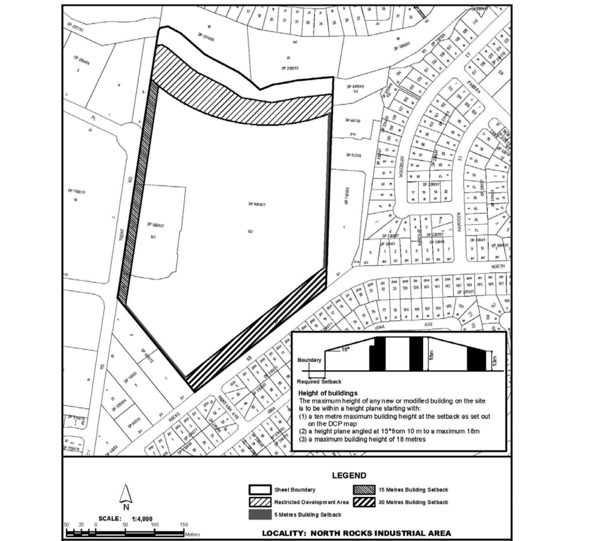

> [Picture on page 763: a picture, saved as a picture (images/part-08-centres-precincts-special-character-areas-specific-page-763-2.gif, 150 dpi).]

Figure 8.5.14.13 – Setback requirements and restricted development areas for land within North Rocks Industrial Area

LAND IDENTIFIED WITH ADDITIONAL MATTERS FOR CONSIDERATION

PARRAMATTA AND GRANVILLE

The increase in population associated with higher density development makes it necessary for wider carriageways and footpaths to cater for the increase in vehicular and pedestrian traffic. Therefore, to achieve a more consistent road width and a more efficient road system, Council requires in those areas of higher density development, that a strip of land be dedicated for road widening.

This Section of this DCP provides provisions to guide development and ensure appropriate measures are taken to support Road Widenings, Road Closures and Splay Corners In and Adjacent To Residential R4 Zones within Parramatta and Granville. These are shown in Figure 8.5.14.14, Figure 8.5.14.15 and Figure 8.5.14.16.

Objectives

O.01 Provide controls for road widening, road closures and splay corners. O.02 Achieve a more consistent carriageway width along the length of nominated roads. O.03 Achieve a more efficient road system in those areas of higher density development associated with the increase in population.

O.04 Provide wider carriageways and footpaths to cater for the increase in vehicular and pedestrian traffic.

O.05 Within the ‘no development’ strip located at the rear of the properties between Tottenham Lane and High Street, Granville (shown in Figure 8.5.14.14 and Figure 8.5.14.15)

a) to make the laneway a safer place;

b) to create passive supervision;

c) to improve landscaping; and

d) to minimise opportunities for graffiti and vandalism

Controls

C.01 Plans for Development Applications must show any road widenings, splay corners, road closures and/or “No Development Strips” that are required by the provisions of this development control plan. This applies where:

a) the property is identified in Figure 8.5.14.14 and Figure 8.5.14.15 of this Section; and

b) the property is not a single dwelling house.

Road Widening C.02 1.5 metres of land shall be dedicated for road widening and/or footpath widening in areas where wider carriageways and footpaths are necessary to cater for the increase in vehicular and pedestrian traffic, as identified in Figure 8.5.14.14.

C.03 The developer must meet the cost of constructing the widened road pavement, kerb and gutter and foot paving on the new alignment in accordance with the provisions of this plan.

Splay Corners

LAND IDENTIFIED WITH ADDITIONAL MATTERS FOR CONSIDERATION

C.04 In accordance with Figure 8.5.14.13 and Figure 8.5.14.14 showing where splay corners must be provided, the developer must construct and dedicate to Council any splay corner thus identified.

Road Closures C.05 Figure 8.5.14.14, Figure 8.5.14.15 – Road Widening requirements for land fronting Church , and Figure 8.5.14.16 – Frontage requirements - land within Parramatta/Granville show where road closures will be constructed by Council. Council will maintain access to existing developments after the road closures have taken place.

C.06 All new developments will not be permitted to use the roads proposed to be closed by the provisions of this plan for access to their land. Access to these sites must be off another road.

Strip C.07 The ‘no development’ strip is located at the rear of the properties between Tottenham Lane and High Street, shown in Figure 8.5.14.14 and Figure 8.5.14.15 – Road Widening requirements for land fronting Church . The ‘no development’ strip is to start from the rear of the lots, and be a strip of land 4 metres wide. Landscape this land and keep it free from any structures.

C.08 Locate decorative tubular pool style fencing that stands a minimum of 1.5 metres on the boundary of the laneway. Existing conditions are permitted, but the no development strip must be implemented for any future development to be approved.

Rear Access Laneway between High Street and Tottenham Lane C.09 Existing access from the laneway to lots will be continued. Access from the laneway to new developments will be prohibited, with access being from either Raymond Street, High Street, Junction Street or Tottenham Lane.

Implementation C.10 Carry out the construction of the road widening when:

a) Affected sites are developed for any purpose other than for a single dwelling house.

b) Affected sites containing an existing use, other than a single dwelling house, is the subject of an application for further development.

c) Affected sites are the subject of an application for subdivision or strata subdivision.

C.11 Complete the works required under this Development Control Plan prior to the release of an occupation certificate by Council.

C.12 In the case of all sites, other than those used, or to be used, for a single dwelling house, show the required works on any strata or subdivision plan submitted to Council for approval. Council will hold a bond on the dedication of the subject land.

C.18 5 metres of land as shown in Figure 8.5.14.15 – Road Widening requirements for land fronting Church is to be dedicated to Council for the purposes of road widening.

LAND IDENTIFIED WITH ADDITIONAL MATTERS FOR CONSIDERATION

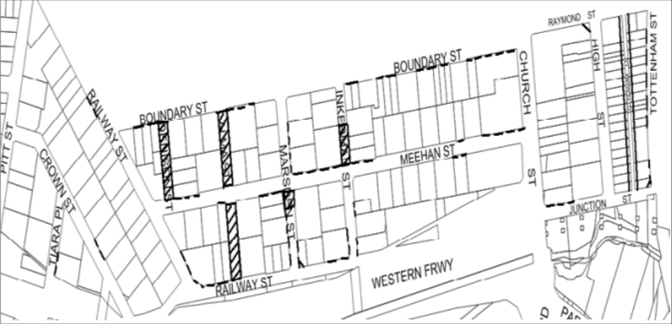

> [Picture on page 766: a picture, saved as a picture (images/part-08-centres-precincts-special-character-areas-specific-page-766-2.gif, 150 dpi).]

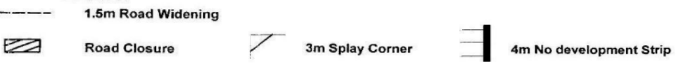

> [Picture on page 766: a picture, saved as a picture (images/part-08-centres-precincts-special-character-areas-specific-page-766-3.gif, 150 dpi).]

Figure 8.5.14.14 – Land subject to road widening and splay corners in Parramatta and Granville

LAND IDENTIFIED WITH ADDITIONAL MATTERS FOR CONSIDERATION

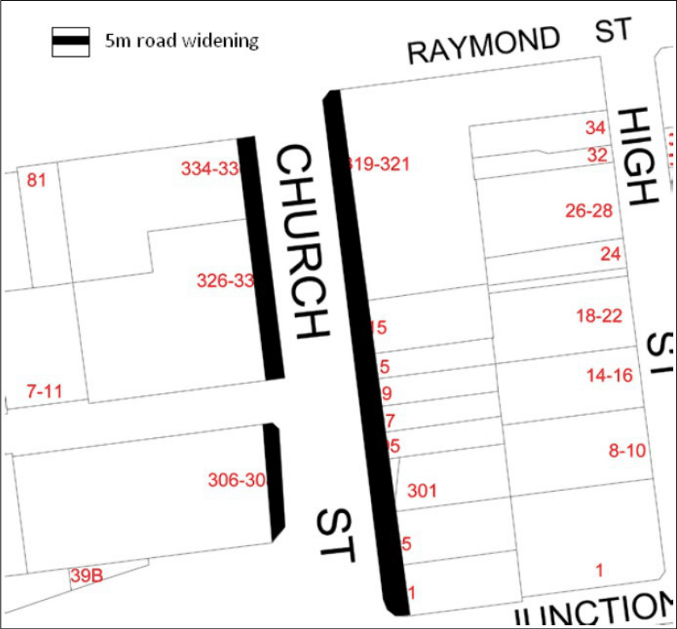

> [Picture on page 767: a picture, saved as a picture (images/part-08-centres-precincts-special-character-areas-specific-page-767-2.gif, 150 dpi).]

Figure 8.5.14.15 – Road Widening requirements for land fronting Church Street, Granville

LAND IDENTIFIED WITH ADDITIONAL MATTERS FOR CONSIDERATION

Lot Size and Frontage Objectives O.06 Ensure residential flat development is carried out on sites adequate in size and dimensions to provide appropriately proportioned development which is sited to allow for the provision of private outdoor space with regard to solar and daylight access, and convenient vehicle access and parking where required.

O.07 Maximise the potential of land to best achieve urban consolidation and to improve the quality and variety of housing design.

Controls C.19 The minimum lot frontage for residential flat buildings at the property line is 24 metres for the areas shown in Figure 8.5.14.16.

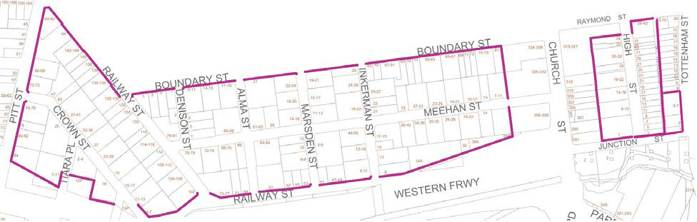

> [Picture on page 768: a picture, saved as a picture (images/part-08-centres-precincts-special-character-areas-specific-page-768-13.gif, 150 dpi).]

Figure 8.5.14.16 – Frontage requirements - land within Parramatta/Granville
