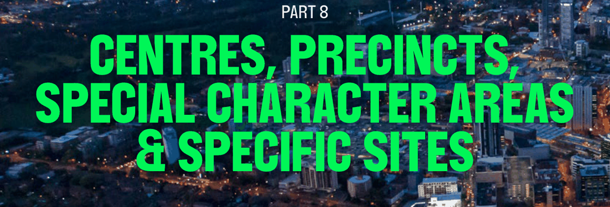

# Parramatta Development Control Plan 2023 - Part 8 Centres, Precincts, Special Character Areas & Specific Sites

> This chapter is split into 220 section file(s), one per numbered heading, in the order they appear in the PDF.

Source PDF: [dcp-part-08-centres-precincts-special-character-areas-and-specific-sites.pdf](dcp-part-08-centres-precincts-special-character-areas-and-specific-sites.pdf)

## PART 8

> [Picture on page 1: a picture, saved as a picture (images/part-08-centres-precincts-special-character-areas-specific-page-1-2.gif, 150 dpi).]

CENTRES, PRECINCTS,

### SPECIAL CHARACTER AREAS

### & SPECIFIC SITES

CENTRES, PRECINCTS, SPECIAL CHARACTER AREAS & SPECIFIC SITES

This Part of the DCP contains specific design requirements for certain centres and precincts of the City of Parramatta (the City) including strategic centres, local centres, neighbourhood precincts, special character areas, and specific sites. The controls guide future development in a manner that enables development potential to be realised whilst continuing to reinforce the special attributes and qualities of the centre, precinct, or site.

In addition to the specific provisions that are specified in this Section, Part 8 should be read in conjunction with the relevant Sections of this DCP including:

• Part 2 – Design in Context

• Part 3 – Residential Development

• Part 4 – Non-Residential Development

• Part 5 – Environmental Management

• Part 6 - Traffic and Transport

• Part 7 – Heritage and Archaeology The consent authority, in considering a development application for land described in Part 8 must have regard to the specific provisions. Should there be any inconsistency between this Section and any other part of this DCP, this Section prevails to the extent of the inconsistency.

In addition to specific provisions that are specified in Sections 8.1 – Strategic Centres, 8.2 – Local Centres and 8.3 – Neighbourhood Precincts of this DCP, the following general objectives apply:

General Objectives

O.01 Ensure that new development within the business zones provides active ground level uses, creating vibrant local centres.

O.02 Ensure that new development provides an interface to adjoining public spaces, including roads, laneways, pedestrian connections and parks.

O.03 Encourage the provision of new pedestrian and vehicular connections within strategic centres, local centres and neighbourhood precincts.

O.04 Provide high quality retail, commercial and residential development within strategic centres, local centres and neighbourhood precincts.

O.05 Encourage the revitalisation of the public domain in strategic centres, local centres and neighbourhood precincts.

O.06 Encourage opportunities for additional public open spaces in strategic centres, local centres and neighbourhood precincts.

CENTRES, PRECINCTS, SPECIAL CHARACTER AREAS & SPECIFIC SITES

O.07 Development is to conserve and enhance identified views, heritage items and the natural environment.

New Laneway and Pedestrian Links O.08 Improve the existing vehicular and pedestrian network. O.09 Improve legibility and permeability of centres. O.10 Provide better servicing for residential and commercial uses. O.11 Reduce conflict between pedestrian and vehicular movements. O.12 Reinforce the role of the street hierarchy. Setbacks O.13 Reinforce the street edge and role of centres. O.14 Activate ground level retail spaces and encourage pedestrian activity. O.15 Provide for continuous awnings and weather protection in and around centres. O.16 Provide an address to important elements of centres such as railway stations and public open spaces.

O.17 Ensure that new development encourages activation of laneways.

CENTRES, PRECINCTS, SPECIAL CHARACTER AREAS & SPECIFIC SITES

### CONTENTS

| 8.1 | STRATEGIC CENTRES ....................................................................................................................... 3 |
|---|---|
| 8.2 | LOCAL CENTRES ............................................................................................................................ 85 |
| 8.3 | NEIGHBOURHOOD PRECINCTS ............................................................................................... 450 |
| 8.4 | SPECIAL CHARACTER AREAS ................................................................................................... 528 |
| 8.5 | SPECIFIC SITES .............................................................................................................................. 552 |

TOC - 1

CENTRES, PRECINCTS, SPECIAL CHARACTER AREAS & SPECIFIC SITES

STRATEGIC CENTRES

<!-- sections -->
## Sections

1. [8.1 STRATEGIC CENTRES](001-8-1-strategic-centres.md)
2. [8.1.1 EPPING STRATEGIC CENTRE](002-8-1-1-epping-strategic-centre.md)
3. [8.1.1.1 EPPING CENTRAL](003-8-1-1-1-epping-central.md)
4. [8.1.1.2 EPPING TOWN CENTRE](004-8-1-1-2-epping-town-centre.md)
5. [8.1.1.3 EPPING AREAS – RESIDENTIAL DEVELOPMENT](005-8-1-1-3-epping-areas-residential-development.md)
6. [8.1.1.4 EPPING AREAS – BUSINESS DEVELOPMENT](006-8-1-1-4-epping-areas-business-development.md)
7. [8.1.1.5 EPPING AREAS – MIXED USE DEVELOPMENT](007-8-1-1-5-epping-areas-mixed-use-development.md)
8. [8.2 LOCAL CENTRES](008-8-2-local-centres.md)
9. [8.2.1.1 DESIRED FUTURE CHARACTER](009-8-2-1-1-desired-future-character.md)
10. [8.2.2.1 DESIRED FUTURE CHARACTER](010-8-2-2-1-desired-future-character.md)
11. [8.2.2.2 DESIGN QUALITY](011-8-2-2-2-design-quality.md)
12. [8.2.2.3 SUBDIVISION](012-8-2-2-3-subdivision.md)
13. [8.2.2.4 PUBLIC DOMAIN AND OPEN SPACE](013-8-2-2-4-public-domain-and-open-space.md)
14. [8.2.2.5 SITE ACCESS, CIRCULATION AND CONNECTIVITY](014-8-2-2-5-site-access-circulation-and-connectivity.md)
15. [8.2.2.6 STREET NETWORK](015-8-2-2-6-street-network.md)
16. [8.2.2.7 ALLOCATION OF GROSS FLOOR AREA](016-8-2-2-7-allocation-of-gross-floor-area.md)
17. [8.2.2.8 BIODIVERSITY](017-8-2-2-8-biodiversity.md)
18. [8.2.2.9 HERITAGE](018-8-2-2-9-heritage.md)
19. [8.2.2.10 DEVELOPMENT AND DESIGN](019-8-2-2-10-development-and-design.md)
20. [8.2.2.11 TRAFFIC AND TRANSPORT](020-8-2-2-11-traffic-and-transport.md)
21. [8.2.2.12 DEVELOPMENT LOT CONTROLS – INDIVIDUAL](021-8-2-2-12-development-lot-controls-individual.md)
22. [8.2.3 GRANVILLE LOCAL CENTRE](022-8-2-3-granville-local-centre.md)
23. [8.2.3.1 GRANVILLE TOWN CENTRE](023-8-2-3-1-granville-town-centre.md)
24. [8.2.4.1 DESIRED FUTURE CHARACTER](024-8-2-4-1-desired-future-character.md)
25. [8.2.4.2 HEIGHT OF BUILDINGS](025-8-2-4-2-height-of-buildings.md)
26. [8.2.4.3 LANDSCAPING](026-8-2-4-3-landscaping.md)
27. [8.2.4.4 TRAVEL PLANS AND TRAVEL INFORMATION GUIDES](027-8-2-4-4-travel-plans-and-travel-information.md)
28. [8.2.4.5 BUILDING DESIGN](028-8-2-4-5-building-design.md)
29. [8.2.4.6 ECO-INDUSTRIAL DEVELOPMENT](029-8-2-4-6-eco-industrial-development.md)
30. [8.2.4.7 SPECIAL AREAS](030-8-2-4-7-special-areas.md)
31. [8.2.5 NEWINGTON LOCAL CENTRE](031-8-2-5-newington-local-centre.md)
32. [8.2.5.1 NEWINGTON SMALL VILLAGE](032-8-2-5-1-newington-small-village.md)
33. [8.2.5.2 NEWINGTON BUSINESS PARK PRECINCT](033-8-2-5-2-newington-business-park-precinct.md)
34. [8.2.5.3 NEWINGTON RESIDENTIAL PRECINCT](034-8-2-5-3-newington-residential-precinct.md)
35. [8.2.6.1 INTRODUCTION](035-8-2-6-1-introduction.md)
36. [8.2.6.2 BUILT FORM](036-8-2-6-2-built-form.md)
37. [8.2.6.3 PUBLIC DOMAIN](037-8-2-6-3-public-domain.md)
38. [8.2.6.4 VEHICULAR ACCESS, PARKING, SERVICING](038-8-2-6-4-vehicular-access-parking-servicing.md)
39. [8.2.6.5 SUSTAINABILITY](039-8-2-6-5-sustainability.md)
40. [8.2.6.6 SITE SPECIFIC CONTROLS – AREA 4 MELROSE PART NORTH](040-8-2-6-6-site-specific-controls-area-4-melrose.md)
41. [8.2.6.7 APPENDIX A – MELROSE PARK FIGURES](041-8-2-6-7-appendix-a-melrose-park-figures.md)
42. [8.2.6.8 APPENDIX B – WATER MANAGEMENT CONTROL PLAN](042-8-2-6-8-appendix-b-water-management-control-plan.md)
43. [8.2.6.9 APPENDIX C – MELROSE PARK NORTH FLOODING MAPS](043-8-2-6-9-appendix-c-melrose-park-north-flooding.md)
44. [8.2.7 TELOPEA LOCAL CENTRE](044-8-2-7-telopea-local-centre.md)
45. [8.2.7.1 DESIRED FUTURE CHARACTER](045-8-2-7-1-desired-future-character.md)
46. [8.2.7.2 TRAFFIC AND TRANSPORT](046-8-2-7-2-traffic-and-transport.md)
47. [8.2.7.3 DEVELOPMENT AND DESIGN](047-8-2-7-3-development-and-design.md)
48. [8.2.7.4 NATURAL ENVIRONMENT AND HERITAGE](048-8-2-7-4-natural-environment-and-heritage.md)
49. [8.2.7.5 SUSTAINABILITY](049-8-2-7-5-sustainability.md)
50. [8.2.8 CARLINGFORD LOCAL CENTRE](050-8-2-8-carlingford-local-centre.md)
51. [8.2.8.1 CARLINGFORD CENTRAL](051-8-2-8-1-carlingford-central.md)
52. [8.2.8.2 CARLINGFORD SOUTH](052-8-2-8-2-carlingford-south.md)
53. [8.2.8.3 CARLINGFORD EAST (BUSINESS)](053-8-2-8-3-carlingford-east-business.md)
54. [8.2.8.4 CARLINGFORD EAST (RESIDENTIAL)](054-8-2-8-4-carlingford-east-residential.md)
55. [8.3 NEIGHBOURHOOD PRECINTS](055-8-3-neighbourhood-precints.md)
56. [8.3.1 HARRIS PARK](056-8-3-1-harris-park.md)
57. [8.3.1.1 DESIRED FUTURE CHARACTER](057-8-3-1-1-desired-future-character.md)
58. [8.3.2 HARRIS PARK SPECIAL AREAS](058-8-3-2-harris-park-special-areas.md)
59. [8.3.2.1 KEY BLOCK ONE: WYETH SITE](059-8-3-2-1-key-block-one-wyeth-site.md)
60. [8.3.2.2 KEY BLOCK TWO: BLOCK BOUNDED BY ARTHUR STREET, WESTON](060-8-3-2-2-key-block-two-block-bounded-by-arthur.md)
61. [8.3.2.3 KEY BLOCK THREE: BLOCK BOUNDED BY OAK STREET, HOPE STREET,](061-8-3-2-3-key-block-three-block-bounded-by-oak.md)
62. [8.3.2.4 KEY BLOCK FOUR: ROSEHILL BOWLING CLUB](062-8-3-2-4-key-block-four-rosehill-bowling-club.md)
63. [8.3.2.5 KEY BLOCK FIVE](063-8-3-2-5-key-block-five.md)
64. [8.3.2.6 KEY BLOCKS SIX TO EIGHT](064-8-3-2-6-key-blocks-six-to-eight.md)
65. [8.3.3 RIVER ROAD WEST](065-8-3-3-river-road-west.md)
66. [8.3.3.1 DESIRED FUTURE CHARACTER](066-8-3-3-1-desired-future-character.md)
67. [8.3.3.2 BUILDING FORM](067-8-3-3-2-building-form.md)
68. [8.3.4 MORTON STREET](068-8-3-4-morton-street.md)
69. [8.3.4.1 DESIRED FUTURE CHARACTER](069-8-3-4-1-desired-future-character.md)
70. [8.3.5 EAST RYDALMERE](070-8-3-5-east-rydalmere.md)
71. [8.3.5.1 DESIRED FUTURE CHARACTER](071-8-3-5-1-desired-future-character.md)
72. [8.3.6.1 DESIRED FUTURE CHARACTER](072-8-3-6-1-desired-future-character.md)
73. [8.3.7 DUNDAS](073-8-3-7-dundas.md)
74. [8.3.7.1 DESIRED FUTURE CHARACTER](074-8-3-7-1-desired-future-character.md)
75. [8.3.8 COLLET PARK (NORTH PARRAMATTA)](075-8-3-8-collet-park-north-parramatta.md)
76. [8.3.8.1 DESIRED FUTURE CHARACTER](076-8-3-8-1-desired-future-character.md)
77. [8.3.9 HUNTERFORD ESTATE, OATLANDS](077-8-3-9-hunterford-estate-oatlands.md)
78. [8.3.10 NORTH EAST OF CITY CENTRE PRECINCT](078-8-3-10-north-east-of-city-centre-precinct.md)
79. [8.3.10.1 DESIRED FUTURE CHARACTER](079-8-3-10-1-desired-future-character.md)
80. [8.3.10.2 MINIMUM SITE REQUIREMENTS](080-8-3-10-2-minimum-site-requirements.md)
81. [8.3.10.3 THE BUILDING ENVELOPE](081-8-3-10-3-the-building-envelope.md)
82. [8.3.10.4 RESIDENTIAL APARTMENT DESIGN QUALITY](082-8-3-10-4-residential-apartment-design-quality.md)
83. [8.3.10.5 DEEP SOIL AND LANDSCAPING](083-8-3-10-5-deep-soil-and-landscaping.md)
84. [8.3.10.6 HERITAGE RELATIONSHIPS AND TRANSITION](084-8-3-10-6-heritage-relationships-and-transition.md)
85. [8.3.10.7 PARKING DESIGN AND VEHICULAR MOVEMENT](085-8-3-10-7-parking-design-and-vehicular-movement.md)
86. [8.3.10.8 FLOODPLAIN RISK MANAGEMENT](086-8-3-10-8-floodplain-risk-management.md)
87. [8.4 SPECIAL CHARACTER AREAS](087-8-4-special-character-areas.md)
88. [8.4.1 SYLVIA GARDENS](088-8-4-1-sylvia-gardens.md)
89. [8.4.1.1 DISTINCTIVE CHARACTER STATEMENT](089-8-4-1-1-distinctive-character-statement.md)
90. [8.4.1.2 DISTINCTIVE CHARACTERISTICS](090-8-4-1-2-distinctive-characteristics.md)
91. [8.4.2 THOMAS AND LOMBARD STREETS](091-8-4-2-thomas-and-lombard-streets.md)
92. [8.4.2.1 DISTINCTIVE CHARACTER STATEMENT](092-8-4-2-1-distinctive-character-statement.md)
93. [8.4.2.2 DISTINCTIVE CHARACTERISTICS](093-8-4-2-2-distinctive-characteristics.md)
94. [8.4.3 JEFFERY AVENUE](094-8-4-3-jeffery-avenue.md)
95. [8.4.3.1 DISTINCTIVE CHARACTER STATEMENT](095-8-4-3-1-distinctive-character-statement.md)
96. [8.4.3.2 DISTINCTIVE CHARACTERISTICS](096-8-4-3-2-distinctive-characteristics.md)
97. [8.4.4 SUTHERLAND ROAD](097-8-4-4-sutherland-road.md)
98. [8.4.4.1 DISTINCTIVE CHARACTER STATEMENT](098-8-4-4-1-distinctive-character-statement.md)
99. [8.4.4.2 DISTINCTIVE CHARACTERISTICS](099-8-4-4-2-distinctive-characteristics.md)
100. [8.4.5 AREA BOUNDED BY BRICKFIELD, BELMORE, BULLER AND ALBERT](100-8-4-5-area-bounded-by-brickfield-belmore.md)
101. [8.4.5.1 DISTINCTIVE CHARACTER STATEMENT](101-8-4-5-1-distinctive-character-statement.md)
102. [8.4.6 ALL SAINTS CEMETERY](102-8-4-6-all-saints-cemetery.md)
103. [8.4.6.1 DISTINCTIVE CHARACTER STATEMENT](103-8-4-6-1-distinctive-character-statement.md)
104. [8.4.6.2 DISTINCTIVE CHARACTERISTICS](104-8-4-6-2-distinctive-characteristics.md)
105. [8.4.7.1 DISTINCTIVE CHARACTER STATEMENT](105-8-4-7-1-distinctive-character-statement.md)
106. [8.4.7.2 DISTINCTIVE CHARACTERISTICS](106-8-4-7-2-distinctive-characteristics.md)
107. [8.4.8 WINSTON HILLS](107-8-4-8-winston-hills.md)
108. [8.4.8.1 DISTINCTIVE CHARACTER STATEMENT](108-8-4-8-1-distinctive-character-statement.md)
109. [8.5 SPECIFIC SITES](109-8-5-specific-sites.md)
110. [8.5.1.1 DESIRED FUTURE CHARACTER](110-8-5-1-1-desired-future-character.md)
111. [8.5.1.2 BUILDING FORM & MASSING](111-8-5-1-2-building-form-and-massing.md)
112. [8.5.1.3 PUBLIC DOMAIN AND INDICATIVE LAYOUT](112-8-5-1-3-public-domain-and-indicative-layout.md)
113. [8.5.1.4 HERITAGE](113-8-5-1-4-heritage.md)
114. [8.5.1.5 TRAFFIC & TRANSPORT](114-8-5-1-5-traffic-and-transport.md)
115. [8.5.2 24-26 RAILWAY PARADE, WESTMEAD](115-8-5-2-24-26-railway-parade-westmead.md)
116. [8.5.2.1 DESIRED FUTURE CHARACTER](116-8-5-2-1-desired-future-character.md)
117. [8.5.2.2 PUBLIC DOMAIN AND LANDSCAPING](117-8-5-2-2-public-domain-and-landscaping.md)
118. [8.5.2.3 TRAFFIC AND TRANSPORT](118-8-5-2-3-traffic-and-transport.md)
119. [8.5.3 LAND ON THE CORNER OF PARRAMATTA ROAD, GOOD STREET AND](119-8-5-3-land-on-the-corner-of-parramatta-road.md)
120. [8.5.3.1 DESIRED FUTURE CHARACTER](120-8-5-3-1-desired-future-character.md)
121. [8.5.3.2 BUILT FORM AND MASSING](121-8-5-3-2-built-form-and-massing.md)
122. [8.5.3.3 PUBLIC DOMAIN AND LANDSCAPING](122-8-5-3-3-public-domain-and-landscaping.md)
123. [8.5.4 38-42 EAST STREET, GRANVILLE](123-8-5-4-38-42-east-street-granville.md)
124. [8.5.4.1 DESIRED FUTURE CHARACTER](124-8-5-4-1-desired-future-character.md)
125. [8.5.4.2 BUILT FORM AND MASSING](125-8-5-4-2-built-form-and-massing.md)
126. [8.5.4.3 PODIUM, GROUND LEVEL AND PUBLIC DOMAIN](126-8-5-4-3-podium-ground-level-and-public-domain.md)
127. [8.5.4.4 COMMUNAL OPEN SPACE](127-8-5-4-4-communal-open-space.md)
128. [8.5.4.5 TRAFFIC](128-8-5-4-5-traffic.md)
129. [8.5.4.6 SUBSTATIONS](129-8-5-4-6-substations.md)
130. [8.5.4.7 FLOODING](130-8-5-4-7-flooding.md)
131. [8.5.4.8 WINTERGARDEN BALCONIES](131-8-5-4-8-wintergarden-balconies.md)
132. [8.5.5 38 COWPER STREET, GRANVILLE](132-8-5-5-38-cowper-street-granville.md)
133. [8.5.5.1 BUILT FORM](133-8-5-5-1-built-form.md)
134. [8.5.6 LAND BOUND BY PARRAMATTA ROAD, ALBERT STREET, VICTORIA](134-8-5-6-land-bound-by-parramatta-road-albert.md)
135. [8.5.6.1 DESIRED FUTURE CHARACTER](135-8-5-6-1-desired-future-character.md)
136. [8.5.6.2 BUILT FORM, SITING AND MASSING](136-8-5-6-2-built-form-siting-and-massing.md)
137. [8.5.6.3 PUBLIC DOMAIN AND LANDSCAPING](137-8-5-6-3-public-domain-and-landscaping.md)
138. [8.5.6.4 ACTIVATION OF STREETS AND PUBLIC PLACES](138-8-5-6-4-activation-of-streets-and-public-places.md)
139. [8.5.6.5 TRAFFIC AND TRANSPORT](139-8-5-6-5-traffic-and-transport.md)
140. [8.5.7.1 DESIRED FUTURE CHARACTER](140-8-5-7-1-desired-future-character.md)
141. [8.5.7.2 BUILT FORM AND MASSING](141-8-5-7-2-built-form-and-massing.md)
142. [8.5.7.3 HEIGHT OF BUILDINGS](142-8-5-7-3-height-of-buildings.md)
143. [8.5.7.4 FLOOR SPACE RATIO](143-8-5-7-4-floor-space-ratio.md)
144. [8.5.7.5 PUBLIC DOMAIN AND AREAS OF ECOLOGICAL VALUE](144-8-5-7-5-public-domain-and-areas-of-ecological.md)
145. [8.5.8 264-268 PENNANT HILLS ROAD, CARLINGFORD](145-8-5-8-264-268-pennant-hills-road-carlingford.md)
146. [8.5.8.1 DESIRED FUTURE CHARACTER](146-8-5-8-1-desired-future-character.md)
147. [8.5.8.2 PUBLIC DOMAIN](147-8-5-8-2-public-domain.md)
148. [8.5.8.3 HEIGHT OF BUILDINGS](148-8-5-8-3-height-of-buildings.md)
149. [8.5.8.4 SETBACKS](149-8-5-8-4-setbacks.md)
150. [8.5.8.5 FLOOR SPACE RATIO](150-8-5-8-5-floor-space-ratio.md)
151. [8.5.8.6 LANDSCAPED SPACES AND AREAS OF ECOLOGICAL VALUE](151-8-5-8-6-landscaped-spaces-and-areas-of.md)
152. [8.5.8.7 BUILT FORM AND SITE REQUIREMENTS](152-8-5-8-7-built-form-and-site-requirements.md)
153. [8.5.8.8 BUILDING DESIGN EXCELLENCE, FINISHES AND MATERIALS](153-8-5-8-8-building-design-excellence-finishes-and.md)
154. [8.5.9 27-33 NORTH ROCKS ROAD, NORTH ROCKS](154-8-5-9-27-33-north-rocks-road-north-rocks.md)
155. [8.5.9.1 DESIRED FUTURE CHARACTER](155-8-5-9-1-desired-future-character.md)
156. [8.5.9.2 HUNTER PIPELINE EASEMENT & AGL GAS MAIN](156-8-5-9-2-hunter-pipeline-easement-and-agl-gas.md)
157. [8.5.9.3 BUILT FORM AND SITE PLANNING](157-8-5-9-3-built-form-and-site-planning.md)
158. [8.5.9.4 SOLAR ACCESS AND OVERSAHDOWING](158-8-5-9-4-solar-access-and-oversahdowing.md)
159. [8.5.9.5 DESIGN EXCELLENCE](159-8-5-9-5-design-excellence.md)
160. [8.5.9.7 LANDSCAPE AND OPEN SPACE](160-8-5-9-7-landscape-and-open-space.md)
161. [8.5.9.8 FLOODING](161-8-5-9-8-flooding.md)
162. [8.5.9.9 NATURAL VENTILATION](162-8-5-9-9-natural-ventilation.md)
163. [8.5.9.10 NOISE AND VISUAL PRIVACY](163-8-5-9-10-noise-and-visual-privacy.md)
164. [8.5.9.11 BUSH FIRE](164-8-5-9-11-bush-fire.md)
165. [8.5.9.12 CONTAMINATION](165-8-5-9-12-contamination.md)
166. [8.5.9.13 WASTE STORAGE AND REMOVAL](166-8-5-9-13-waste-storage-and-removal.md)
167. [8.5.9.14 STAGING OF DEVELOPMENT](167-8-5-9-14-staging-of-development.md)
168. [8.5.10 257 WINDSOR ROAD AND RUSSELL STREET, BAULKHAM HILLS](168-8-5-10-257-windsor-road-and-russell-street.md)
169. [8.5.10.2 GENERAL OBJECTIVES](169-8-5-10-2-general-objectives.md)
170. [8.5.10.3 GENERAL](170-8-5-10-3-general.md)
171. [8.5.10.4 BUILT FORM, HEIGHT OF BUILDINGS AND SITE PLANNING](171-8-5-10-4-built-form-height-of-buildings-and-site.md)
172. [8.5.10.5 LANDSCAPE AND VEGETATION](172-8-5-10-5-landscape-and-vegetation.md)
173. [8.5.10.6 TRAFFIC AND ACCESS](173-8-5-10-6-traffic-and-access.md)
174. [8.5.10.7 OVERLOOKING AND VISUAL/ACOUSTIC PRIVACY](174-8-5-10-7-overlooking-and-visual-acoustic-privacy.md)
175. [8.5.10.8 SOLAR ACCESS AND OVERSHADOWING](175-8-5-10-8-solar-access-and-overshadowing.md)
176. [8.5.10.9 PRIVATE AND COMMUNAL OPEN SPACE](176-8-5-10-9-private-and-communal-open-space.md)
177. [8.5.10.10 SITE FACILITIES & SERVICES](177-8-5-10-10-site-facilities-and-services.md)
178. [8.5.10.11 ECOLOGICALLY SUSTAINABLE DEVELOPMENT](178-8-5-10-11-ecologically-sustainable-development.md)
179. [8.5.10.12 HERITAGE](179-8-5-10-12-heritage.md)
180. [8.5.11 23-25 WINDSOR ROAD, NORTHMEAD](180-8-5-11-23-25-windsor-road-northmead.md)
181. [8.5.11.1 DESIRED FUTURE CHARACTER](181-8-5-11-1-desired-future-character.md)
182. [8.5.11.2 BUILT FORM](182-8-5-11-2-built-form.md)
183. [8.5.12 263-281 PENNANT HILLS ROAD, CARLINGFORD](183-8-5-12-263-281-pennant-hills-road-carlingford.md)
184. [8.5.12.1 DESIRED FUTURE CHARACTER](184-8-5-12-1-desired-future-character.md)
185. [8.5.12.2 DESIGN QUALITY](185-8-5-12-2-design-quality.md)
186. [8.5.12.3 INDICATIVE SITE STRUCTURE](186-8-5-12-3-indicative-site-structure.md)
187. [8.5.12.4 SETBACKS](187-8-5-12-4-setbacks.md)
188. [8.5.12.5 BUILDING LOCATION AND HEIGHT](188-8-5-12-5-building-location-and-height.md)
189. [8.5.12.6 BUILDING SEPARATION AND TOWER SLENDERNESS](189-8-5-12-6-building-separation-and-tower.md)
190. [8.5.12.7 BUILDING DESIGN](190-8-5-12-7-building-design.md)
191. [8.5.12.8 FLOOR TO FLOOR HEIGHTS](191-8-5-12-8-floor-to-floor-heights.md)
192. [8.5.12.9 RETAIL GROUND FLOOR FRONTAGE](192-8-5-12-9-retail-ground-floor-frontage.md)
193. [8.5.12.10 RESIDENTIAL GROUND FLOOR FRONTAGE](193-8-5-12-10-residential-ground-floor-frontage.md)
194. [8.5.12.11 RESIDENTIAL DESIGN APARTMENT QUALITY](194-8-5-12-11-residential-design-apartment-quality.md)
195. [8.5.12.12 NON-RESIDENTIAL USES](195-8-5-12-12-non-residential-uses.md)
196. [8.5.12.13 COMMUNITY CENTRE AND LIBRARY FACILITY](196-8-5-12-13-community-centre-and-library-facility.md)
197. [8.5.12.14 WINTERGARDENS](197-8-5-12-14-wintergardens.md)
198. [8.5.12.15 RETAINING WALLS](198-8-5-12-15-retaining-walls.md)
199. [8.5.12.16 WATER MANAGEMENT](199-8-5-12-16-water-management.md)
200. [8.5.12.17 STREET NETWORK AND FOOTPATHS](200-8-5-12-17-street-network-and-footpaths.md)
201. [8.5.12.18 ACTIVE TRANSPORT](201-8-5-12-18-active-transport.md)
202. [8.5.12.19 PUBLIC OPEN SPACE AND PEDESTRIAN CONNECTIONS](202-8-5-12-19-public-open-space-and-pedestrian.md)
203. [8.5.12.20 COMMUNAL OPEN SPACE](203-8-5-12-20-communal-open-space.md)
204. [8.5.12.21 OVERHEAD POWERLINES](204-8-5-12-21-overhead-powerlines.md)
205. [8.5.12.22 STREET TREES](205-8-5-12-22-street-trees.md)
206. [8.5.12.23 AWNINGS AND AWNING DESIGN](206-8-5-12-23-awnings-and-awning-design.md)
207. [8.5.12.24 LANDSCAPE DESIGN AND PLANTING](207-8-5-12-24-landscape-design-and-planting.md)
208. [8.5.12.25 VEHICULAR ACCESS](208-8-5-12-25-vehicular-access.md)
209. [8.5.12.26 ON-SITE PARKING](209-8-5-12-26-on-site-parking.md)
210. [8.5.12.27 BICYCLE PARKING](210-8-5-12-27-bicycle-parking.md)
211. [8.5.12.28 SUSTAINABILITY](211-8-5-12-28-sustainability.md)
212. [8.5.12.29 VERTICAL FACADES](212-8-5-12-29-vertical-facades.md)
213. [8.5.12.30 AWNINGS](213-8-5-12-30-awnings.md)
214. [8.5.12.31 PUBLIC ART](214-8-5-12-31-public-art.md)
215. [8.5.13 NORTH ROCKS VILLAGE PRECINCT](215-8-5-13-north-rocks-village-precinct.md)
216. [8.5.13.1 DESIRED FUTURE CHARACTER](216-8-5-13-1-desired-future-character.md)
217. [8.5.13.2 SPATIAL STRUCTURE AND BUILT FORM](217-8-5-13-2-spatial-structure-and-built-form.md)
218. [8.5.13.3 PUBLIC DOMAIN](218-8-5-13-3-public-domain.md)
219. [8.5.13.4 VEHICULAR ACCESS AND PARKING](219-8-5-13-4-vehicular-access-and-parking.md)
220. [8.5.14 LAND IDENTIFIED WITH ADDITIONAL MATTERS FOR](220-8-5-14-land-identified-with-additional-matters.md)
