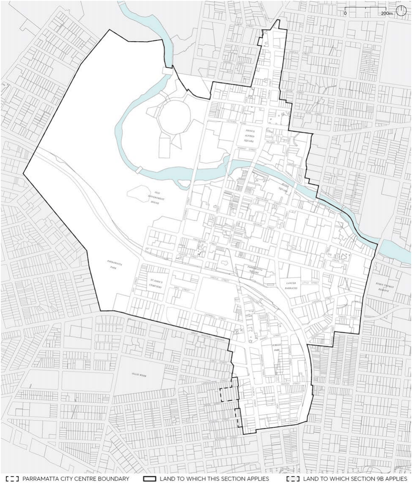

### 9.1 INTRODUCTION

#### 9.1.1 APPLICATION

The controls in this Part apply to the Parramatta City Centre the Land Application Map, below. The controls in this Part support the controls contained in Part 7 of Parramatta LEP 2023.

> [Picture on page 6: a picture, saved as a picture (images/part-09-parramatta-city-centre-page-6-6.gif, 150 dpi).]

Figure 9.1.1 – Land Application Map – Parramatta City Centre

INTRODUCTION

A further exception to the application of this Part is that the controls for the Park Edge Highly Sensitive Area (situated within the deferred Area A) are contained in this Part (see 9.5.10 – Park Edge Highly Sensitive Area). The intent of the CBD Planning Proposal process was to retain existing DCP and LEP controls for the Park Edge precinct. So the controls for this precinct reflect the controls that applied to this precinct prior to the introduction of Part 9.
