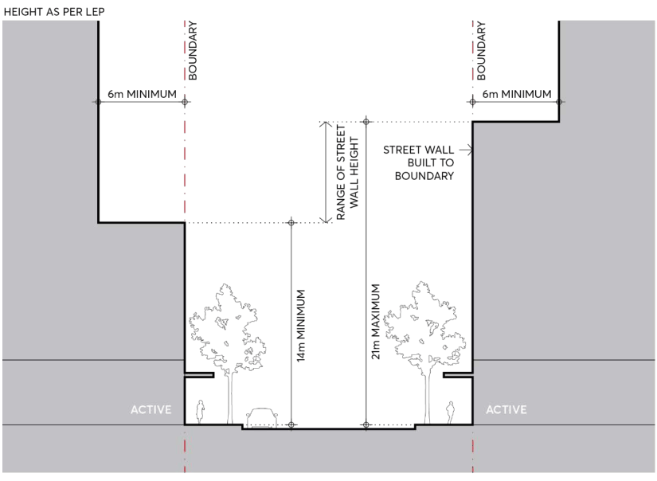
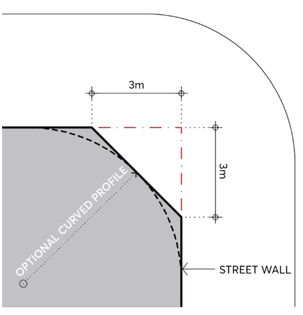
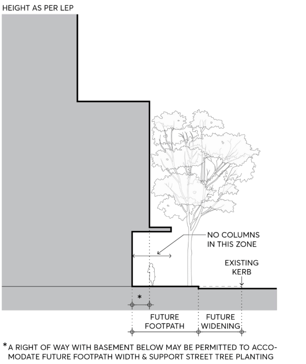
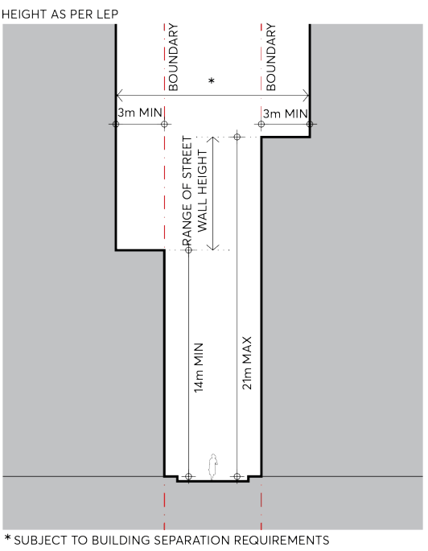
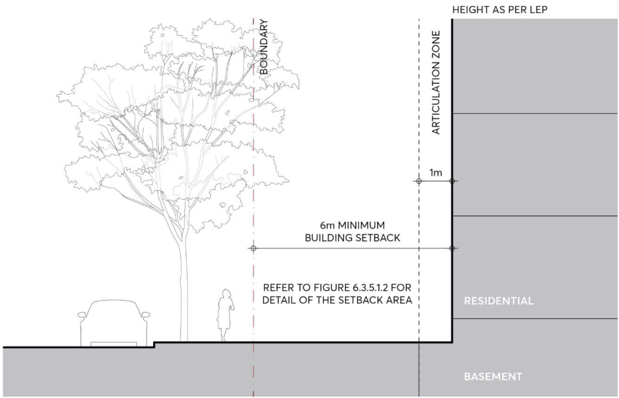

#### 9.3.3.1 STREET SETBACKS

The primary distinguishing characteristic for purposes of establishing street setbacks relates to ground floor usage. There are two principal categories:

• The building has an active ground floor frontage with an attached street wall (that is, a street wall with zero side setback); or

• The building has a residential ground floor frontage.

BUILT FORM

In areas with active street frontages the street wall is the part of the development that has most impact on the street and public domain experience. Together with the attached adjacent street walls, all built to the street alignment, it defines and articulates the street with appropriate scale and detail. Above the street wall, towers must be set back and designed as separate detached buildings.

In areas with residential ground floors, the building must be set back from the street alignment, allowing an arrangement which balances the need for resident privacy as well as engagement with the street, and also provides the necessary space for landscape amenity, both for residents and the street.

In areas where ground floor usage is uncertain, primarily areas at the fringes of the City Centre zoned MU1 Mixed Use and not identified with an active street frontage on the Active Frontages Map, existing and possible future context must be taken into account in determining appropriate built form and ground floor arrangements.

Street setbacks and building separation controls outlined in this section contribute to the reduction of heat in the urban environment. View of sky is a significant factor in mitigating urban heat, refer Section 9.8 – Environment Sustainability.

Objectives

O.01 Reinforce the spatial definition of streets and public spaces. O.02 Emphasise the street as a distinct spatial entity and design the street wall frontage with an appropriate human scale and sense of enclosure for the street.

O.03 Ensure consistent street frontages along the street alignment. O.04 Recognise the variation in street frontage heights throughout the city and allow flexibility to respond to context.

O.05 Protect daylight access at street level and permit views of sky from the street by providing setbacks above street frontage height that promote separation between buildings and assist in mitigating urban heat.

O.06 Ensure that building form achieves comfortable public domain conditions for pedestrians, with adequate daylight, appropriate scale, and mitigation of urban heat and wind effects of tower buildings.

O.07 Create a clear delineation between public and private space. O.08 Reinforce important elements of the local context including public spaces, heritage buildings, monuments and landscape elements.

O.09 Provide space in residential areas for landscape amenity that also contributes to the public domain.

O.10 Ensure that built form enables a healthy environment for street trees.

BUILT FORM

Controls

C.01 For all buildings that have an active frontage:

a) Street setbacks and heights must comply with Figure 9.3.3.1.1, except where stated otherwise in the Special Areas Section of this Part.

b) The street wall must be built to the street boundary a minimum of 14 metres and a maximum of 21 metres above the footpath level.

c) The tower above the street wall must be set back a minimum of 6 metres from the street boundary wall.

d) Only one step in the built form between the street wall and tower is permissible.

e) Setbacks above the street wall on corner sites apply to both streets.

f) The street wall on corner sites must incorporate a set back from the corner intersection for its full height, which may be splayed or curved, refer to Figure 9.3.3.1.2.

g) Development applications must be accompanied by a streetscape analysis to determine the most appropriate street wall height within the permissible range.

h) Refer to Sections 9.3.4 and 9.3.5 for controls relating to the design of the street wall and the ground floor.

C.02 Where a development with an active frontage is affected by a widening notation on the Land Reservation Acquisition Map in Parramatta LEP 2023, a street wall with a recessed ground floor frontage may be considered, refer Figure 9.3.3.1.3. The detailed profile of the street wall must be determined in relation to the requirements and circumstances of each site and must be capable of consistent application for the block. Applicants should contact Council at the start of the design process to establish the street profile for the development.

BUILT FORM

> [Picture on page 14: a picture, saved as a picture (images/part-09-parramatta-city-centre-page-14-2.gif, 150 dpi).]

Figure 9.3.3.1.1 – Street Setbacks and Street Wall Height – Active Ground Floor Street Frontage

> [Picture on page 14: a picture, saved as a picture (images/part-09-parramatta-city-centre-page-14-5.gif, 150 dpi).]

Figure 9.3.3.1.2 – Street Wall Corners

BUILT FORM

> [Picture on page 15: a picture, saved as a picture (images/part-09-parramatta-city-centre-page-15-2.gif, 150 dpi).]

Figure 9.3.3.1.3 – Street wall subject to LRA

C.03 For all buildings with a lane frontage:

a) Street setbacks and heights must comply with Figure 9.3.3.1.4.

b) The street wall must be built to the lane boundary a minimum of 14 metres and a maximum of 21 metres above the footpath level as shown in Figure 9.3.3.1.4.

c) The tower above the street wall must be set back a minimum of 3 metres from the street wall as shown in Figure 9.3.3.1.4.

d) The above setbacks are subject to building separation controls in Section 9.3.3.2.

e) Only one step in the built form between the street wall and tower is permissible.

BUILT FORM

> [Picture on page 16: a picture, saved as a picture (images/part-09-parramatta-city-centre-page-16-2.gif, 150 dpi).]

Figure 9.3.3.1.4 – Laneway Setbacks

C.04 For all buildings that have a residential ground floor street frontage:

a) Street setbacks must comply with Figure 9.3.3.1.5.

b) The building must be set back a minimum of 6 metres from the street boundary as shown in Figure 9.3.3.1.5.

c) A 1 metre articulation zone is permitted forward of the setback, in which building elements may occupy a maximum of one third of the area of the facade. Services or lift shafts are not permitted in the articulation zone as shown in Figure 9.3.3.1.5.

d) Refer to Section 9.3.5 – The Ground Floor for controls relating to the design of the ground floor.

BUILT FORM

> [Picture on page 17: a picture, saved as a picture (images/part-09-parramatta-city-centre-page-17-2.gif, 150 dpi).]

Figure 9.3.3.1.5 – Street Setbacks - Residential Ground Floor street frontage

C.05 For sites that are zoned MU1 Mixed Use and are not required to have active ground floor street frontages in the LEP, an analysis of existing and likely future context must be submitted to determine the most appropriate ground floor uses, setbacks, and built form at the street frontage.

C.06 Setbacks must be measured perpendicular to the boundary and extend to the outer faces of the building including balconies, sunscreens, and the like.
