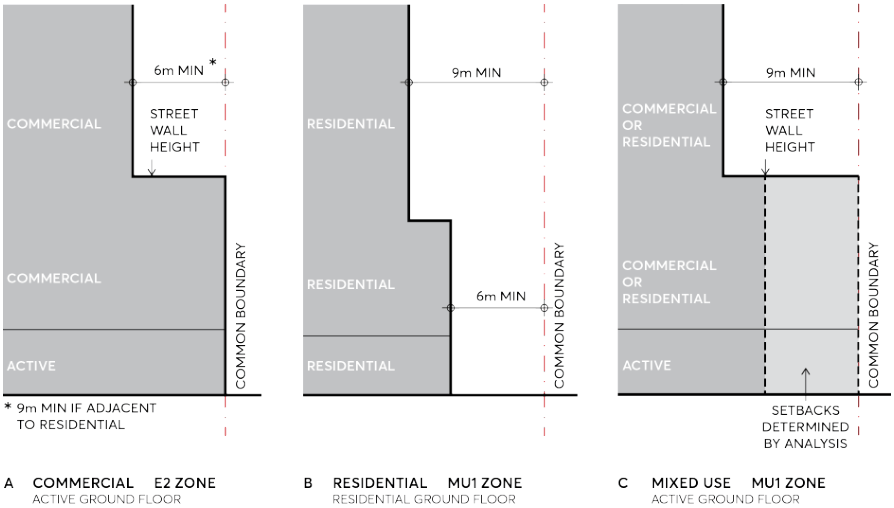

#### 9.3.3.2 BUILDING SEPARATION

Objectives

O.01 Protect the amenity of streets and public places by providing a healthy environment for street trees, and allowing adequate daylight and views to the sky.

O.02 Provide adequate privacy, access to light, air and outlook for the occupants of buildings, neighbouring properties and future buildings.

O.03 Ensure towers are sufficiently separated so that tower buildings are seen in the round. O.04 Ensure development does not prejudice the re-development of adjoining sites in the future.

Controls

C.01 For commercial buildings in the E2 Commercial Centre zone, building separation above street wall height must be a minimum of 12 metres. The separation distance must be apportioned equally between adjacent sites to determine side and rear boundary setbacks. Refer Figure

BUILT FORM

9.3.3.2.1 A Commercial E2 zone. However, for commercial buildings in the E2 Commercial Centre zone seeking additional FSR consistent with Clause 7.28A in Parramatta LEP 2023, building separation above street wall height must be a minimum of 15 metres. The separation distance must be apportioned equally between adjacent sites to determine side and rear boundary setbacks. Variations to this will be considered but only when varied by a site specific DCP or Stage 1 Concept Development Application applicable to the site, and then forms the primary basis of assessment of a Design Excellence winning scheme.

C.02 For residential buildings in the MU1 Mixed Use zone that have a residential ground floor, building separation must be a minimum of:

a) 12 metres up to 4 storeys.

b) 18 metres over 4 storeys.

C.03 The above separation distances must be apportioned equally between adjacent sites to determine side and rear boundary setbacks. Refer Figure 9.3.3.2.1 B Residential MU1 zone.

C.04 For mixed use buildings in the MU1 Mixed Use zone that have an active ground floor street frontage:

a) Building separation above street wall height must be a minimum of 18 metres. The separation distance must be apportioned equally between adjacent sites to determine side and rear boundary setbacks.

b) An analysis of existing and possible future context must be submitted to determine the most appropriate built form below the street wall height at the side and rear boundaries.

Refer Figure 9.3.3.2.1 C Mixed Use MU1 zone.

C.05 Only one step in the built form is permissible. C.06 Separation must be measured to the outside face of the building including balconies, vertical and horizontal circulation, internal voids, and external walls.

C.07 Separation must be measured perpendicular to the boundary to the outer faces of the building including balconies.

C.08 For purposes of these controls, serviced apartments and build-to-rent apartments must be treated as a residential building.

C.09 An existing adjacent building, even if heritage listed, cannot be used to justify a reduced setback which could compromise the development potential of the adjacent site in the future.

BUILT FORM

> [Picture on page 19: a picture, saved as a picture (images/part-09-parramatta-city-centre-page-19-2.gif, 150 dpi).]

Figure 9.3.3.2.1 (A, B and C) – Building Separation
