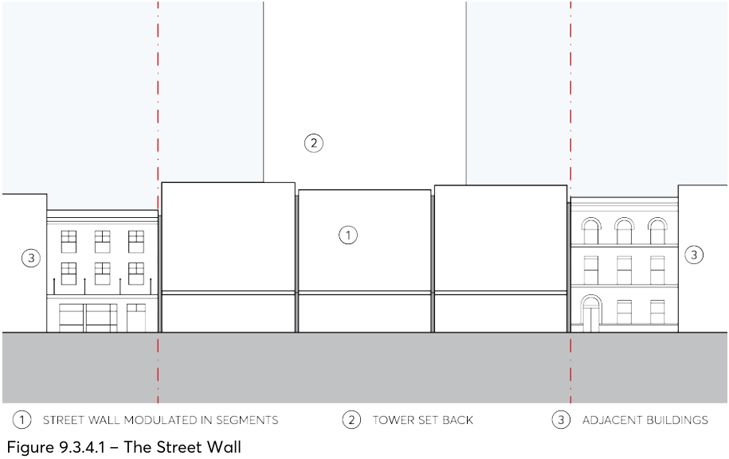

#### 9.3.4 THE STREET WALL

Together with the public domain, the attached street wall with active ground floor frontage is the built element that shapes the way most of the city is experienced. As the primary means of providing definition and spatial enclosure to the streets and other public spaces, it is the principal architectural component of collective civic intent. That is, it must operate in concert with other street walls to form a satisfyingly rich experience for the public spaces of the city, and its modulation, articulation and character must be guided by this understanding of its role. Its design must be derived from the general characteristics that make successful streets: spatial definition of the street, human scale, urban grain, facades of tactile material quality articulated with depth and shadow. Seen this way, the street wall can be thought of as a separate project to the design of the tower and can be distinct and different in character from the tower, but it should complement other street walls. In the foreground, it acts as a mitigating element for the set back tower building, able to define the street at the appropriate height and protect the street from the wind effects of the tower. The street wall height is set at a range that allows some flexibility with a maximum that generates a street width to height ratio in the order of 1:1. Erosions or interruptions of the street wall generally work to undermine the vitality and definition of the street and are not favoured.

Objectives

O.01 Define the space of the street and public spaces and articulate their edges. O.02 Design the street wall to provide appropriate scale, material quality and detail. O.03 Create visual interest and variety in the streetscape within an overall framework of consistency in the definition of the street and its character.

O.04 Design the street wall to achieve fine grain modulation in the street. O.05 Encourage walkability by locating active uses in streets. O.06 Provide comfort and shelter for pedestrians. O.07 Minimise large expanses of inactive frontage.

Controls

C.01 The street wall must:

a) Be built to the street alignment along its full frontage at all levels. Minor recesses in the profile for modulation and articulation are permissible.

b) Be modulated vertically in segments that relate to a fine grain subdivision pattern where the site frontage is more than 25 metres. Refer to Figure 9.3.4.1 – The Street Wall.

c) Be of predominantly masonry character with no lightweight panel construction or curtain walling.

d) Be articulated with depth, relief and shadow on the street facade. A minimum relief of 150mm between the masonry finish and glazing face must be achieved.

BUILT FORM

e) Utilise legible architectural elements and spatial types - doors, windows, pilasters, sills, plinths, frame and infill, etc. - not necessarily expressed in a literal traditional manner.

f) Include an awning in accordance with Section 9.4.2 – Awnings and Trees on Streets.

g) Include a ground floor facade design which intensifies the walking experience with particular richness in detail, refer to Section 9.3.5 – The Ground Floor.

C.02 Undercrofts or other interruptions of the street wall which expose the underside of the tower and amplify its presence on the street are not permitted.

C.03 Green walls, screens and the like must not be used as an applied cover that masks the architectural attributes of the street wall facade. Greenery may be incorporated in the street wall so as to complement its required character as set out in C.01 and C.02 above.

C.04 All development applications must include a streetscape analysis to determine the most appropriate street wall height and provide details of the street wall. Submissions must include:

a) The street wall elevation at 1:200 scale in context showing existing buildings on the block.

b) A detailed street wall elevation at 1:100 scale including immediately adjacent buildings accurately drawn.

c) Sections through the street wall and awning at 1:50 scale including the public domain.

d) Detail street wall facade plans and sections at 1:20 scale, including ground floor active frontage and awning details, refer Sections 9.3.5, 9.4.2 and 9.4.3.

> [Picture on page 22: a picture, saved as a picture (images/part-09-parramatta-city-centre-page-22-20.gif, 150 dpi).]

Figure 9.3.4.1 – The Street Wall

BUILT FORM
