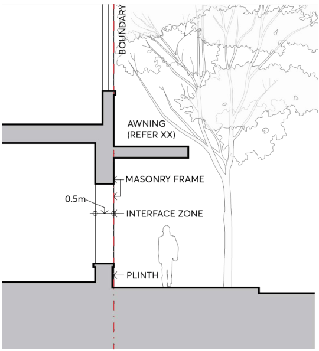

#### 9.3.5.1 NON FLOOD AFFECTED SITES

#### 9.3.5.1.1 ACTIVE GROUND FLOOR FRONTAGE

The factors that make for a thriving active ground floor street environment are well established: a scale appropriate to the pedestrian, narrow shopfronts and many doors, a mix of tenancy types, good transparency to the inside, quality materials with expressed detail, vertically articulated facades (which make distances along the street appear shorter), and a plinth for the glazed frontages. Where required, shelter and weather protection for pedestrians on footpaths must be provided by awnings. Colonnades are generally not favoured on streets as they restrict views of retail frontage and fragment the street interface, thereby undermining the intensity of public activity at the frontage. There may be limited situations where colonnades are considered reasonable, such as where they allow continuity of important view corridors.

Objectives

O.01 Provide for the amenity, interest and liveliness of the street environment. O.02 Ensure a positive experience for pedestrians with the necessary fine grain environment of the street.

O.03 Enable sensory engagement with the street. O.04 Provide an active ground floor frontage that is accessible and integrated with the design of the public domain.

BUILT FORM

O.05 Maximise the extent of active frontages in the public domain. O.06 Ensure appropriate scale and proportion of foyers and lobbies in relation to site frontage. O.07 Promote activity, connectivity and variety in the public domain. O.08 Increase the number of safe routes of travel throughout the Parramatta City Centre. O.09 Increase passive surveillance of the street and enhance safety. O.10 Ensure security measures do not inhibit passive surveillance of the street.

Controls

C.01 The following numeric parameters apply to active ground floor frontage: Active uses must fully occupy the ground floor frontage not taken up by services or vehicular access. The minimum depth of tenancy must be 4 metres, and tenancies must have an unobstructed view to a depth of 4 metres from the footpath. Where the street frontage is identified as having an active frontage on the Active Frontages Map in Parramatta LEP 2023, the maximum internal tenancy width allowed for must be 6 metres. Where active street frontage is not nominated on the Active Frontages Map, the maximum internal tenancy width allowed for must be 10 metres. Foyers and lobbies in the E2 Commercial Centre zone must be a maximum of 20% of the frontage width. Foyers and lobbies in the MU1 Mixed Use zone must be a minimum of 3 metres and a maximum of 8 metres of the frontage width. Where food and beverage premises have operable elements they must not be greater than 80% of the individual tenancy width.

C.02 The active ground floor frontage must be considered in detail and the following must be incorporated in its design, refer Figure 9.3.5.1.1: A nominal 500mm interface zone at the frontage must be set aside to create interest and variety in the streetscape, to be used for setbacks for entries, opening of windows, seating ledges, benches, and general articulation. The ground floor levels and facade masonry frame must allow for tenancy widths as noted above in C.01. The facade must have a high level of expressed detail and tactile material quality. The base of the facade must achieve a well resolved meeting with the footpath that takes account of any slope.  A horizontal plinth, integrated in the design, must be incorporated at the base of glazing to the footpath. A clear path of travel must be provided in the public domain as defined in the Public Domain Guidelines. Legible entrances must be formed in the frontage.

BUILT FORM

Fire escapes and service doors must be seamlessly incorporated into the facade with quality materials. The facade must not have deep recesses for entry lobbies that compromise safety. Colonnades are not permitted on streets. Awnings must be provided where required in accordance with Section 9.4.2 – Awnings and Trees on Streets. All required services must be incorporated in the design of the ground floor frontage at DA stage, refer Section 9.3.5.4 – Services and Utilities. Parking security grilles or doors must be aligned to the building edge as closely as safety constraints permit. Security doors or grilles must be designed to be fitted internally behind the shopfront, fully retractable and a minimum 50% transparent when closed. Refer to Section 9.3.5.2 – Flood Affected Sites for flood affected sites.

> [Picture on page 25: a picture, saved as a picture (images/part-09-parramatta-city-centre-page-25-14.gif, 150 dpi).]

Figure 9.3.5.1.1 – Active Ground Floor Frontage

BUILT FORM
