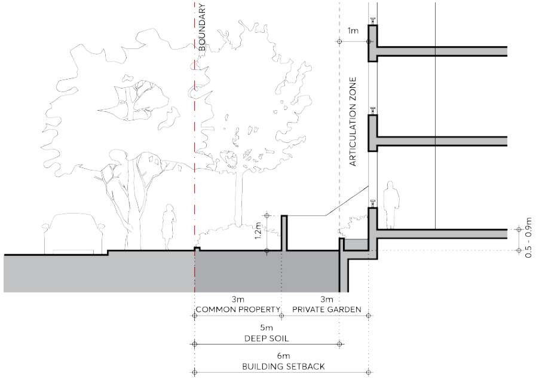

#### 9.3.5.1.2 RESIDENTIAL GROUND FLOOR FRONTAGE

Residential buildings must be set back from the street boundary to provide amenity for ground floor residents, a landscaped setting for buildings, and a landscape character for the street. The area between the facade and the street boundary must receive attention both in design and in its material quality. The subtleties involved in the design of ground level entries, private terraces or balconies, fences, walls, level changes and planting play an important part in the articulation of the street. A detailed resolution of these elements is essential in contributing to an unambiguous definition of public space, good street form, pedestrian scale, clarity of access and address, and a balance of privacy and passive surveillance. These details must all be designed with the same level of care given to the building. The potential mix of possible street frontage conditions in the MU1 Mixed Use zone that are not identified as having an active frontage on the Active Frontages Map must be subject to analysis in each situation. Existing and possible future context and use must be taken into account in determining the optimum built form.

Objectives

O.01 Establish new canopy trees that contribute to the landscape character of the street and residential amenity.

O.02 Appropriately define and design the street edge and setback area to achieve amenity and privacy for residents as well as engagement with and passive surveillance of the street.

Controls

C.01 The following parameters apply to residential ground floor street frontage, refer to Figure 9.3.5.1.1. The building must be set back 6 metres from the street boundary. A 1 metre articulation zone is permitted forward of the setback, in which building elements may occupy a maximum of one third of the area of the facade. Services or lift shafts are not permitted in the articulation zone. Basements must be set back a minimum of 5 metres from the street boundary measured to the outside face of structure to allow deep soil in the setback area. The setback area must allocate the front 3 metres adjacent to the footpath as common property for landscaping. Canopy trees must be planted in this area, a minimum 3.5 metres from any structure, to achieve greater than 13 metres mature height and spread, at the rate of 1 canopy tree for every 15 lineal metres of frontage. A wall set back 3 metres from the street boundary must articulate the front areas in private ownership. The wall must be a maximum 1.2 metres high and of masonry construction, integrated with dividing masonry walls for private open spaces. Impervious surface at ground level must be minimised in the setback area. Ground floor apartment levels must be a minimum of 500mm and maximum of 900mm above footpath level.

BUILT FORM

All required services must be incorporated in the design of the ground floor frontage at DA stage, refer to Section 9.3.5.4 – Services and Utilities. Refer to Section 9.3.5.2 – Flood Affected Sites for flood affected sites.

> [Picture on page 27: a picture, saved as a picture (images/part-09-parramatta-city-centre-page-27-5.gif, 150 dpi).]

Figure 9.3.5.1.2 – Residential Ground Floor Street Frontage

C.02 Where individual apartment entries from the street serve as a primary address, separation between the entry and private open space, and a front door with a distinct entry space within the apartment, must be provided. If the entries are only for the use of residents they must be understated, with post boxes and street numbers located at the common entry.

C.03 All stairs and ramps providing access to lobbies must be internalised where necessary to ensure the street interface is not compromised.

C.04 For sites that are zoned MU1 Mixed Use and not identified as having an active frontage on the Active Frontages Map, an analysis of existing and likely future context and use must be provided to determine the most appropriate built form and use at the street frontage.

C.05 A fully illustrated and co-ordinated ground floor design, showing all the necessary levels and detail, must accompany development applications. Drawings must include the following: A detail ground level plan and sections as part of the architectural submission which illustrates the relationships between the interior and the exterior spaces of the setback area, including the landscape and hydraulic detail, and extends into the public domain. Any required services must be discreetly integrated into the frontage design. The architectural drawings must be fully co-ordinated with the landscape and hydraulic drawings.

BUILT FORM

Elevations and sections at minimum 1:50 scale of all built elements in the setback area must be provided.
