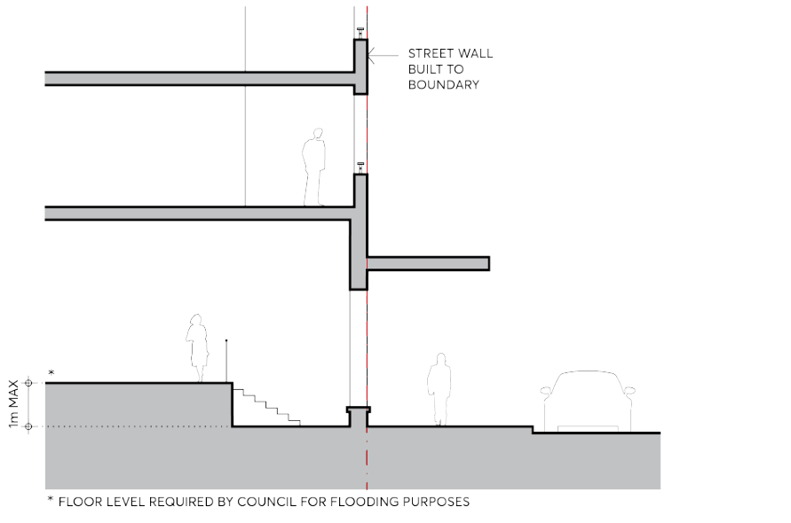
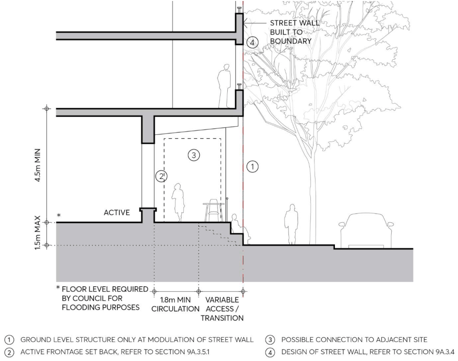
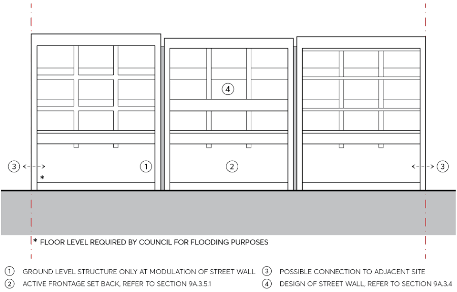
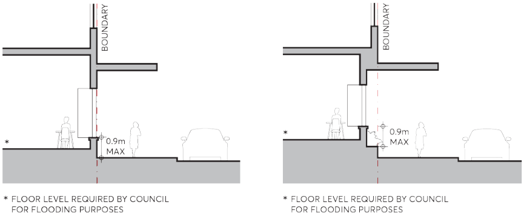
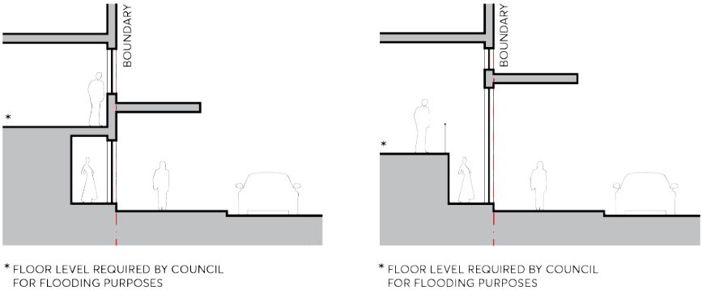

#### 9.3.5.2.1. This area must:

Provide a safe and easy transition within the building that meets Australian Standard for Disabled access to the remainder of the tenancy located at the floor level required by Council for flood protection. Have a maximum interior level change of 1 metre. Comply with requirements listed in Section 9.7.2 – Land Uses and Building Levels.

> [Picture on page 29: a picture, saved as a picture (images/part-09-parramatta-city-centre-page-29-11.gif, 150 dpi).]

Figure 9.3.5.2.1 – Active Ground Floor: Floor level permitted partly at footpath level

C.02 Where the floor level required by Council for flood protection is a maximum of 1.5 meters above footpath level the active frontage may be set back from the street boundary with access and transition adjacent to the footpath, refer to Figures 9.3.5.2.2 A and 9.3.5.2.2 B. In this case, the ground floor must: Have clear sightlines and maximise transparency and ease of circulation between the public footpath and upper circulation zone. Comply with applicable active frontage controls in Section 9.3.5.1 – Non Flood Affected Sites. Be free of structure outside of the active frontage except at intervals to modulate the street wall into vertical segments, refer to Figures 9.3.5.2.2 A and 9.3.5.2.2 B. Have a minimum upper circulation zone width of 1.8 metres.

BUILT FORM

Incorporate universal accessibility to the raised level, fully accommodated within the boundaries of the site. Allow for integration with existing and future development on adjacent sites. Side boundary walls extending to the street boundary must incorporate openings or removable sections to connect to existing or future development where this can be achieved.

> [Picture on page 30: a picture, saved as a picture (images/part-09-parramatta-city-centre-page-30-7.gif, 150 dpi).]

Figure 9.3.5.2.2 A – The Street Wall: Active frontage set back

BUILT FORM

> [Picture on page 31: a picture, saved as a picture (images/part-09-parramatta-city-centre-page-31-2.gif, 150 dpi).]

Figure 9.3.5.2.2 B – Active Ground Floor: Floor level required up to 1.5 metres above footpath level

C.03 Where integration with adjacent frontage is not possible or desirable, active frontage may be located on or close to the street boundary, subject to the maximum height of any wall being

0.9 metres. Refer to Figure 9.3.5.2.3 below.

> [Picture on page 31: a picture, saved as a picture (images/part-09-parramatta-city-centre-page-31-8.gif, 150 dpi).]

Figures 9.3.5.2.3 – Active Ground Floor: Frontage on or close to the street boundary

C.04 Where the floor level required by Council for flood protection is greater than 1.5 metres above footpath level, a raised frontage set back and adjacent to the footpath is unlikely to be practical, and the frontage may be activated with display windows, refer to Figures 9.3.5.2.4 below.

BUILT FORM

> [Picture on page 32: a picture, saved as a picture (images/part-09-parramatta-city-centre-page-32-2.gif, 150 dpi).]

Figures 9.3.5.2.4 – Active Ground Floor: Floor level required greater than 1.5m above footpath level
