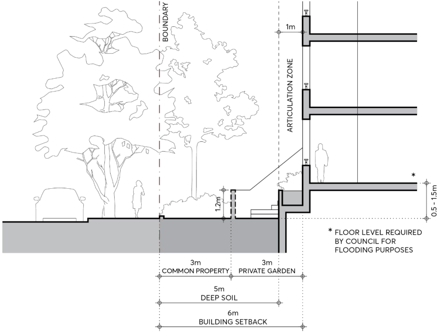
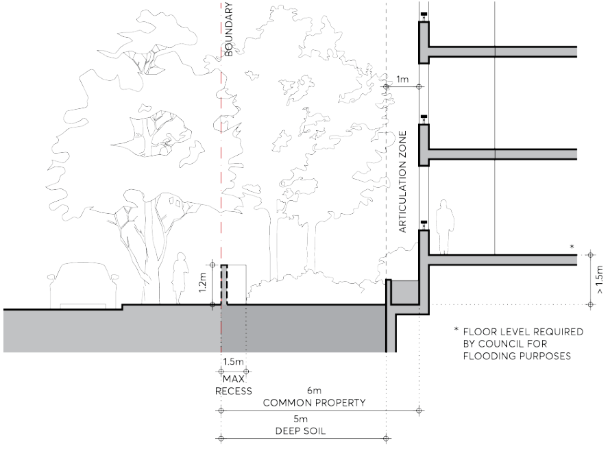

#### 9.3.5.2.2 RESIDENTIAL GROUND FLOOR FRONTAGE

Buildings with residential ground floors may be more easily able to incorporate the transition to the floor level required by Council for flood protection as they are set back from the street with deep soil landscape, and the desired spatial relationships at ground level are more suited to accommodate raised ground floors. This section is correlated with the controls for residential ground floor frontage (Section 9.3.5.1.2 – Residential Ground Floor Frontage), adjusted as necessary for flooding constraints.

Controls

C.01 Where the floor level required by Council for flood protection is 0.5-1.5 metres above footpath level the following parameters apply to the ground floor street frontage, refer to Figure 9.3.5.2.2.1. The building must be set back 6 metres from the street boundary. A 1 metre articulation zone is permitted forward of the setback, in which building elements may occupy a maximum of one third of the area of the facade. Services or lift shafts are not permitted in the articulation zone. Basements must be set back a minimum of 5 metres from the street boundary measured to the outside face of structure to allow deep soil in the setback area. The setback area must allocate the front 3 metres of the site adjacent to the footpath as common property for landscaping. Canopy trees must be planted in this area, a minimum

4.5 metres from the building facade, to achieve greater than 13 metres mature height and spread, at the rate of 1 canopy tree for every 15 lineal metres of frontage. Species selection and footing types must allow for optimum growing conditions as well as long term protection of any structures in the setback area. A wall set back 3 metres from the street boundary must articulate the front areas in private ownership. The wall must be a maximum 1.2 metres high and of masonry construction only if acceptable to Council. If the street frontage is a significant overland flow path or

BUILT FORM

floodway Council may require the use of vegetation screening (hedges, shrubs) or open fences instead of solid walls as spatial separators. Where individual apartment entries from the street serve as a primary address, separation between the entry and private open space, and a front door with a distinct entry space within the apartment, must be provided. If the entries are only for the use of residents they must be understated, with post boxes and street numbers located at the common entry. All stairs and ramps providing access to lobbies must be internalised where necessary to ensure the street interface is not compromised.

> [Picture on page 33: a picture, saved as a picture (images/part-09-parramatta-city-centre-page-33-10.gif, 150 dpi).]

Figure 9.3.5.2.2.1 – Residential Ground Floor: Floor level required 0.5-1.5m above footpath level

C.02 Where the floor level required by Council for flood protection is greater than 1.5 metres above footpath level, the following parameters apply to the ground floor street frontage, refer to Figure 9.3.5.2.2.2: The building must be set back 6 metres from the street boundary. A 1 metre articulation zone is permitted forward of the setback, in which building elements may occupy a maximum of one third of the area of the facade. Services or lift shafts are not permitted in the articulation zone. Basements must be set back a minimum of 5 metres from the street boundary measured to the outside face of structure to allow deep soil in the setback area.

BUILT FORM

The setback area of 6 metres must be in common property. Canopy trees must be planted in this area, a minimum 4.5 metres from the building facade, to achieve greater than 13 metres mature height and spread, at the rate of 1 canopy tree for every 15 lineal metres of frontage. Species selection and footing design must allow for optimum growing conditions as well as long term protection of any structures in the setback area. A wall at the boundary must define the street frontage. The wall must be a maximum of

1.2 metres high and of masonry construction only if acceptable to Council. If the street frontage is a significant overland flow path or floodway Council may require the use of vegetation screening (hedges, shrubs) or open fences instead of solid walls as spatial separators. If solid walls are permitted, recesses in the wall of maximum 1.5 metres deep may be set in from the boundary at intervals to relieve its length.

> [Picture on page 34: a picture, saved as a picture (images/part-09-parramatta-city-centre-page-34-13.gif, 150 dpi).]

Figure 9.3.5.2.2.2 – Residential Ground Floor: Floor level required greater than 1.5 metres above footpath level

C.03 A fully illustrated and co-ordinated ground floor design, showing all the necessary levels and detail, must accompany development applications. Drawings must include the following: A detail ground level plan and sections as part of the architectural submission which illustrates the relationships between the interior and the exterior spaces of the setback area, including the landscape and hydraulic detail, and extends into the public domain. Any required services must be discreetly integrated into the frontage design. The architectural drawings must be fully co-ordinated with the landscape and hydraulic drawings.

BUILT FORM

Elevations and sections at minimum 1:50 scale of all built elements in the setback area must be provided.
