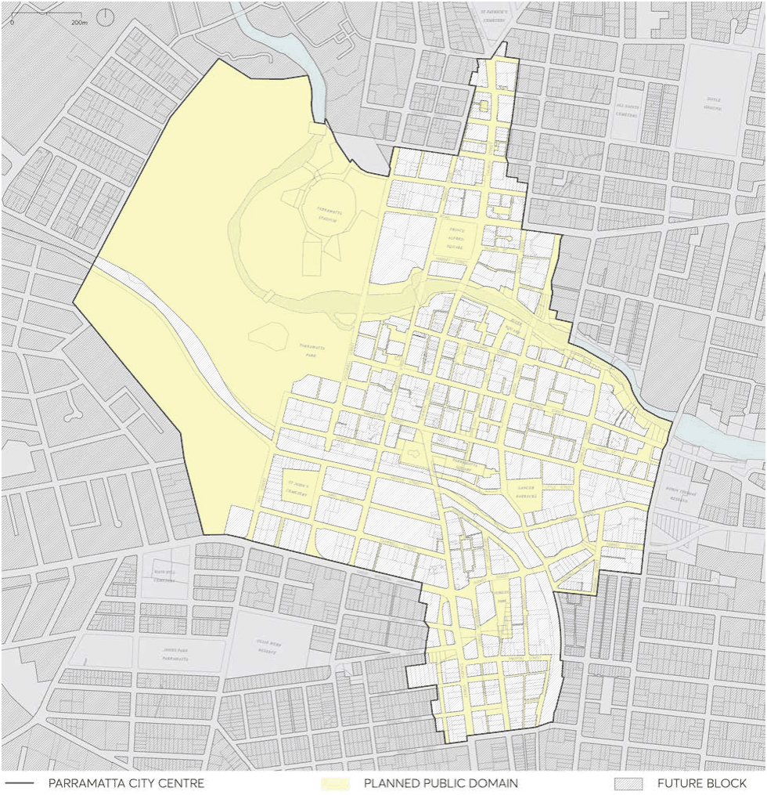

### 9.4 PUBLIC DOMAIN

Figure 9.4.1 indicates the existing and intended future Public Domain of the Parramatta City Centre together with relevant surrounding places. Public spaces – streets, squares and parks – are the most enduring spaces of the city, the shared social and cultural domain that make up the organising framework of the City. Their clarity, quality and amenity contribute in a fundamental way to the identity and experience of the city. This section details aspects of the design of the public domain, and must be read in conjunction with the Public Domain Guidelines, which sets out the process, design guidelines and submission requirements for all new public domain assets in the City of Parramatta.

> [Picture on page 41: a picture, saved as a picture (images/part-09-parramatta-city-centre-page-41-11.gif, 150 dpi).]

Figure 9.4.1 – The Public Domain

PUBLIC DOMAIN
