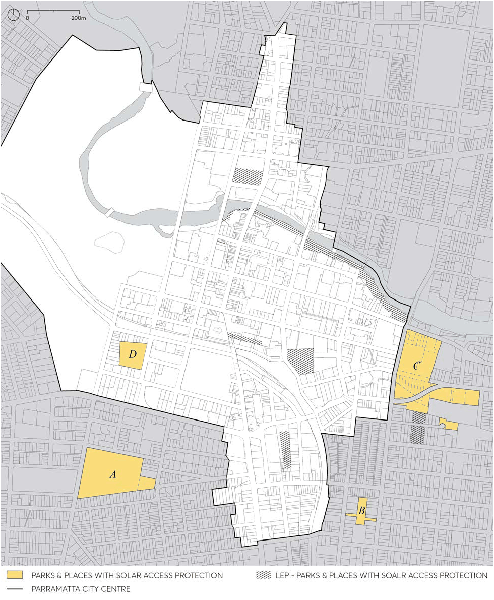
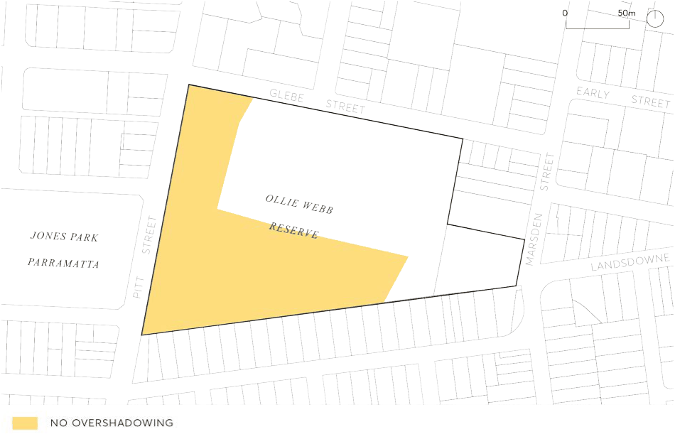
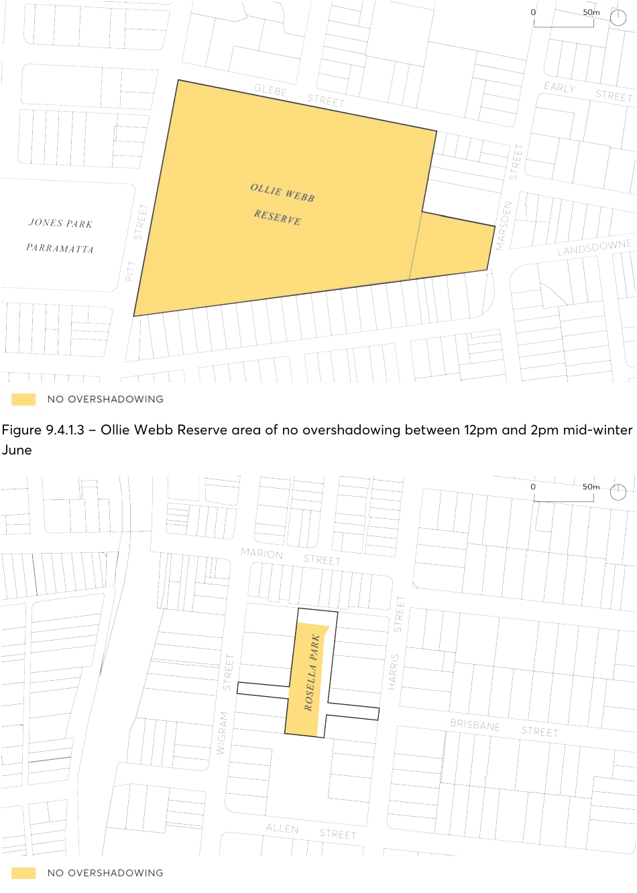
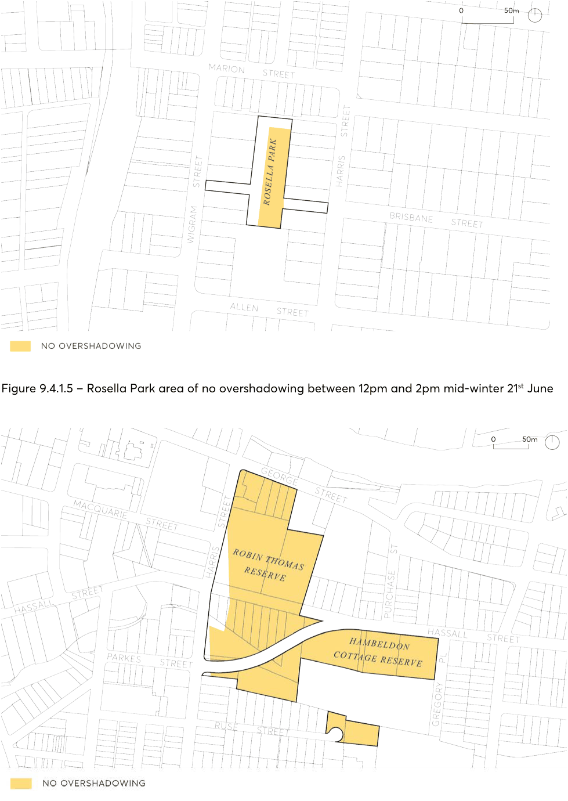
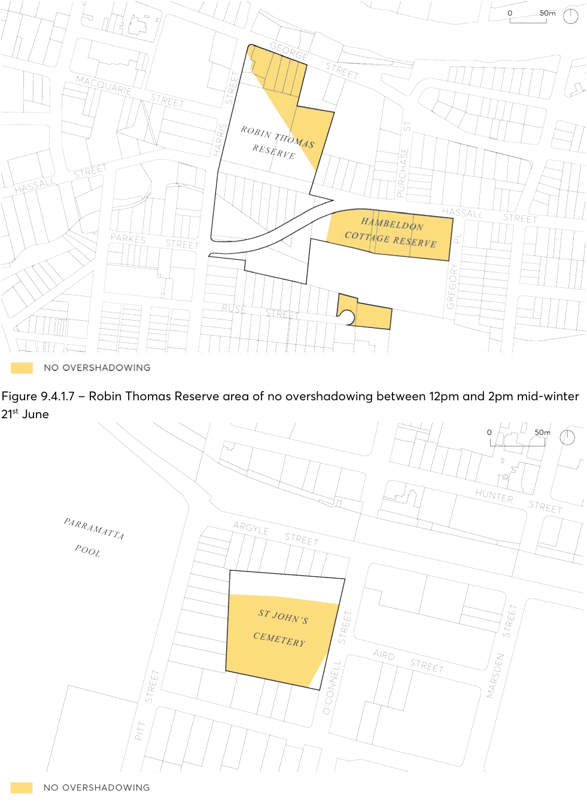
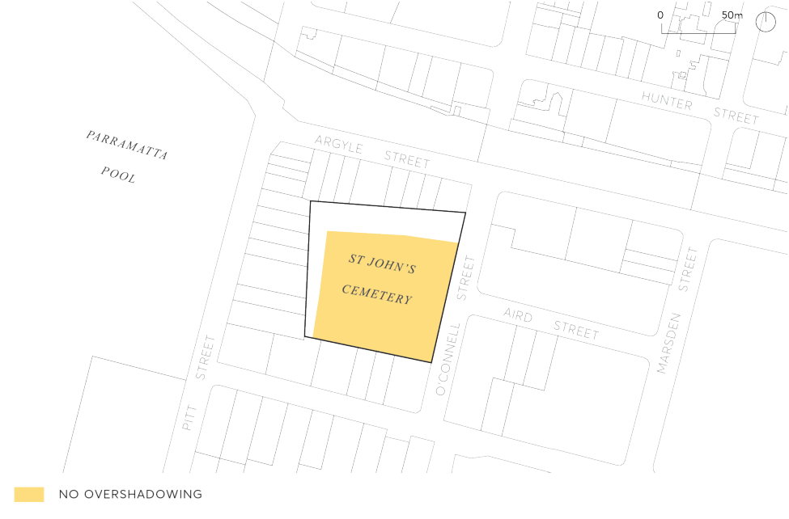

#### 9.4.1 SOLAR ACCESS TO SIGNIFICANT PARKS AND SPACES

Good solar access is an important contributor to the amenity of public spaces. Maintaining sunlight to significant public spaces within and close to the perimeter of the Parramatta City Centre will provide benefit to existing and future residents, workers, and visitors. The provision of solar access throughout the year is essential for a successful public open space. In addition, sunlight is crucial for the establishment and sustained health of tree planting and vegetation which provides attractive and cool environments for people in the City Centre. The Parramatta LEP 2023 provides specific solar access controls for Parramatta Square, Lancer Barracks, the River Foreshore and Jubilee Park.  Additional parks and spaces within and close to the perimeter of the Parramatta City Centre have been identified in Figure 9.4.1.1 as providing valuable opportunities to maintain and enhance solar access.

Objectives

O.01 Maintain or maximise solar access to the significant parks and spaces in and around the Parramatta City Centre during periods in the day when they are most used throughout the year.

O.02 Maintain or maximise solar access to spaces which have important recreation values, aesthetic qualities and or heritage significance.

O.03 Maintain or maximise solar access to existing spaces which may contribute to the open space network in the future.

O.04 Promote active and passive recreation to public spaces to service existing and planned population of the Parramatta City Centre and surrounds.

O.05 Ensure the successful growth and survival of trees and vegetation within these parks and spaces.

Controls

C.01 New development, or additions and alterations to existing buildings, must not create any overshadowing to areas marked ‘no overshadowing’ in all Figures referenced in Column 2 of Table 9.4.4.1, between the nominated times listed in Column 3 of Table 9.4.4.1. Contact Council to source CAD files of areas identified for ‘no overshadowing’.

C.02 Where overshadowing of parks and spaces identified in Figure 9.4.1.1 is likely, a statement with supporting solar access studies must be submitted by a registered architect demonstrating that the proposed development does not overshadow the affected open space consistent with all Figures referenced in Column 2 of Table 9.4.4.1.

C.03 New development and additions or alterations to existing buildings are to comply with the solar access controls irrespective of the existing height of nearby buildings.

C.04 Ancillary structures such as columns, pillars, spires, flag poles, public art, and architectural roof features including equipment for servicing the building, such as plant, lift motor rooms, fire stairs and the like, must not be excluded from any overshadowing analysis.

PUBLIC DOMAIN

> [Picture on page 43: a picture, saved as a picture (images/part-09-parramatta-city-centre-page-43-2.gif, 150 dpi).]

Figure 9.4.1.1 – Parks and Places with Solar Access Protection

PUBLIC DOMAIN

Table 9.4.1.1 – Nominated Significant Parks and Spaces and times for solar access protection

| Column 1: Significant Park or Space | Column 2: Figure reference | Column 3: Nominated Time |
|---|---|---|
| A. Ollie Webb Reserve | Figure 9.4.1.2 Figure 9.4.1.3 | 10am to 12 midday mid-winter 21st June 12 midday to 2pm mid-winter 21st June |
| B. Rosella Park | Figure 9.4.1.4 Figure 9.4.1.5 | 10am to 12midday mid-winter 21st June 12 midday to 2pm mid-winter 21st June |
| C. Robin Thomas and James Ruse Reserve | Figure 9.4.1.6 Figure 9.4.1.7 | 10am to 12 midday mid-winter 21st June 12 midday to 2pm mid-winter 21st June |
| D. St John’s Cemetery | Figure 9.4.1.8 Figure 9.4.1.9 | 10am to 12 midday mid-winter 21st June 12 midday to 2pm mid-winter 21st June |

> [Picture on page 44: a picture, saved as a picture (images/part-09-parramatta-city-centre-page-44-4.gif, 150 dpi).]

Figure 9.4.1.2 – Ollie Webb Reserve area of no overshadowing between 10am and 12pm mid-winter 21st June

PUBLIC DOMAIN

> [Picture on page 45: a picture, saved as a picture (images/part-09-parramatta-city-centre-page-45-2.gif, 150 dpi).]

Figure 9.4.1.3 – Ollie Webb Reserve area of no overshadowing between 12pm and 2pm mid-winter 21st

June

Figure 9.4.1.4 – Rosella Park area of no overshadowing between 10am and 12pm mid-winter 21st June

PUBLIC DOMAIN

> [Picture on page 46: a picture, saved as a picture (images/part-09-parramatta-city-centre-page-46-2.gif, 150 dpi).]

Figure 9.4.1.5 – Rosella Park area of no overshadowing between 12pm and 2pm mid-winter 21st June

Figure 9.4.1.6 – Robin Thomas Reserve area of no overshadowing between 10am and 12pm mid-winter 21st June

PUBLIC DOMAIN

> [Picture on page 47: a picture, saved as a picture (images/part-09-parramatta-city-centre-page-47-2.gif, 150 dpi).]

Figure 9.4.1.7 – Robin Thomas Reserve area of no overshadowing between 12pm and 2pm mid-winter 21st June

Figure 9.4.1.8 – St Johns Cemetery area of no overshadowing between 10am and 12pm mid-winter 21st June

PUBLIC DOMAIN

> [Picture on page 48: a picture, saved as a picture (images/part-09-parramatta-city-centre-page-48-2.gif, 150 dpi).]

Figure 9.4.1.9 – St Johns Cemetery area of no overshadowing between 12pm and 2pm mid-winter 21st June

PUBLIC DOMAIN
