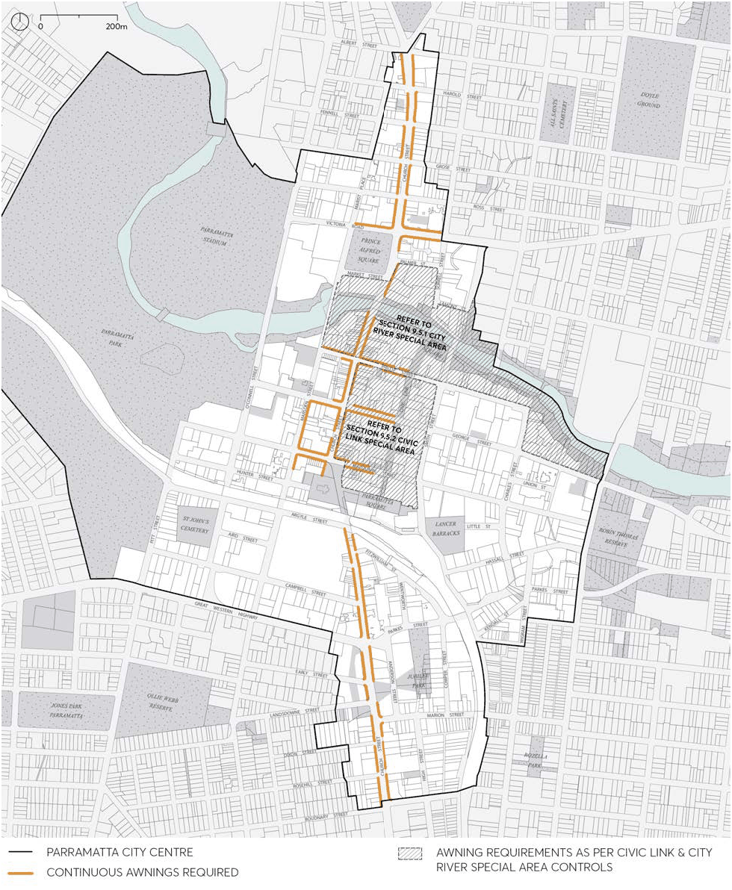
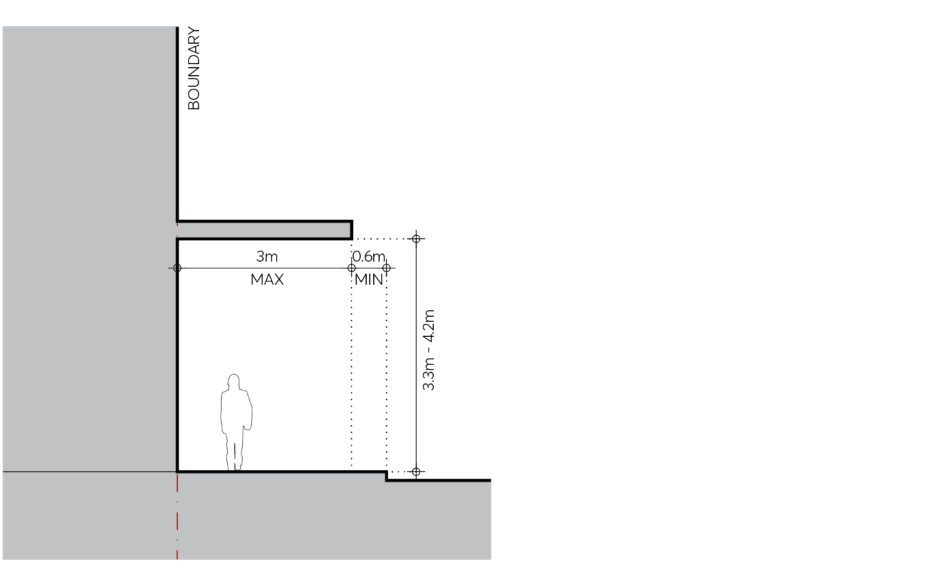

#### 9.4.2.1 AWNINGS HAVE PRIORITY

Objectives

O.01 Ensure increased amenity in areas of high pedestrian volume by providing continuous protection from rain, sun and wind down draft.

Controls

C.01 Continuous awnings must be provided along streets where identified in Figure 9.4.2.1.1. C.02 Dimensions of awnings must be in accordance with Figure 9.4.2.1.2.

PUBLIC DOMAIN

> [Picture on page 50: a picture, saved as a picture (images/part-09-parramatta-city-centre-page-50-2.gif, 150 dpi).]

Figure 9.4.2.1.1 – Awnings have priority – Continuous awnings

PUBLIC DOMAIN

> [Picture on page 51: a picture, saved as a picture (images/part-09-parramatta-city-centre-page-51-2.gif, 150 dpi).]

Figure 9.4.2.1.2 – Awnings have priority – Dimensions of awnings
