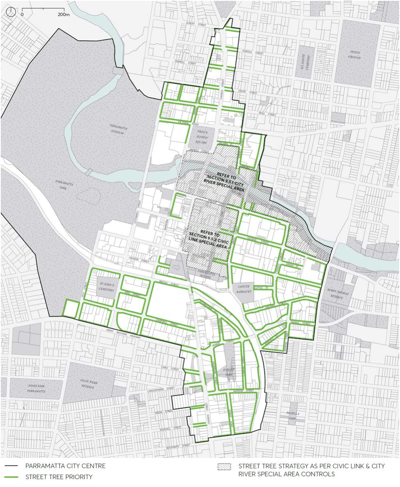
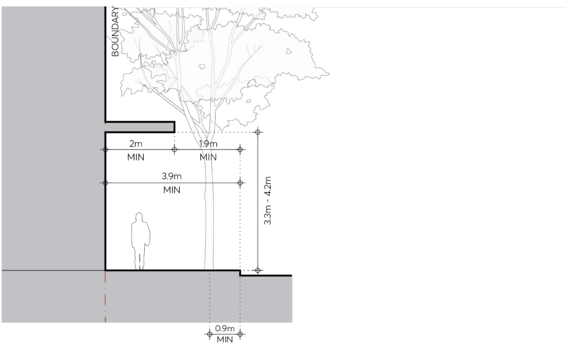

#### 9.4.2.2 STREET TREES HAVE PRIORITY

In those areas where trees have priority, awnings of reduced width may be provided where footpaths are of sufficient width. Parramatta Public Domain Guidelines identify the location of street trees and species selection and should be consulted when proposing the delivery of street trees as part of any development.

Objectives

O.01 Maintain existing street trees and plant additional street trees within the public domain. O.02 Improve and enhance environmental biodiversity and mitigate temperature at ground level. O.03 Ensure maximum street tree crown development and performance. O.04 Improve visual amenity of the public domain. O.05 Improve quality of view for residents, workers and others overlooking the public domain.

Controls

C.01 Street trees must be provided along those streets identified in Figure 9.4.2.2.1. C.02 Where footpath widths are 3.9 metres or greater, narrow width awnings may also be provided in accordance with Figure 9.4.2.2.2.

C.03 Street tree species and spacing must be as specified in the Parramatta Public Domain Guidelines.

PUBLIC DOMAIN

C.04 Street trees must be installed in accordance with the Parramatta Public Domain Guidelines and Council Design Standards.

C.05 A Public Domain Alignment Plan indicating the street tree locations as detailed in the Parramatta Public Domain Guidelines must be submitted for the Development Application and Construction Certificate Application.

> [Picture on page 52: a picture, saved as a picture (images/part-09-parramatta-city-centre-page-52-7.gif, 150 dpi).]

Figure 9.4.2.2.1 – Street trees have priority

PUBLIC DOMAIN

> [Picture on page 53: a picture, saved as a picture (images/part-09-parramatta-city-centre-page-53-2.gif, 150 dpi).]

Figure 9.4.2.2.2 – Street Trees have priority, narrow width awnings
