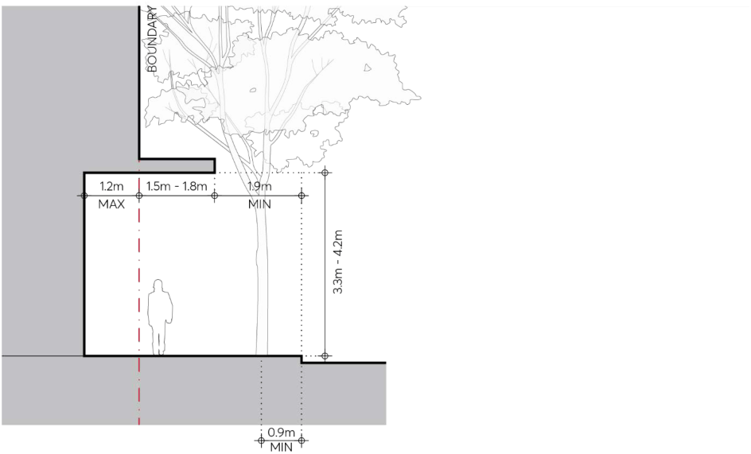

#### 9.4.2.3 SEMI-RECESSED AWNINGS

Semi-recessed awnings are an option for consideration either where awnings or street trees have priority. Setting the ground floor frontage back from the boundary and integrating the awning with the building soffit above can provide a generous footpath width, good awning cover as well as the necessary space for street trees. Existing and possible future adjacent context must be taken into account in determining whether this option is feasible in each situation. Applicants should contact Council at the start of the design process to establish the street and awning profile for the proposal.

Objectives

O.01 Allow for the possibility of generous footpaths, shelter from awnings as well as street trees where circumstances permit.

Controls

C.01 Semi-recessed awnings may be provided in accordance with Figure 9.4.2.3.1. C.02 Where a semi-recessed awning is proposed, the following must be incorporated in its design: The awning must be integrated with the building soffit above as shown in Figure 9.4.2.3.1. The space under the semi-recessed awning must be free of columns. The frontage must be integrated with the adjacent existing frontage.

PUBLIC DOMAIN

A clear path of travel must be provided in the public domain as defined in the Parramatta Public Domain Guidelines.

> [Picture on page 54: a picture, saved as a picture (images/part-09-parramatta-city-centre-page-54-4.gif, 150 dpi).]

Figure 9.4.2.3.1 – Semi-Recessed Awnings
