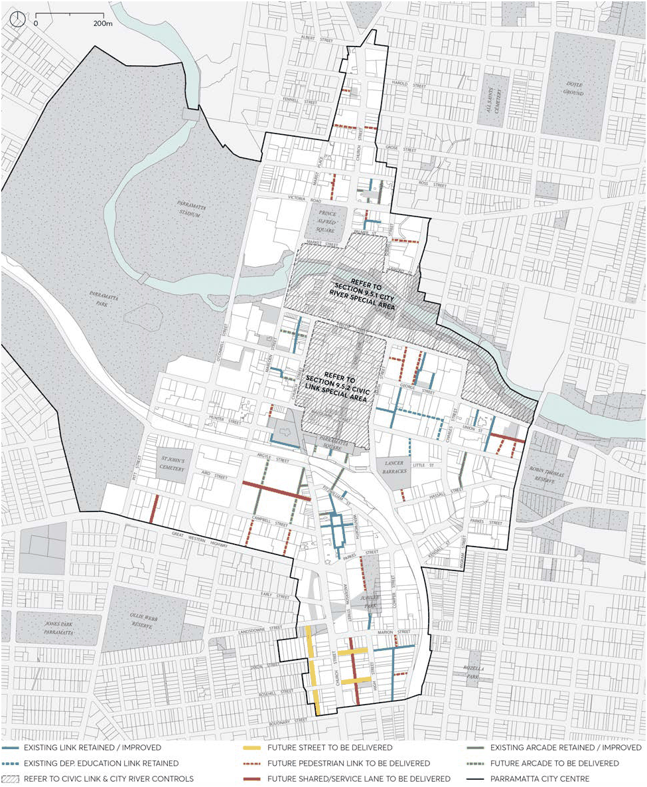

#### 9.4.4 PEDESTRIAN LANES, SHARED ZONES AND SERVICE LANES

Many street blocks within the Parramatta City Centre are long, some being over 250 metres in an east-west direction and over 140 metres in a north-south direction. The benefits of a finer network of lanes are numerous: greater connectivity, increased frontage for entries and business opportunities, and a spatial intimacy and variety in the public domain. Service lanes also assist with activation of primary street frontages by providing back of house vehicular access, thereby reducing the necessity for driveways disrupting major city footpaths. Pedestrian lanes are non-trafficable and can be narrower in width than those with vehicular access. Shared lanes have pedestrian priority over vehicle movement and typically have a flush surface for the full width of the lane. Service lanes prioritise vehicle movement and separate pedestrian movement by the use of kerbs or barriers. Service lanes should also be preserved from residential encroachment to ensure servicing is maintained or improved. Council’s City Centre Lane Policy and Parramatta Public Domain Guidelines provide further guidance on the design of pedestrian lanes, service lanes and shared zones.

Objectives

O.01 Retain and increase connectivity in the public domain and variety in the street network. O.02 Encourage vehicular entries from shared zones and service lanes and not primary street frontages.

O.03 Design lanes, shared zones and service lanes to encourage pedestrian amenity and safety. O.04 Encourage active frontages along lanes, shared zones, and service lanes without compromising safe pedestrian access and use.

O.05 Ensure that any proposed privately owned lanes have a fully public nature equivalent to the public domain.

Controls

C.01 A development must fully or partially deliver a pedestrian lane, service lane or shared zone as shown in Figure 9.4.4.1 Existing and Required lanes in the Parramatta City Centre

C.02 Any development that proposes a new pedestrian lane, shared zone or service lane in addition to those indicated in Figure 9.4.4.1 must demonstrate that it meets the objectives and controls of this section.

C.03 The minimum width of a pedestrian lane must be 4 metres as measured from the property boundaries.

C.04 The minimum width of a shared zone or service lane must be 6. 5 metres as measured from the property boundaries.

C.05 The design and finish of pedestrian lanes, shared zones or service lanes must be in accordance with the Parramatta Public Domain Guidelines.

C.06 All pedestrian lanes, shared zones and service lanes must: Be fully open to the sky.

PUBLIC DOMAIN

Be accessible to the public at all times. Provide direct throughways with direct sightlines. Be unencumbered by any basement car parking or any other private infrastructure under.

C.07 Where a proposed lane or shared zone is not able to be dedicated to Council: The lane must be designed as part of the public street network, of equivalent status to the public domain, with its fully public nature embedded in the title arrangements. The lane must be designed with the same parameters and finishes as required for Council owned lanes outlined in this section. The lane must be named and signposted in the same way as for Council owned lanes.

C.08 Pedestrian lanes must be clear of all obstructions, including columns, stairs, escalators and fixed furniture. A minimum of 50 per cent of lane width is to provide clear pedestrian access.

C.09 Main building entry points on lanes must be clearly visible and defined as appropriately with canopies, building signage, lighting and high-quality articulation. Steps, handrails, or Tactile Ground Surface Indicators must not protrude into or interfere with the lane.

C.10 Arcades are a secondary pedestrian option and must not to replace the role or function of a lane, shared zone, or service lane.

PUBLIC DOMAIN

> [Picture on page 58: a picture, saved as a picture (images/part-09-parramatta-city-centre-page-58-2.gif, 150 dpi).]

Figure 9.4.4.1 – Existing and Required Lanes

PUBLIC DOMAIN
