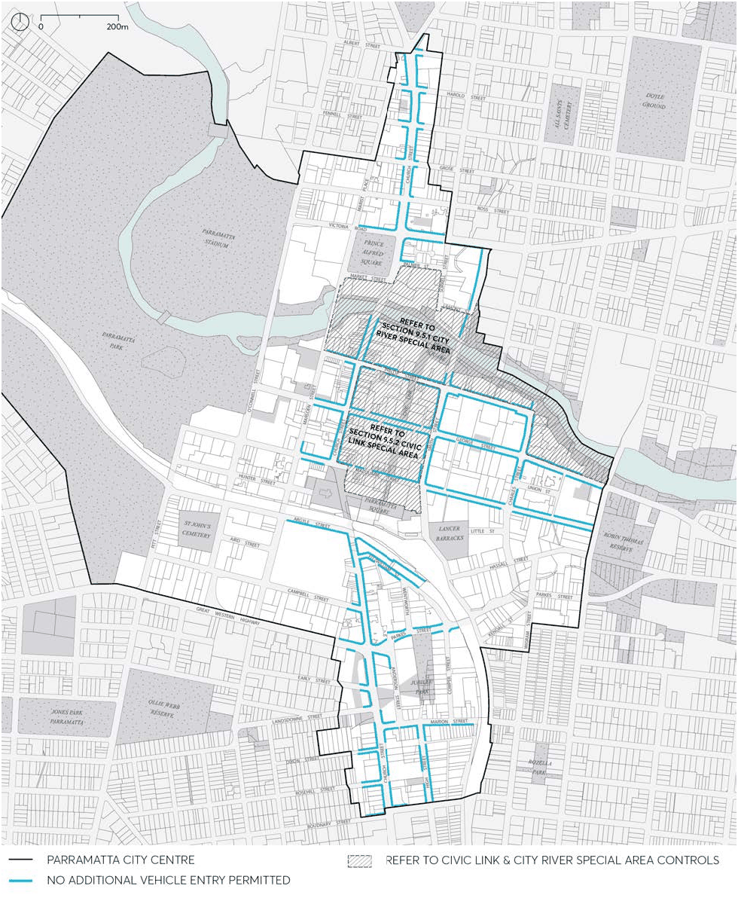

#### 9.4.6 VEHICLE FOOTPATH CROSSINGS

The design and location of vehicle access to developments should minimise conflicts between pedestrians and vehicles on footpaths, particularly along primarily pedestrian streets. Vehicle access should also be designed to minimise visual intrusion and disruption of the public domain. Porte-cocheres are not encouraged as they disrupt pedestrian movement, do not contribute to active street frontage, and provide no public benefit.

PUBLIC DOMAIN

Objectives

O.01 Provide a simple, legible, and direct pedestrian footway on all streets. O.02 Make vehicle access to buildings more compatible with pedestrian movements and the public domain.

O.03 Prioritise safe pedestrian movements within the public domain. O.04 Ensure vehicle entry points are integrated into the building design and contribute to high quality architecture and streetscapes.

O.05 Minimise the width of any vehicular footpath crossing. O.06 Ensure vehicle access to heritage items is not detrimental to the values, setting or context of that heritage place.

Controls

C.01 No additional vehicle entry points will be permitted into the parking or service areas of development along those streets identified as significant pedestrian circulation routes in Figure 9.4.6.1.

C.02 In all other areas, one vehicle access point only will generally be permitted, which is to include the access for service vehicles and parking for both residential and non-residential uses within mixed use developments.

C.03 Where practicable, vehicle access must be from lanes and minor streets rather than primary street fronts or streets with major pedestrian activity.

C.04 Vehicle slip lanes in public streets for private use are not permitted. C.05 Where practicable, adjoining buildings must share or amalgamate vehicular access points, basements and servicing facilities. Internal on-site signal equipment must be used to allow shared access. Wherever appropriate, new buildings must provide vehicle access points that can be shared at a later date.

C.06 Vehicle access ramps must be perpendicular to the street frontage to minimise the width of vehicle entry and exit openings.

C.07 Vehicle landings (for the length of one vehicle) must be flush with the public domain to maximise visual contact with oncoming pedestrians.

C.08 The design of vehicle access doors to vehicle access points must be fitted behind the building facade and be of materials that integrate with the design of the building and that contribute positively to the public domain.

C.09 Vehicle entries visible from the street when doors are open must have a high quality finish to walls and ceilings as well as a high standard of detailing. No service ducts or pipes are to be visible from the street.

C.10 Porte-cocheres may be permitted in exceptional circumstances for hotels and major tourist venues, subject to high quality urban design, streetscape, heritage and pedestrian safety and amenity considerations.

PUBLIC DOMAIN

C.11 If permitted, a porte-cochere must be internal to the building with one combined vehicle entry and exit point, or one entry and one exit point on two different street fronts of the development. In exceptional circumstances, for buildings with one street frontage only, an indented porte-cochere with separate entry and exit points across the footpath may be permitted.

C.12 A porte-cochere must be constructed level to the public domain.

> [Picture on page 61: a picture, saved as a picture (images/part-09-parramatta-city-centre-page-61-7.gif, 150 dpi).]

Figure 9.4.6.1 – No Additional Vehicle Entry Permitted

PUBLIC DOMAIN
