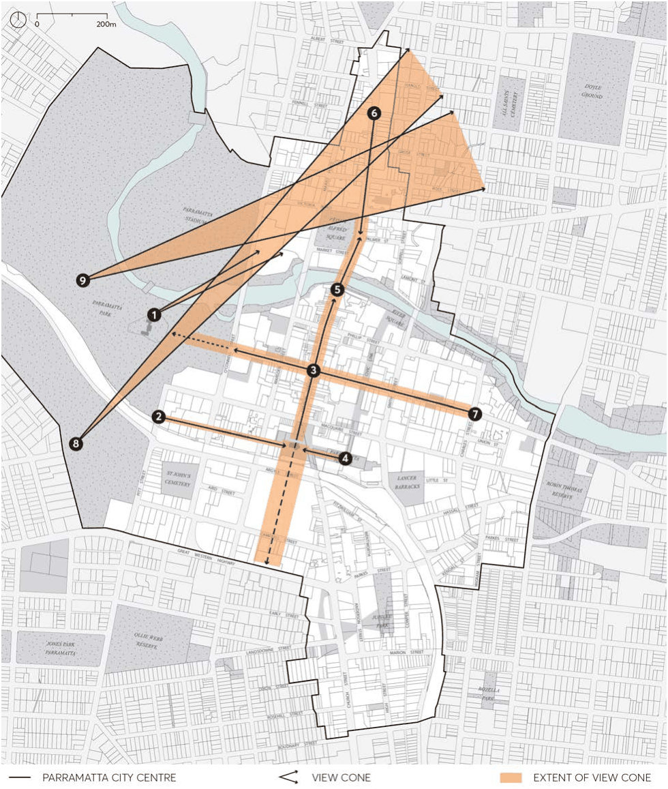

#### 9.4.7 VIEWS

Important views contribute to way finding and a sense of place and identity for the city. Views are shaped and informed by their surrounds. The physical setting of the Parramatta City Centre, generally framed by Parramatta Park, Parramatta River, and the heavy rail corridor makes for special views of the natural setting with significant heritage and cultural elements. It is important that significant views within, into and out of the city are maintained from as many points in the public domain as possible. Design that acknowledges the value of important views can protect and enhance these views, thereby contributing to the character and quality of the public domain.

The controls in this section apply to sites within the City Centre that are affected by view corridors illustrated in Figure 9.4.7.1.

Objectives

O.01 Reinforce the sense of place and way finding in the City Centre. O.02 Maintain and enhance views from the City Centre to significant heritage, natural features and significant trees.

O.03 Maintain and reinforce views along streets and to urban spaces. O.04 Maintain views of silhouettes of the tops of major buildings or structures as seen against the sky.

O.05 Encourage views from Parramatta City Centre to Parramatta River and to Parramatta Park.

Controls

C.01 Where a proposed development is within the corridor of the identified views in Figure 9.4.7.1 and Table 9.4.7.1, an analysis must demonstrate: The impact of the proposed development. How the view is maintained and reinforced by the proposal. How the view informed site planning, architectural form, finish, materials and detailing of the proposal.

PUBLIC DOMAIN

> [Picture on page 63: a picture, saved as a picture (images/part-09-parramatta-city-centre-page-63-2.gif, 150 dpi).]

Figure 9.4.7.1 – Historic Views to be protected

PUBLIC DOMAIN

Table 9.4.7.1 – Identified Historic Views to be protected

|  | Identified View | Significance |
|---|---|---|
| 1. | Old Government House view northeast to the river, Old King’s School building and site of former Government farm. | Key historic view demonstrating the relationship between the Governor, early Government farm and major school institution. Setting of both heritage items. |
| 2. | Views east along Hunter Street to St John’s Cathedral and spires, available back to Parramatta Regional Park. | Vistas along Hunter Street providing a framed view to St John’s Cathedral, across the cathedral grounds towards the Town Hall, and to the site of the Governor’s annual ‘feast’ with Aboriginal clans (instituted by Governor Macquarie) that took place at the rear (eastern end) of the Cathedral. |
| 3. | Views southwards to and beyond St John’s Cathedral and Centenary Square, and northwards along the procession of Church Street. | Historic main street approach to City Centre and St John’s Cathedral with other heritage items in view, as well as the procession and views from St John’s northwards, up Church Street. Views from Church Street towards St John's Cathedral must allow the silhouette of the Cathedral spires to be seen against the sky. |
| 4. | Views west along Parramatta Square to St John’s Cathedral, past the Town Hall. | Backdrop and setting of church. Views to the Cathedral and spires. |
| 5. | Views north and south along Church Street, including views of the Western Sydney Stadium and heritage buildings, St John’s Church spires to the south and St Peter’s church. | Historic main street and approach to city, framed by a number of heritage buildings and recurrent views to Parramatta Park. |
| 6. | Approach to Parramatta along Church Street from Fennell Street, and sequential views southward. | Historic main street and approach. Relatively consistent scale and setback of streetscape. |
| 7. | Views along George Street to Parramatta Park / George Street Gatehouse and trees. | Key historic street approach to the park and Old Government House. City edge of park, framing views to George Street Gatehouse, trees, and Old Government House (not now visible), views of streetscape, heritage items. |
| 8. | View from Marys Hill across Parramatta’s City Centre to distant hills. | Key historic viewing point from the highest part of the Parramatta Park with best views of the city in the river valley, glimpses to hills behind the city between buildings. |
| 9. | View from The Crescent to the distant hills Key historic viewing point from the ridge of The Crescent. | Key historic viewing point from the ridge of The Crescent to glimpses of distant hills between buildings. |

SPECIAL AREAS
