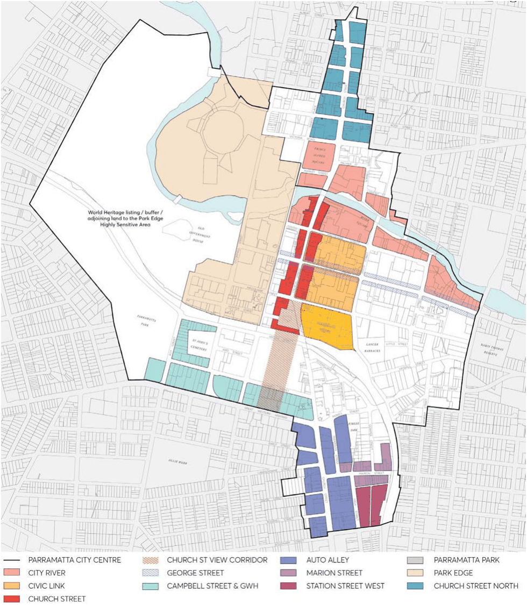

### 9.5 SPECIAL AREAS

Special Areas are defined precincts with distinctive conditions that require specific controls relating to the characteristics of the area.  Development within a Special Area must respond to the particular attributes and qualities of that place.

This Special Areas section should be read in conjunction with the other sections of the City Centre controls. Unless modified or specifically excluded in this section, all controls in Sections 9.1 - 9.4 and Sections 9.6 - 9.9 apply to development in Special Areas.

> [Picture on page 65: a picture, saved as a picture (images/part-09-parramatta-city-centre-page-65-9.gif, 150 dpi).]

Figure 9.5.1 – Parramatta City Centre Special Areas

SPECIAL AREAS
