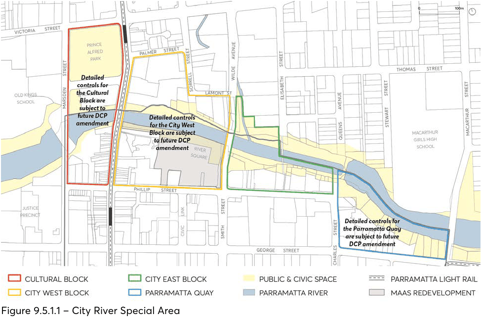

#### 9.5.1 CITY RIVER

The history of the Parramatta City Centre is interwoven with the River. The banks of the River have been inhabited by Aboriginal people for tens of thousands of years, providing fresh water, food and transport for the Dharug people and other Aboriginal clans that lived, met and sustained ongoing cultural practices along its course. The City River Special Area occurs at the place where the salt water of Sydney Harbour meets the freshwater extent of Lake Parramatta and continues to remain a culturally important place for Aboriginal people today.  Traces of this rich history and ongoing culture are evident in the Pleistocene sand sheet and Aboriginal Archaeology which occur along the banks of the river, underpinning and in many instances occurring side by side with the City’s European history and heritage. Within the bounds of the City Centre, the river itself is approximately 30 metres wide and is traversed by several vehicular and pedestrian bridges. This includes the heritage listed Lennox Bridge, first completed in 1839, which carries Church Street across the River as the main north-south street in the City Centre. Existing development on both sides of the river consists of low, medium, and large-scale buildings that vary in age, uses and ownership. A number of these buildings are of heritage significance which contribute to the character and the cultural importance of the precinct. The river frontage is edged with a mixture of buildings and green space. Pedestrian walkways are located along both sides of the river edge, however there are no public streets between the buildings and the water. On the north bank, street blocks generally run perpendicular to the river responding to the hilly topography and providing views to the river and southern shore. On the south bank, consistent with the historical access from the river along George Street, the street blocks run parallel to the river on the flat topography of the floodplain. Views to the northern shore from the public domain on this side are more limited. The City River Special Area controls aim to acknowledge the different design responses that are required for the north and south banks. A key unifying element within the City River Special Area is the River Square, which establishes a direct connection to Parramatta Square through Civic Link. The Riverside Theatre is located on the north bank between Marsden and Church Streets, and on the south bank the new Powerhouse Parramatta is to be located at the end of Civic Link. The City River Special Area also incorporates other important places such as the Charles Street Square adjacent to the Parramatta Wharf, and Prince Alfred Square – one of the oldest formalised civic spaces in New South Wales. The following controls are designed to refocus activities along the river and to ensure that future development addresses and defines the river space. Existing view corridors will be reinforced by the buildings and new view corridors and connections introduced. Pedestrian paths above the flood plain level will offer opportunities to engage with the river.

The City River Special Area has been divided into a series of distinctive blocks that are bound by the Parramatta River’s bridges as per Figure 9.5.1.1; the Cultural Block, the City West Block, the City East Block, and Parramatta Quay.

SPECIAL AREAS

> [Picture on page 67: a picture, saved as a picture (images/part-09-parramatta-city-centre-page-67-2.gif, 150 dpi).]

Figure 9.5.1.1 – City River Special Area

Objectives

O.01 Respectfully acknowledge, celebrate and express the ongoing cultural importance of the Parramatta River to Dharug and Aboriginal people.

O.02 Celebrate the unique Parramatta River landscape setting, views, and topography of the City Centre.

O.03 Ensure future development contributes to the activation of the river, strengthening the significance of the river to the City Centre.

O.04 Strengthen the visual and physical north-south connections between the city and the river. O.05 Maximise pedestrian connections at lower and upper levels of the river foreshore to ensure contiguous east-west movement is achieved.

O.06 Balance the needs of the natural and built environment, enhancing the Parramatta River as the major natural and cultural asset of the City Centre.

O.07 Maximise sun access to the foreshore and adjacent public open spaces. O.08 Enhance the interface between private and public land along the river, ensuring future development addresses the river and contributes to the overall quality, safety and amenity along the river foreshore.

O.09 Preserve the Parramatta River as a priority corridor for ecological protection, flood sensitive design and future landscape improvements.

O.10 Ensure flood response is integrated into the design of future development and appropriate escape routes above the floodplain is provided to ensure safety for the community.

SPECIAL AREAS

O.11 Frame the Parramatta River and its foreshore by providing consistent and defined building edge to the foreshore, with generous upper-level setbacks.

O.12 Achieve an appropriate consolidation pattern that allows the objectives of the City River Special Area to be integrated into development proposals.

O.13 Recognise the historical and contemporary importance of the precinct to the City’s identity through: Preservation of appropriate curtilage, surrounding scale and view corridors to heritage items. Contextually responsive design and adaptive reuse of heritage buildings. A curated collection of high quality, contemporary heritage interpretation and public art which enlivens the public domain.
