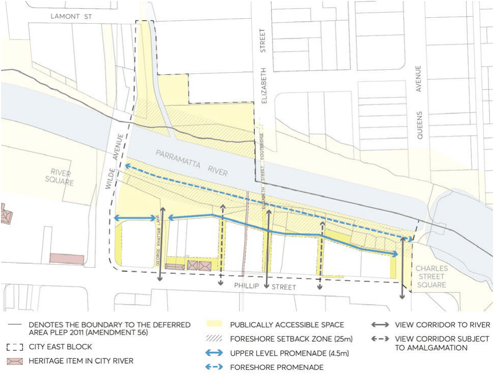
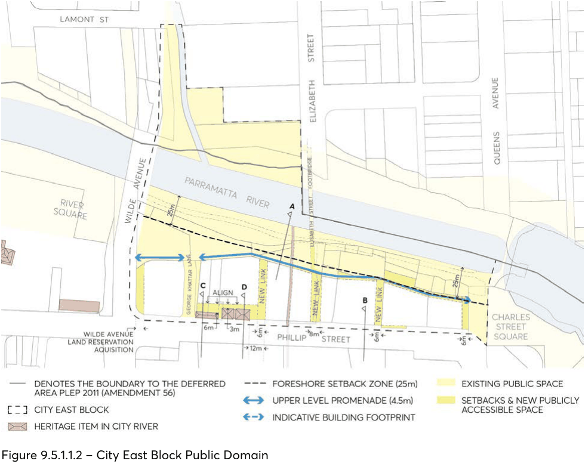
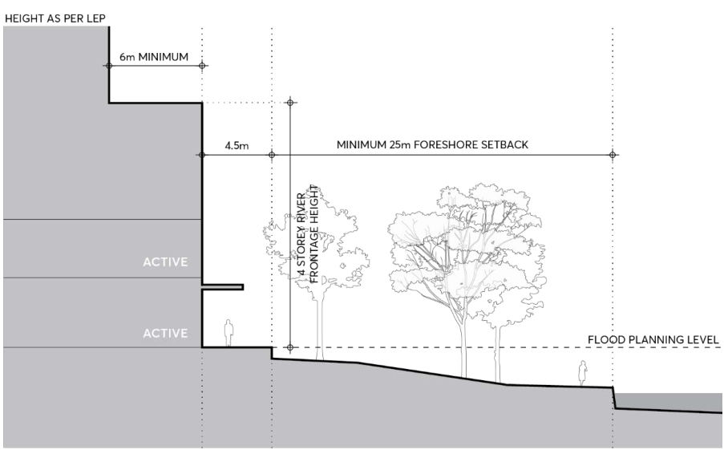
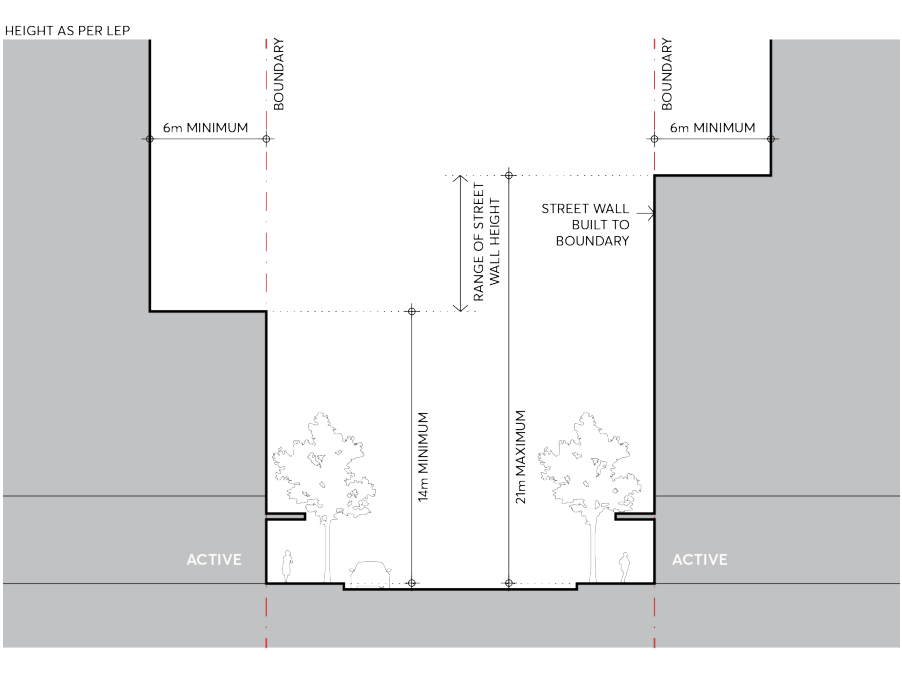
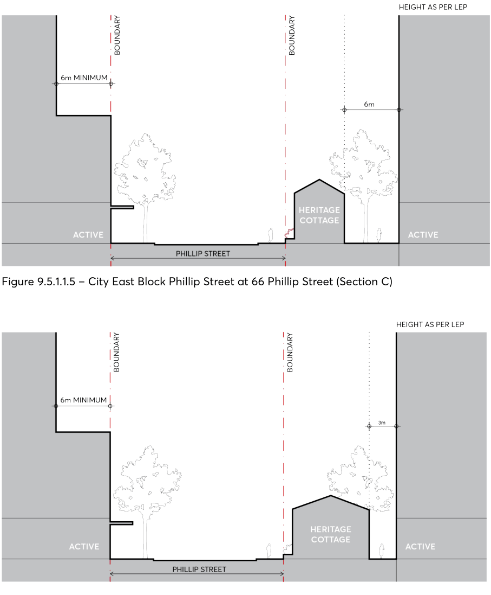

#### 9.5.1.2 CITY EAST BLOCK

The following controls apply to the City East Block within the City River Special Area. This block is bound by Wilde Avenue, Phillip Street, Charles Street Square, and the north bank river foreshore open space. On both sides of the river, a continuous foreshore promenade allows pedestrian and cyclist access along the water’s edge before the land slopes steeply up and away from the water. The north bank is more densely vegetated and characterised by 3- to 4- storey residential brick buildings that have been generously set back from the foreshore. The south bank commands a more urbanised character, and an existing mix of residential and non-residential uses address the river front. Brickfield Creek also joins the Parramatta River in this location, and the historically significant Convict Drain dating back to the 1820s passes through the south bank. A series of single storey cottages remain along Phillip Street, breaking up the street wall scale and are to be retained as local heritage items. The most significant opportunity in the City East Block is to enhance existing views, and establish new views, towards the River. A new upper level promenade is to be delivered by future development to allow a continuous and active edge to the River that would be fronted by cafés, restaurants, bars and other retail tenancies – all with views over the Parramatta River.

SPECIAL AREAS

> [Picture on page 69: a picture, saved as a picture (images/part-09-parramatta-city-centre-page-69-2.gif, 150 dpi).]

Figure 9.5.1.1.1 – City East Block Framework Plan

Objectives

O.01 Define a continuous foreshore space between the river edge and future building face to provide a system of connected and accessible open spaces, as well as natural flood storage capacity.

O.02 Frame views between buildings from Phillip Street to the river foreshore by maintaining and expanding view corridors along existing streets and laneways, and by creating new laneways.

O.03 Create a premier river frontage and address for the City Centre that accommodates activities during the day and night.

O.04 Delivers high quality architectural resolution when viewed along the river, from bridges and from across the river to the north.

O.05 Provide a safe egress route during flood events that connects between Charles Street Square and George Khattar Lane and along George Khattar to Phillip Street or to refuge within buildings.

O.06 Ensure any future development on the north bank that is located outside the City Centre and City River boundary acknowledges the significance of the river foreshore and responds to the objectives of the City River Special Area.

SPECIAL AREAS

> [Picture on page 70: a picture, saved as a picture (images/part-09-parramatta-city-centre-page-70-2.gif, 150 dpi).]

Figure 9.5.1.1.2 – City East Block Public Domain

Controls

Unless modified or specifically excluded below, all controls in Sections 9.1 to 9.4 and Sections 9.6 to 9.9 of this Part apply to development within the City River Special Area City East Block. C.01 Development must comply with Figure 9.5.1.1.2 and be setback a minimum of 25m from the river’s edge and/or align with the future alignment of the upper-level promenade.

C.02 Site consolidation must allow for the realisation of the objectives of the City River Special Area and desired publicly accessible through site links to be delivered as per Figure 9.5.1.1.2.

C.03 A new upper-level promenade along the river frontage of properties must comply with Figure 9.5.1.1.3. Development must provide a 4.5 metres wide open to sky pedestrian walkway above the flood planning level along the northern boundary that is shared with the river foreshore. The horizonal and vertical alignment of the promenade is to be determined in consultation with Council.

C.04 Street wall heights and setbacks along the river foreshore must comply with Figure 9.5.1.1.3 (Section A). Development on the south bank must provide a street wall height of 4-storeys along the foreshore, and towers must be set back 6 metres from the street wall.

C.05 Development must provide ground level building entries to lift lobbies and ground level retail or restaurant tenancies that are directly accessible from the upper-level promenade. Multiple

SPECIAL AREAS

storeys of non-residential uses on the river frontage are encouraged to increase activity along the foreshore edge.

C.06 An awning must be provided along the upper-level promenade for weather protection and outdoor dining must be located within the building footprint to provide space for unobstructed pedestrian travel as shown in Figure 9.5.1.1.3 (Section A).

C.07 Street walls facing the river must comply with the street wall controls in Section 9.3 – Built Form controls.

> [Picture on page 71: a picture, saved as a picture (images/part-09-parramatta-city-centre-page-71-9.gif, 150 dpi).]

Figure 9.5.1.1.3 – City East Block Typical River Frontage (Section A)

C.08 New through site links must be provided as per Figure 9.5.1.1.2. All new links must be open to sky, visually and physically connecting Phillip Street and the upper level promenade with extended views to the River corridor.

C.09 The existing laneway at Elizabeth Street bridge must be widened to 8 metres with clear site lines between the bridge and Phillip Street, as shown in Figure 9.5.1.1.2.

C.10 Development must prioritise locating car parking in basement structures to ensure active ground floor uses are provided along the river foreshore. Where basement car parking is considered inappropriate due to identified constraints such as archaeology or flooding, above ground car parking must be sleeved with active uses.

C.11 At 90-96 Phillip Street, noting the lot configuration and land commitments for public purposes, development must provide a minimum 3 metre tower setback along the Phillip Street and River foreshore frontage that addresses wind, solar access and design objectives.

C.12 At 60 Phillip Street, development must dedicate local road widening to Wilde Avenue as per the Land Reservation Acquisition Map in Parramatta LEP 2023.

SPECIAL AREAS

C.13 Street setbacks and street wall heights on Phillip Street must comply with Figure 9.5.1.1.4 (Section B). Unless the site contains a heritage item, the street wall must be built to the boundary, and towers must be set back a minimum of 6 metres from the street wall.

> [Picture on page 72: a picture, saved as a picture (images/part-09-parramatta-city-centre-page-72-5.gif, 150 dpi).]

Figure 9.5.1.1.4 – City East Block Phillip Street (Section B)

C.14 Development must provide a 6 metre setback to heritage cottages on the lot known as 66 Phillip Street as per Figure 9.5.1.1.5 (Section C), and a 3 metre setback to heritage cottages on the lot known as 70-74 Phillip Street as per Figure 9.5.1.1.6 (Section D).  An aligned building setback must be provided on the southern façade across the two properties as shown in Figure 9.5.1.1.2.

SPECIAL AREAS

> [Picture on page 73: a picture, saved as a picture (images/part-09-parramatta-city-centre-page-73-2.gif, 150 dpi).]

Figure 9.5.1.1.5 – City East Block Phillip Street at 66 Phillip Street (Section C)

Figure 9.5.1.1.6 – City East Block Phillip Street at 70-74 Phillip Street (Section D)

C.15 Heritage cottages must be adaptively re-used, allowing these items to contribute to an active streetscape character and maintain their significance.

C.16 Clear egress for emergency, maintenance, and event vehicles to access the foreshore must be provided from George Khattar Lane.

SPECIAL AREAS
