#### 9.5.2 CIVIC LINK

The Civic Link Special Area is located in the heart of the Parramatta City Centre. Central to the area is the Civic Link, a major new green, pedestrianised public space and cultural spine that connects Parramatta Square to the Parramatta River. Civic Link spans 4 city blocks, divided by Macquarie, George and Phillip Street as shown in Figure 9.5.2.1. In Block 1, the southern end of Civic Link is marked by the Leigh Memorial Church and the Town Hall. Civic Link connects directly to the Square and facilitates access to the existing bus and rail interchange and light rail stop. In Block 2, Civic Link is a new north-south public space extending from Macquarie Street along the widened and pedestrianised eastern Horwood Place. The future underground metro station and associated development replaces the existing Horwood Place Car Park.  Civic Link facilitates interchange between light rail, the metro station and the bus interchange on Smith Street.  A new square provides a new setting for Kia Ora and the Leigh Memorial Church.  The Roxy, a State listed heritage item, retains its use as a cultural landmark. In Block 3, Civic Link follows the existing alignment of Horwood Place. Erby Place Car Park is retained in the short to medium term and continues to serve the CBD.  Future site specific controls for the centre of the block, including the Erby Place Car park, aims to facilitate the long-term realisation of a new north-south street and east-west laneway, major commercial developments and the full pedestrianisation of Civic Link. In Block 4, Civic Link extends through the Parramatta Powerhouse site and connects physically and visually to the River Square and the River Foreshore.  Refer to Section 9.5.1 – City River for controls specific to this block. The following Special Area controls for the precinct describe the alignment of Civic Link and supporting new streets and laneways to enable large city-shaping infrastructure, development projects and incremental change across multiple land holdings.  New streets, laneways and squares increase pedestrian permeability and activity within the City Centre and enable access to transport and major cultural destinations.  Vehicle and service access to existing and future properties is provided with the conversion of Civic Link to pedestrian use. Lot consolidation supports new commercial towers. A diversity of building forms and defined street wall heights reinforce the human scale edge to Civic Link and celebrates the retention and adaptive re-use of heritage buildings.

SPECIAL AREAS

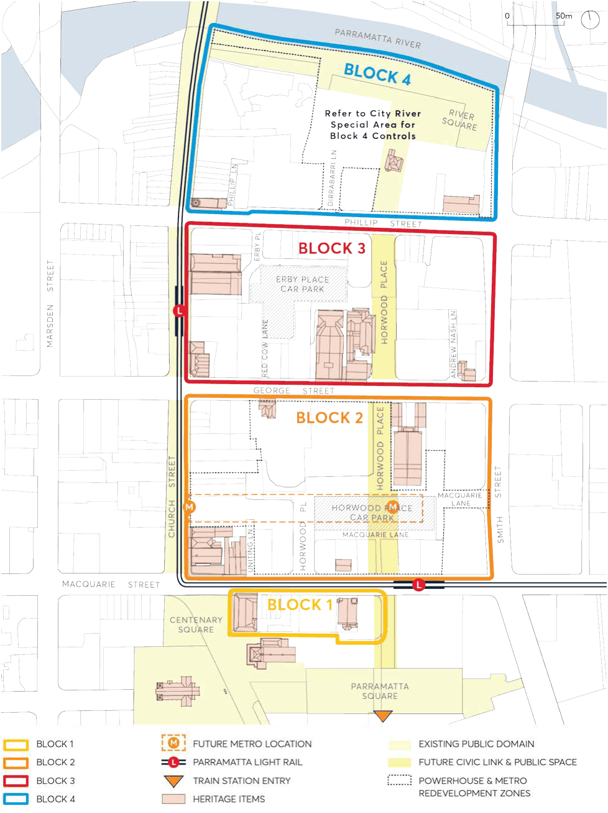

> [Picture on page 75: a picture, saved as a picture (images/part-09-parramatta-city-centre-page-75-2.gif, 150 dpi).]

Figure 9.5.2.1 – Civic Link Special Area Blocks with Existing Context

SPECIAL AREAS

Objectives

O.01 Establish Civic Link as a new linear public space, open to sky and with an avenue of significant trees along its length, linking Parramatta Square to the Parramatta Powerhouse and River foreshore.

O.02 Expand the street and laneway pattern within the block to prioritises pedestrian use and public and active transport choice, while also providing controlled vehicle and service access to existing properties and future developments.

O.03 Dedicate Civic Link, streets, laneways and squares to Council. O.04 Ensure development supports a pleasant microclimate during all times of the year by protecting sunlight to Civic Link during lunch hours, and by mitigating urban heat island and reducing wind impacts from large development within the area.

O.05 Frame view corridors along east-west streets and laneways toward Civic Link to reduce the perceived bulk of large commercial buildings.

O.06 Promote equitable, viable development that supports the commercial core of the CBD and enables staged development across development parcels over time.

O.07 Provide consolidated soil volume areas, stormwater management solutions, and underground utilities to facilitate a high-quality public domain. Structures under the public domain are not supported.

O.08 Reinforce the pedestrian scale of the public domain with architectural design that provides human scale detail and with ground and lower-level building uses and frontages that support activity across the day, night and week. Space for temporary and permanent cultural uses, events and incubator spaces within the area, and in particular along Civic Link is desirable.

O.09 Define building envelopes and street wall heights that assist in transitioning between large scale commercial buildings and retained heritage buildings.

O.10 Spatially and visually differentiate free standing heritage buildings, including Kia Ora and the Roxy, from surrounding new development.

O.11 Ensure the Roxy has a visual setting that allows it to be visually dominant in the immediate streetscape and not visually overwhelmed by new development.

O.12 Create a new square around Kia Ora within a public space and with a connected tree canopy as a backdrop, when viewed from Macquarie Street.

O.13 Create a new square to the east of Leigh Memorial Church that opens views to the church, expands pedestrian space and amenity adjacent the Parramatta Light Rail stop and define a generous threshold to Parramatta Square from Macquarie Street.

O.14 Facilitate legible and easy transport interchange for pedestrians and cyclist within the public domain between the new Metro station at Civic Link, buses on Smith Street, light rail stops at Church and Macquarie Streets and the existing bus and rail interchange.

O.15 Manage overland flow and stormwater to enable Civic Link’s use as an escape route from the river to higher ground in the south during flood events.

SPECIAL AREAS

Controls

Unless modified or specifically excluded below, all controls in Sections 9.1 – 9.4 and Sections 9.6 – 9.9 of the City Centre controls apply to development within the Civic Link Special Area. C.01 The alignment and width of Civic Link must comply with Figure 9.5.2.4 and must be open to sky without building encroachments or overhangs, with the exception of required awnings, along the full length of Blocks 1, 2 and 3. In Block 1, Civic Link must have a minimum 20 metres width with 17 metres wide clear to sky building separation as indicated on Figure 9.5.2.3. In Block 2, Civic Link must have a minimum width of 27 metres between Macquarie Street and Macquarie Lane, as indicated on Figure 9.5.2.3, with the exception of control C.0.6 (g) for a Metro Station. In Block 2, Civic Link must have a minimum width of 20 metres between Macquarie Lane and George Street, measured from the western site boundary of the Roxy as indicated on Figure 9.5.2.2 (Section D).

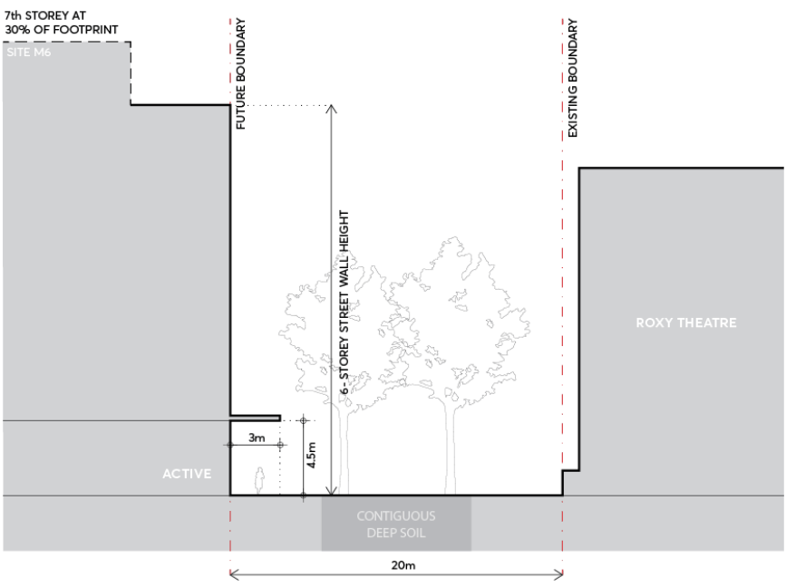

> [Picture on page 77: a picture, saved as a picture (images/part-09-parramatta-city-centre-page-77-16.gif, 150 dpi).]

Figure 9.5.2.2 – Future Civic Link in Block 2 (Section D) Setback & Building Height

In Block 3, Civic Link must follow the existing street reserve except on the eastern side where the predominant alignment at 1 and 3 Horwood Place (Sites 09 and 10) must be adopted as indicated on Figure 9.5.2.5.

SPECIAL AREAS

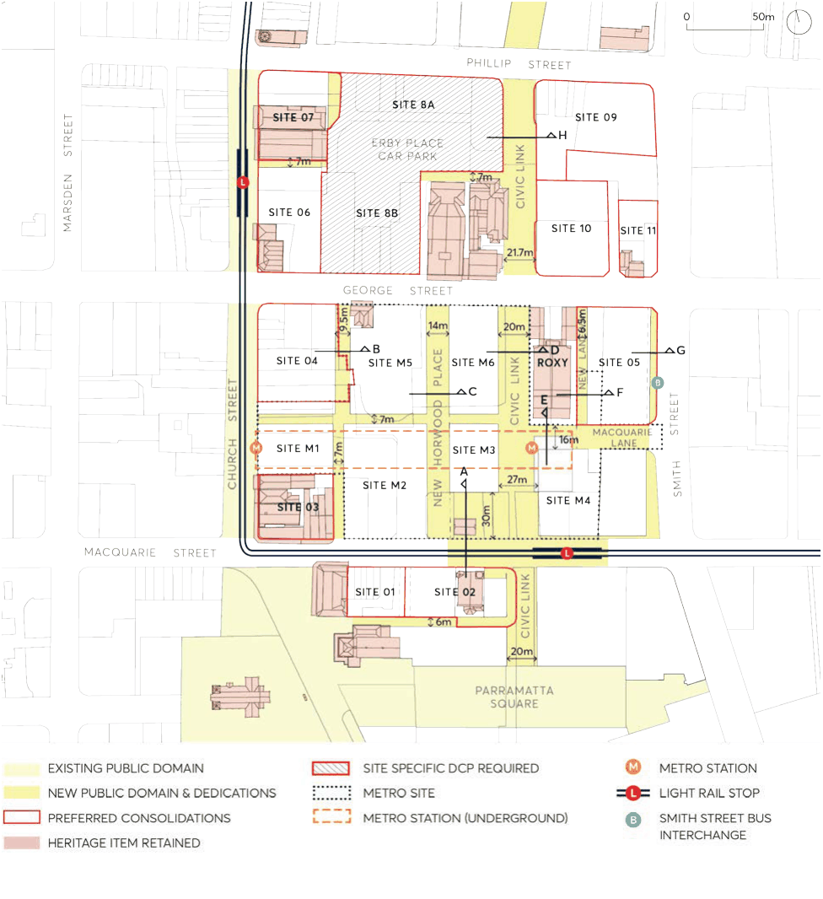

> [Picture on page 78: a picture, saved as a picture (images/part-09-parramatta-city-centre-page-78-2.gif, 150 dpi).]

Figure 9.5.2.3 – Civic Link Special Area Public Domain & Consolidation

C.02 Site consolidation must comply with Figure 9.5.2.3 to realise the objectives of the Civic Link Special Area. Where sites do not amalgamate as shown, buildings must comply with building separation, side and rear setback controls in Section 9.3 of the City Centre controls, including where an alternate amalgamation option for Site 05 is proposed that is exclusive of the Metro land.

C.03 Streets, lanes and open spaces as indicated on Figure 9.5.2.4 must be delivered through development or dedicated to Council for delivery in a coordinated manner.

C.04 New development and additions or alterations must not cause overshadowing of the pedestrian areas (Civic Link and squares and lanes) beyond the allowable building envelopes defined by the permissible FSR and building height in the LEP and the setbacks in this section.

SPECIAL AREAS

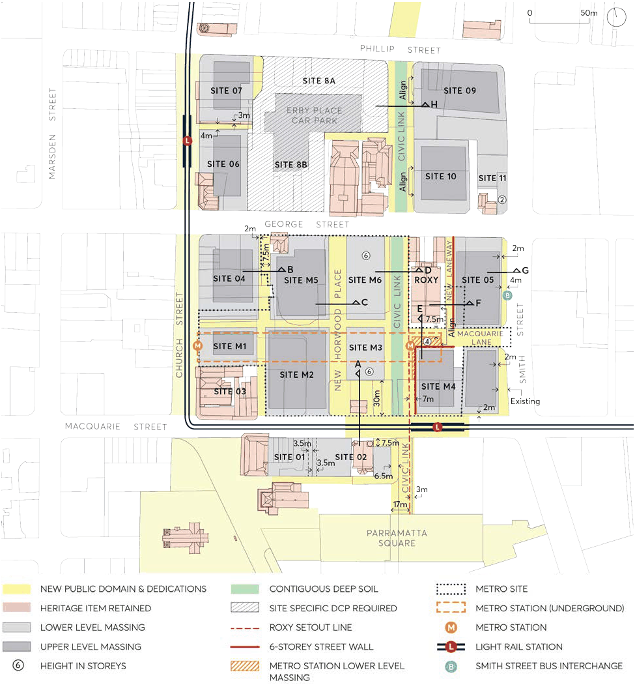

> [Picture on page 79: a picture, saved as a picture (images/part-09-parramatta-city-centre-page-79-2.gif, 150 dpi).]

Figure 9.5.2.4 – Civic Link Streets and Public Spaces

SPECIAL AREAS

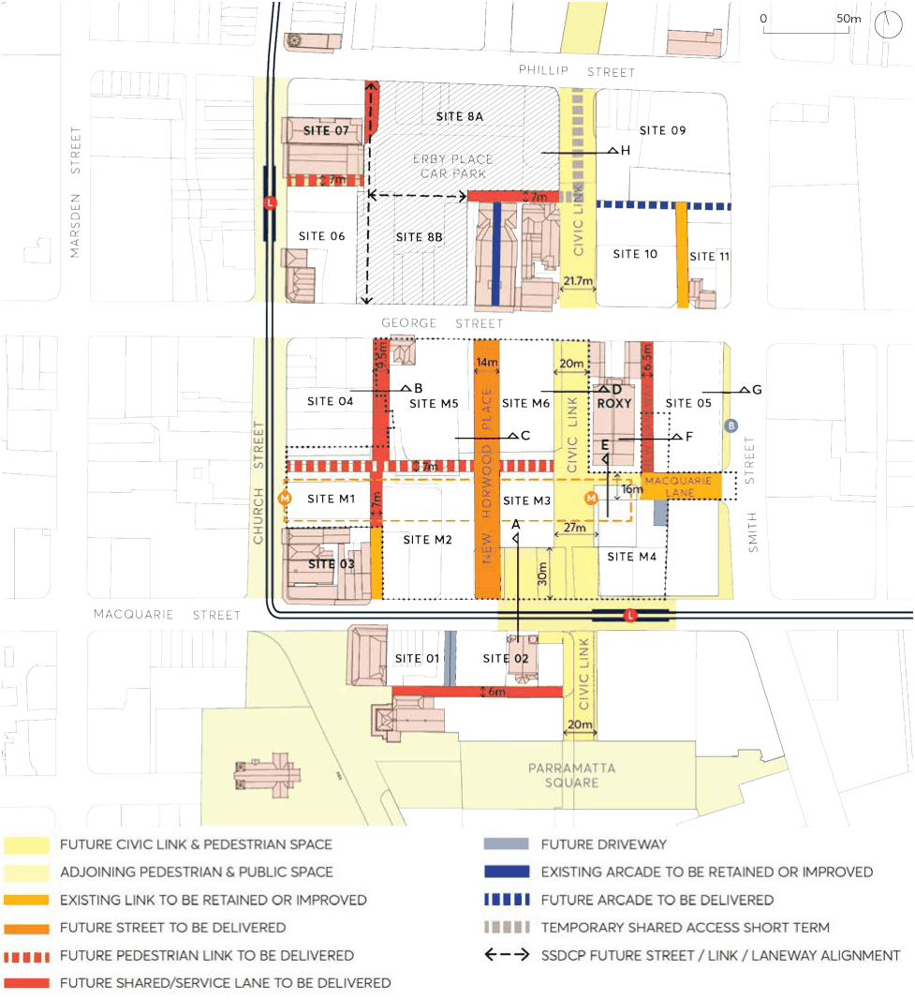

> [Picture on page 80: a picture, saved as a picture (images/part-09-parramatta-city-centre-page-80-2.gif, 150 dpi).]

Figure 9.5.2.5 – Civic Link Setbacks and Indicative Built Form

C.05 Development within Block 1 must comply with the following specified envelope controls: Along Civic Link, a 4 storey/22 metre street wall height with an upper-level setback of 6 metres must be provided. Along the south side of Macquarie Street west of the Leigh Memorial Church, buildings must follow the street alignment and be built to the boundary. At 97 and 99 Macquarie Street, development must provide a 2 storey high, 3.5 metres wide service accessway on each property along the common boundary to create a combined 7 metres shared service access way across both properties.

SPECIAL AREAS

At 119 Macquarie Street, development must provide a minimum 7.5 metres setback to Macquarie Street in alignment with the southern edge of the Leigh Memorial Church; a minimum 6.5 metres setback along Civic Link to achieve a minimum 20 metres public domain corridor; and a minimum 6 metres setback from the southern boundary of 119 to achieve a laneway for vehicle and service access.

C.06 Development within Block 2 must comply with the following specified envelope controls: Along the western edge of Civic Link and eastern edge of New Horwood Place in Block 2 (Sites M3 and M6), buildings must be a maximum of 6 storeys with an additional storey setback a minimum 6 metres with a maximum 30% footprint of the floor below to enable lift core, services and restaurant/ café uses.  Landscape gardens on the remaining roof space is encouraged. Along George Street, a street wall of 6 storeys must be provided at Site 05 and Site M6 with a 12 metres upper level setback to storeys above the street wall. Street walls facing the Roxy at Site 05 western façade, Site M4 northern and western façade, Site M3 eastern façade and Site M6 eastern façade must be 6 storeys high (refer to Figure 9.5.2.6) and designed with a restrained architectural expression with the following:

• a regular form;

• a regular pattern of openings;

• a limited materials, finishes and colour palette, and without strong contrasts;

• a horizontal top to the street wall without any stepping;

• limited decorative details;

• signage limited to the ground floor;

• concealed services;

• discreet night time illumination.

SPECIAL AREAS

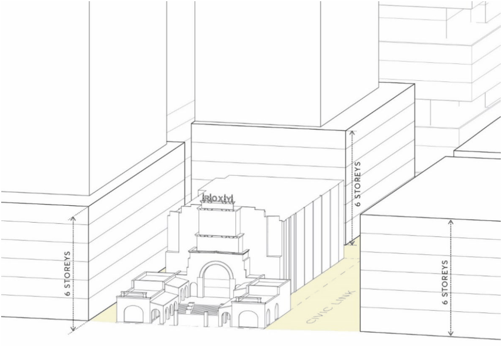

> [Picture on page 82: a picture, saved as a picture (images/part-09-parramatta-city-centre-page-82-2.gif, 150 dpi).]

Figure 9.5.2.6 – Street Wall Heights next to the Roxy

Setback new development 30 metres from Macquarie Street to the north of Kia Ora between Civic Link and New Horwood Place as per Figure 9.5.2.7 (Section A).

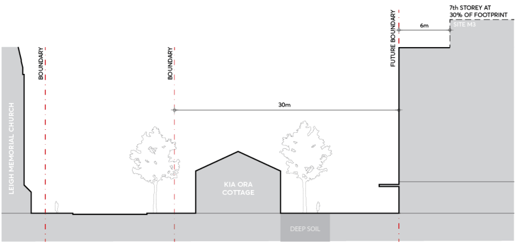

> [Picture on page 82: a picture, saved as a picture (images/part-09-parramatta-city-centre-page-82-6.gif, 150 dpi).]

Figure 9.5.2.7 – Kia Ora Interface (Section A) Setback & Building Height

Street setbacks and street wall heights on the New Horwood Place must comply with Figure 9.5.2.8 (Section C). Development on the western edge of Horwood Place must provide a street wall built to the future boundary, and minimum 3 metre upper-level setback. Development on the eastern edge of Horwood Place must provide a 6-storey street wall height built to the future boundary, and 6 metre upper-level setback.

SPECIAL AREAS

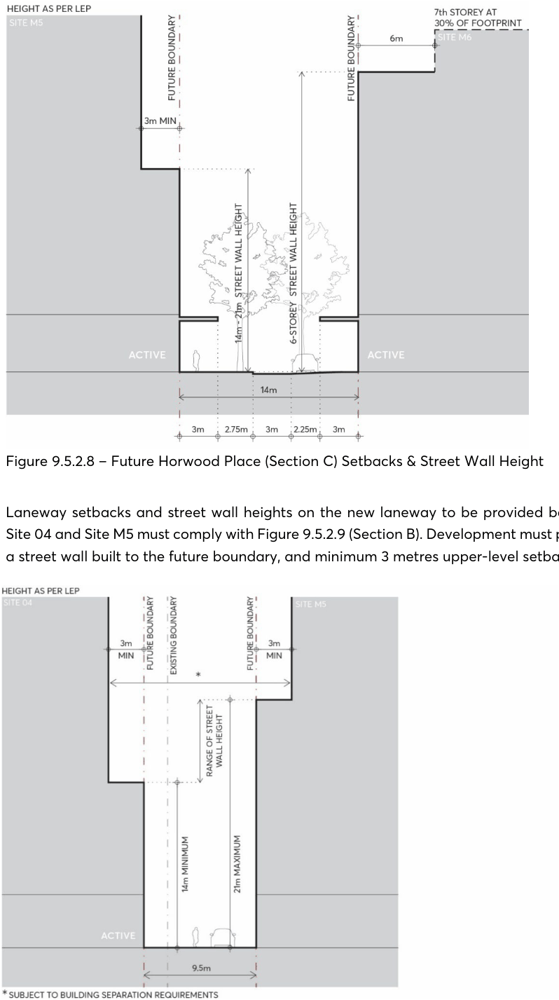

> [Picture on page 83: a picture, saved as a picture (images/part-09-parramatta-city-centre-page-83-2.gif, 150 dpi).]

Figure 9.5.2.8 – Future Horwood Place (Section C) Setbacks & Street Wall Height

Laneway setbacks and street wall heights on the new laneway to be provided between Site 04 and Site M5 must comply with Figure 9.5.2.9 (Section B). Development must provide a street wall built to the future boundary, and minimum 3 metres upper-level setback.

SPECIAL AREAS

Figure 9.5.2.9 – New Laneway between Site 04 and Site M5 (Section B) Setbacks & Street Wall Height

Laneway setbacks and street wall heights on Macquarie Lane must comply with Figure

9.5.2.10 (Section E). Development on the southern edge of Macquarie Lane must provide a building setback of 16 metres from the existing boundary of the Roxy to a 6 storey street wall with a 3 metres upper level setback to the tower. A maximum 4 storey Metro station structure may project into the 16m Macquarie Lane alignment with a separation of 7.5 metres for an open to sky pedestrian laneway between the Roxy and any station structure. The envelope, shown hatched in Figure 9.5.2.5 must align with the Roxy east and western wall and be below the height of the Roxy’s roof at the rear theatre volume.

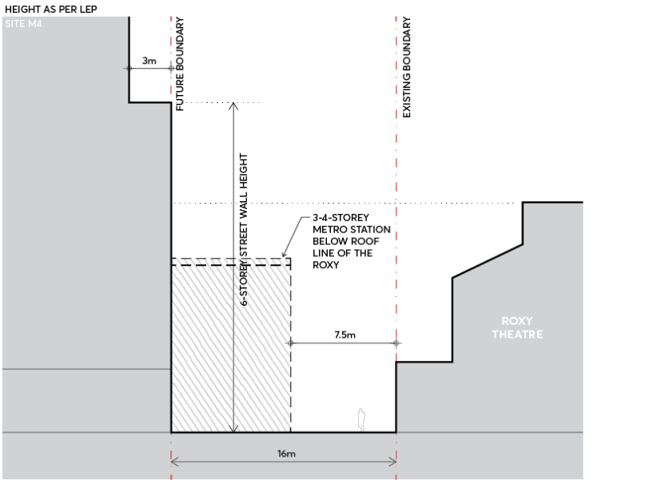

> [Picture on page 84: a picture, saved as a picture (images/part-09-parramatta-city-centre-page-84-12.gif, 150 dpi).]

Figure 9.5.2.10 – Macquarie Lane (Section E) Setbacks & Street Wall Height

At Site 05 street setbacks and street wall heights on Smith Street between George Street and Macquarie Lane must comply with Figure 9.5.2.5 and Figure 9.5.2.11 (Section G). Development must provide a 4 metre dedication for road widening to enable a pedestrian footpath; a 2 metres ground floor setback for use as additional pedestrian footpath; a maximum 8 storey street wall and a minimum 2 metres upper-level setback to the tower.

SPECIAL AREAS

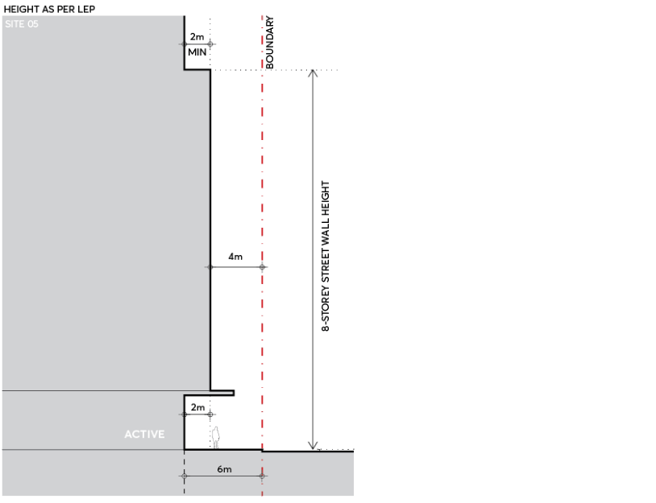

> [Picture on page 85: a picture, saved as a picture (images/part-09-parramatta-city-centre-page-85-2.gif, 150 dpi).]

Figure 9.5.2.11 – 75 George Street at Smith Street (Section G) Setbacks & Street Wall Height

Laneway setbacks and street wall heights on the new laneway to be provided between the Roxy and Site M5 must comply with Figure 9.5.2.12 (Section F). Development must setback

6.5 metres from the existing Roxy boundary, and minimum 3 metres upper level setback. Basement car park, service and loading entry and exit portals must be located on the New Laneway for Site 05 and are not supported on street frontages along George and Smith Street. Site access and traffic measures to properties within Block 2, including The Roxy and Site 05, must prioritise safe, pedestrian circulation and interchange between Smith Street bus corridor stops and the Metro station.

SPECIAL AREAS

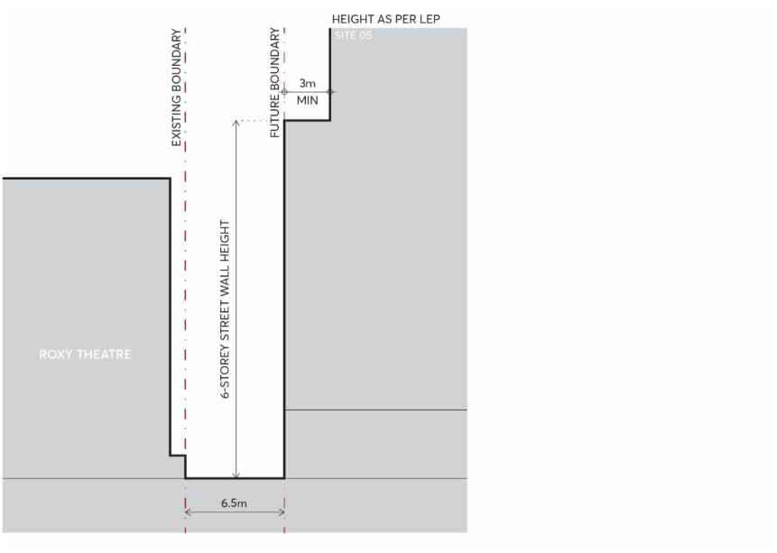

> [Picture on page 86: a picture, saved as a picture (images/part-09-parramatta-city-centre-page-86-2.gif, 150 dpi).]

Figure 9.5.2.12 – New Laneway between the Roxy and Site 05 (Section F)

C.07 Development within Block 3 must comply with the following specified envelope controls: Along Civic Link, where street wall and tower buildings are proposed, a 3-5 storey/14-21 metre street wall height with an upper-level setback of 6 metres must be provided as indicated on Figure 9.5.2.13 (Section H)

SPECIAL AREAS

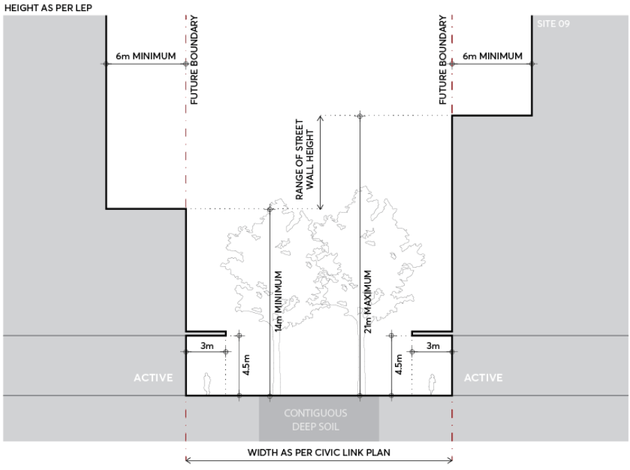

> [Picture on page 87: a picture, saved as a picture (images/part-09-parramatta-city-centre-page-87-2.gif, 150 dpi).]

Figure 9.5.2.13 – Future Civic Link in Block 3 (Section H) Setback & Building Height

C.08 A site specific DCP (SSDCP) must be prepared for the hatched area between George and Phillip Streets as indicated on Figure 9.5.2.4 to provide the following:

a) A new north-south share lane or street that provides vehicle access to properties within the SSDCP area and along Church Street.

b) A new east-west pedestrian link or shared lane linking Civic Link to Church Street and the light rail stop.

c) Consolidated development footprints with address to Phillip Street or George Street and that enable CBD commercial towers, public carparking and/or cultural facilities.

d) A new square of 1000 sqm with direct frontage to Phillip Street.

C.09 Along Civic link, development must provide continuous awnings with a clearance of 4.5 metres and a depth of 3 metres for all new buildings.

C.10 Basement car park, service and loading entry and exit portals must be located on laneways or secondary streets and not on street frontages along Macquarie Street, George Street, Phillip Street and Smith Street, and along frontages to Civic Link.

C.11 On-grade parking within private land is prohibited. All car parking within buildings must be concealed from the public realm or located in basements beneath the building footprint.

C.12 Underground car parking must not extend under Civic Link, streets, laneways and public spaces. Structures underground may be considered, where limited in width and used only for the

SPECIAL AREAS

underground metro station, basement associated with transport infrastructure operations, and for vehicle circulation between basements located under buildings. This is subject to demonstrated achievement of the following public domain outcomes: contiguous soil volumes within the extents shown in Figure 9.5.2.5 and with a minimum 1.8 metres set down including drainage layers and a minimum 1 metre of soil, and excluding slab structures, utilities which are accessible from above ground.  Suspended utilities within basements are prohibited, water sensitive urban design swales and garden beds flush and/or below pavement level, and adequate building structure and public domain fixtures to support large trees and vehicle loads for service and emergency vehicles.

C.13 Public domain fixtures and finishes must comply with Parramatta Public Domain Guidelines and Technical Standards.

C.14 Emergency fire access, stabiliser and vehicle passing requirements must be confirmed at concept design stage or pre-DA equivalent.

C.15 Overland flow waters must be diverted away from the Civic Link. C.16 Developments must seek to adaptively re-use heritage buildings within the Special Area for community facilities, entertainment uses and cultural uses.

C.17 Along Civic Link development must include direct access to ground floor and first floor tenancies with commercial lobbies primarily accessed from Macquarie, Smith, George and Church and New Horwood Place.

C.18 Walls between tenancies on ground and first floors in buildings along Civic Link must be non-load bearing to enable flexibility in tenancy shape and area over time.

C.19 Buildings along Civic Link must be designed with appropriate acoustic amenity for a live music and event environment.
