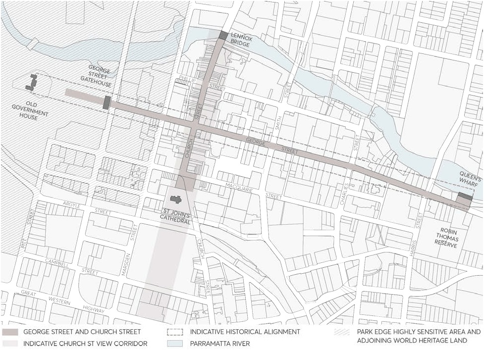
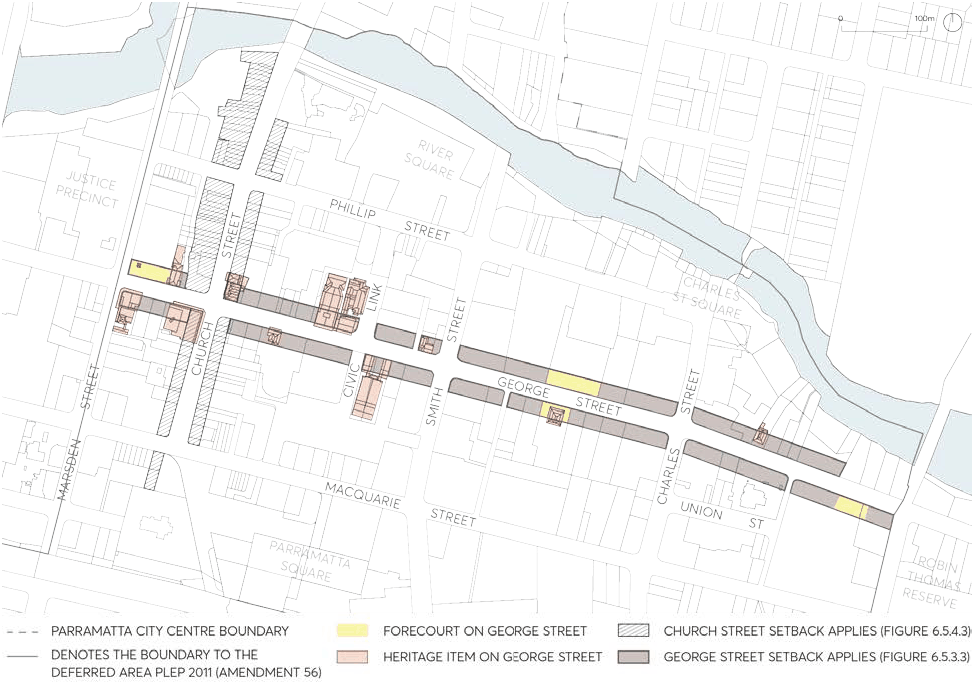
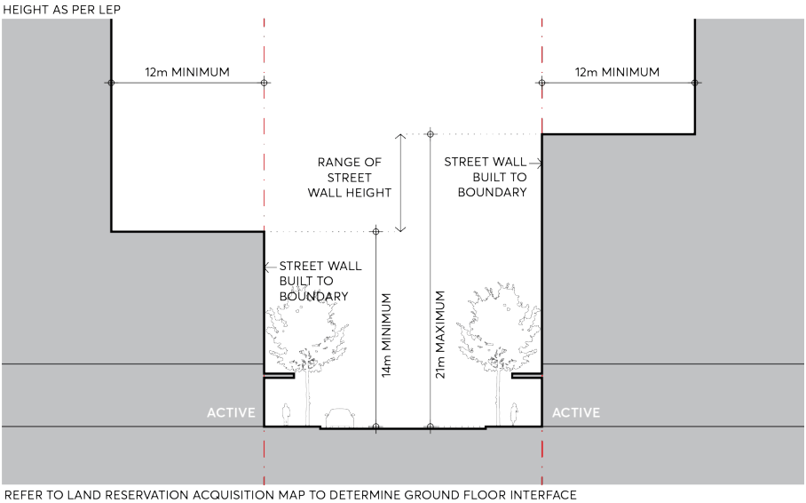

#### 9.5.3 GEORGE STREET

The Colonial township of Parramatta was planned in 1790, and its main street (George Street, formerly High Street) was Sydney’s first formalised street. Originally planned at 200 feet (60 metres) wide, spanning east-west from Government House to the public wharf, George Street was one of the primary axes in Parramatta’s original Georgian Town Plan. To accommodate a rapidly growing population, the second stage of Parramatta’s planning occurred in 1811, when George Street was resized to its present 20 metres width. Today, George Street still holds significant historic value, starting at the Tudor Gates entrance to Parramatta Park, crossing a range of areas in the City Centre including the Justice Precinct, Church Street, the future civic link, and terminating with parklands at either end. There is an existing architectural character along George Street as an outcome of remnant heritage items set among the more recent urban and commercial development. Generally, these items date from the nineteenth and early twentieth centuries, representative of a variety of colonial and

SPECIAL AREAS

Victorian architectural styles such as Harrisford House and Perth House. Significant inter-war redevelopment is also represented by noted buildings such as the Roxy, the former Rural Bank building and the Civic Arcade. The tower setback control for George Street correlates with the 12 metres Height of Building limit on Church Street, emphasizing George Street and Church Street as the primary east-west and north-south streets in the City Centre, refer Figure 9.5.3.1. The tower setback control for George Street assists in preserving the spatial significance of its axis, as well as maintaining views to Parramatta Park, specifically the Tudor gates which terminate views to the west.

> [Picture on page 89: a picture, saved as a picture (images/part-09-parramatta-city-centre-page-89-10.gif, 150 dpi).]

Figure 9.5.3.1 – George Street and Church Street View Corridor

Objectives

O.01 Strengthen the framing of George Street by providing a consistent street wall alignment and generous upper level setbacks. Allow views and vistas to reinforce the civic significance of George Street, defining and framing the view east from the George Street Gatehouse and west toward the George Street Gatehouse.

O.02 Ensure the protection and interpretation of Parramatta’s significant heritage setting and recognise the UNSCO importance the original direct line of George Street (formally High Street) connecting Old Government House and Queens Wharf as a nationally significant cultural landscape.

O.03 Conserve heritage frontages to the highest standard and preserve existing fine grain activation. Maintain all existing open spaces, forecourts or associated curtilage collocated with heritage

SPECIAL AREAS

items along George Street and support the revitalisation of individual squares through upgrades to public domain and canopy planting.

> [Picture on page 90: a picture, saved as a picture (images/part-09-parramatta-city-centre-page-90-4.gif, 150 dpi).]

Figure 9.5.3.2 – George Street Special Area Framework Plan

Controls

Unless modified or specifically excluded below, all controls in Sections 9.1 - 9.4 and Sections 9.6 - 9.9 of the City Centre controls apply to development within the George Street Special Area. C.01 The street wall must be built to the street boundary a minimum of 14 metres and a maximum of 21 metres above the footpath level as per Figure 9.5.3.3. Where identified, a dedication for future footpath widening and cycleway is to be provided at ground, consistent with the Land Acquisition Reservation Map.

C.02 Where identified in Figure 9.5.3.2 towers above the street wall must be set back a minimum of 12 metres from the street boundary, as per Figure 9.5.3.3, reinforcing the historical significance, views, alignment, and status of the street.

SPECIAL AREAS

> [Picture on page 91: a picture, saved as a picture (images/part-09-parramatta-city-centre-page-91-2.gif, 150 dpi).]

Figure 9.5.3.3 – George Street - Street Setbacks and Street Wall Height

C.03 Building alignments and setbacks should respond to important elements of the nearby context including existing forecourts and heritage buildings. In some places, this may require greater setbacks or lower street wall heights than those specified in Figure 9.5.3.3.

C.04 Retain forecourts of heritage items which interpret the historic alignment of George Street, including Perth House, Brislington, and the Roxy Theatre.

C.05 Adaptively re-use and integrate heritage buildings as part of site development strategies, allowing these items to contribute to an active streetscape character and maintain their significance.

C.06 Refer to Section 9.5.2 – Civic Link Special Area for requirements relating to developments adjoining the Civic Link Special Area. Where there is a conflict between the George Street controls and Civic Link controls, the Civic Link controls will prevail.

C.07 Refer to Section 9.5.10 – Park Edge Highly Sensitive Area for requirements relating to developments on George Street between Parramatta Park and Marsden Street that fall within the Old Government House and Domain UNSCO heritage protection area.

SPECIAL AREAS
