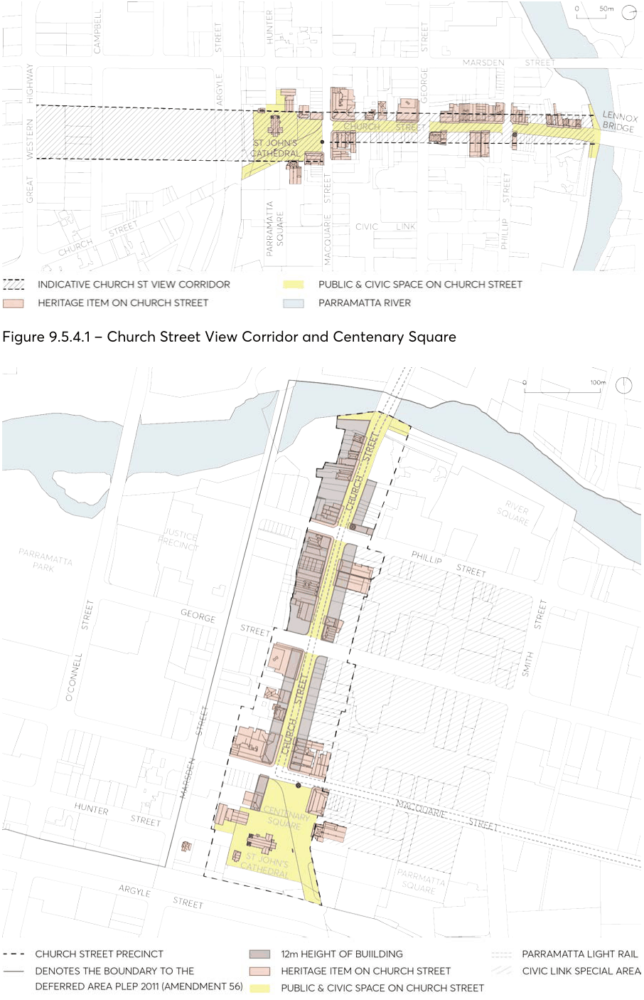
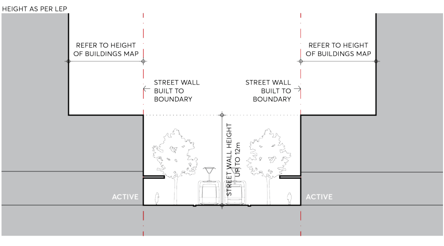

#### 9.5.4 CHURCH STREET

The Church Street Special Area is located between Lennox bridge to the north and the civic spaces at Centenary Square and St John’s Cathedral to the south. Part of the original colonial town layout, Church Street today is the most active street in the city. Development must take care not to erode its evolved character, its vitality, grain and scale. Church Street forms the historic north-south spine of the city, and George Street, although different in character, is its east-west equivalent. Refer Figure 9.5.3.1. Surviving views and vistas of St John’s Cathedral have state historical significance. These include: east along Hunter Street to the Cathedral towers; east from Hunter Street across the northern Cathedral grounds towards the Town Hall and the site of the Governor's annual 'feast' with Aboriginal clans (instituted by Governor Macquarie) that took place at the rear (eastern end) of the Cathedral, and views from Church Street towards St John's Cathedral. A consistent maximum building height along the entire axis of Church Street up to the Cathedral is applied to help preserve these views. The view corridor widens south of Macquarie Street to capture the spatial scale of Centenary Square and the grounds to St John’s Cathedral. The most enduring and arguably most important civic space in Parramatta City Centre, the built elements that provide curtilage to this space must provide a sense of enclosure that is appropriately scaled. As Church Street transforms with the development of the City Centre, its special identity must be retained and reinforced. Development must respond to and incorporate its fine grain, human scale, and active pedestrian character.

Objectives

O.01 Preserve the Church Street view corridor identified in Figure 9.5.4.1 to elevate the spatial significance of Church Street and views to St John’s Cathedral, protecting the silhouette of the St John’s Cathedral spires as seen against the sky from Church Street as well as the procession and views from St John’s Cathedral northwards, up Church Street.

O.02 Strengthen the framing of Church Street by providing a consistent street wall alignment and consistent building height limit as required by the Height of Buildings Map in Parramatta LEP 2023 and Figure 9.5.4.2. Allow views and vistas to reinforce Church Street’s civic significance, defining and framing the view south from the River towards St John’s Cathedral.

O.03 Preserve the low rise setting of Centenary Square created by the existing 2 to 3 storey heritage items that flank it as shown in Figure 9.5.4.2 to protect the heritage relationship between these buildings and their unique framing of Centenary Square.

O.04 Adaptively re-use heritage to foster the continuation of a fine grain character for Church Street. The street wall and ground floor design of development proposals must incorporate the active, fine grain subdivision pattern of Church Street, enabling sensitive urban infill that also compliments the remnant heritage along the street corridor.

O.05 Strengthen and support the distinct outdoor dining character of Church Street, reinforcing its unofficial identity as Parramatta’s ‘Eat Street’.

SPECIAL AREAS

> [Picture on page 93: a picture, saved as a picture (images/part-09-parramatta-city-centre-page-93-2.gif, 150 dpi).]

Figure 9.5.4.1 – Church Street View Corridor and Centenary Square

Figure 9.5.4.2 – Church Street and Centenary Square Framework Plan

SPECIAL AREAS

Controls

Unless modified or specifically excluded below, all controls in Sections 9.1 - 9.4 and Sections 9.6 - 9.9 of the City Centre controls apply to development within the Church Street Special Area. C.01 Street wall heights and street setbacks must comply with Figure 9.5.4.3. The street wall must be built to the street boundary and are encouraged to be at or close to the 12 metres in height. Towers above the street wall must be set back in accordance with the Height of Buildings Map in the Parramatta LEP 2023.

> [Picture on page 94: a picture, saved as a picture (images/part-09-parramatta-city-centre-page-94-9.gif, 150 dpi).]

Figure 9.5.4.3 – Church Street - Street Setbacks and Street Wall Height

C.02 Tower development is prohibited within the Church Street view corridor, as indicated in Figure 9.5.4.1, to preserve views down Church Street and the silhouette of St John’s Cathedral seen against the sky, reinforced by the Height of Buildings Map in Parramatta LEP 2023.

C.03 Fine grain tenancies must be designed at the ground floor along Church Street, allowing for maximum 6 metres wide tenancies. All retail tenancies fronting Church Street must have primary entrances addressing Church Street.

C.04 Refer to and comply with City of Parramatta’s ‘Church Street Colour Scheme Volumes 1 and 2’.

SPECIAL AREAS
