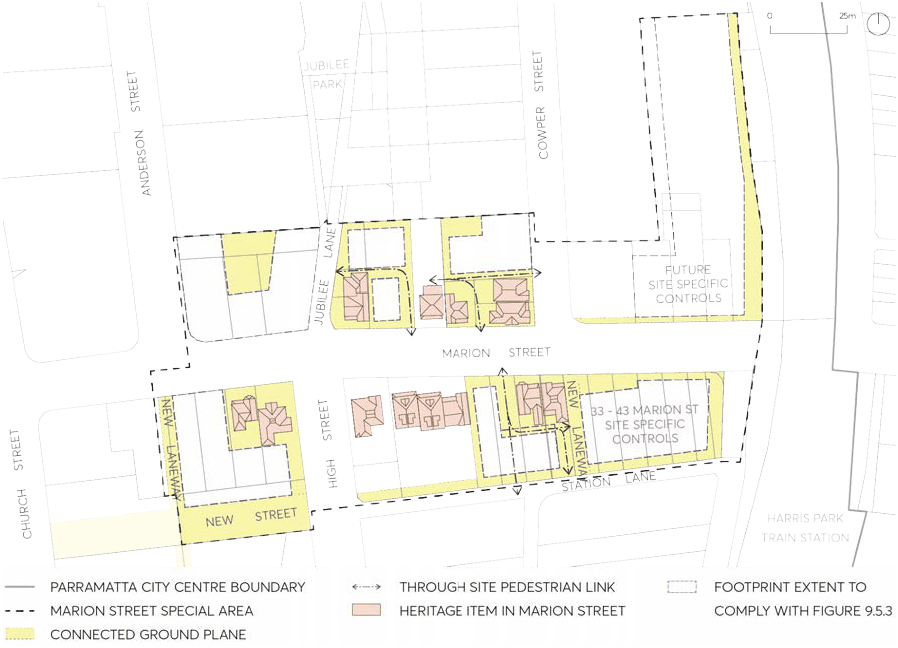
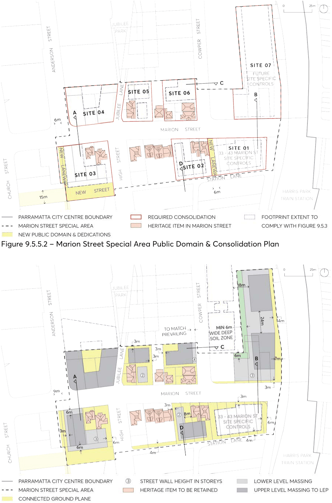
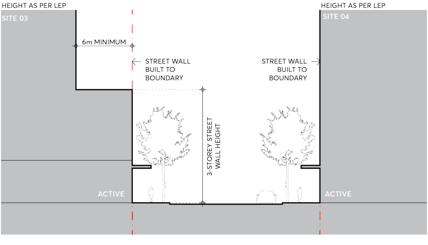
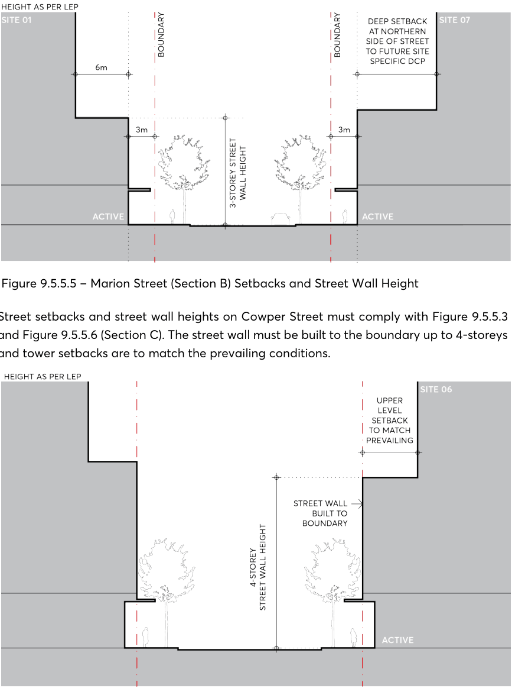
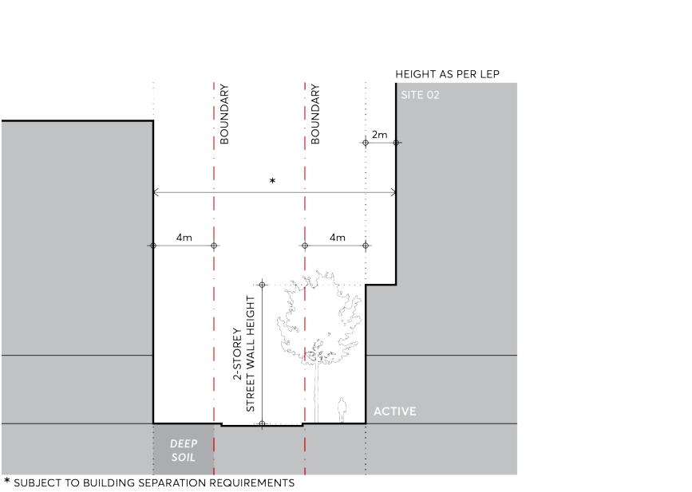

#### 9.5.5 MARION STREET

The Marion Street Special Area is located toward the southern fringes of the Parramatta City Centre. The Eastern edge of the Special Area is directly next to the railway line which bisects Marion Street. Harris Park Train Station is located within walking distance towards the south-east, and the precinct interfaces with Auto Alley to the West, a major pedestrian and vehicular corridor. Jubilee Park is the closest public open space, and to the South, Marion Street is bounded by the Station Street West Special Area. A Council owned carpark is situated within the north-east block and site-specific controls apply to the site at 33-43 Marion Street. Marion Street consists primarily of low scale built form including several heritage cottages clustered within the central area of the street. While the buildings in the precinct vary in their style, scale, age and use, the surviving heritage cottages still maintain a consistent form, relationship to each other and to the street. They also have a spatial quality that contrasts the existing and potential future scale and form of the City towards this fringe. This collective value created by the heritage items adds to the significance of Marion Street as a Special Area. The following Special Area controls for the precinct ensure that a more localised and heritage led response to the desired character of this street will be achieved and that heritage items are given longevity and a chance for integrated adaptive reuse as urban renewal of the area takes place. Future built form must achieve a measured response to the existing developments within the surrounding built context and provide for the desired activation, pedestrian connectivity and amenity within the precinct.

Objectives

O.01 Conserve heritage buildings to the highest standard and activate street frontages through both the adaptive reuse of heritage items as well as the provision of active ground floor spaces within and around the heritage buildings.

O.02 Integrate heritage buildings as part of an overall site development strategy that achieves pedestrian interconnectivity and site permeability around the heritage buildings, resulting in a fine network of intimate streets and laneways in the area.

O.03 Enhance the traditional setting of heritage items with the retention and restoration of gardens, fences and paths associated with the buildings, reflecting the vegetated, intimate and eclectic character of Marion Street.

O.04 Implement a built form approach that places massing away from the street, behind heritage items, and ensures separation between heritage buildings and new development to maximise site permeability, connectivity with the public realm, transition of scale, views to sky and opportunity for solar access to the street and surrounding developments.

O.05 Improve legibility and pedestrian connections within the precinct by achieving a permeable ground plane with visual and physical connectivity through the blocks in accordance with Figure 9.5.5.1 - Marion Street Special Area Framework.

O.06 Achieve an appropriate consolidation pattern in accordance with Figure 9.5.5.2 that allows the principles and objectives of the Marion Street Special Area to be integrated into development proposals.

SPECIAL AREAS

O.07 Maintain the existing heritage grain and pattern at street frontages along Marion Street through a generally low street wall and lower level massing approach to infill development in accordance with Figure 9.5.5.3.

O.08 Create a scale transition corridor along Marion Street that enhances solar access and views to sky by ensuring taller portions of massing are set back behind heritage items away from the main street with appropriate separation, ground plane permeability and interface with heritage buildings.

> [Picture on page 96: a picture, saved as a picture (images/part-09-parramatta-city-centre-page-96-9.gif, 150 dpi).]

Figure 9.5.5.1 – Marion Street Special Area Framework

SPECIAL AREAS

> [Picture on page 97: a picture, saved as a picture (images/part-09-parramatta-city-centre-page-97-2.gif, 150 dpi).]

Figure 9.5.5.2 – Marion Street Special Area Public Domain & Consolidation Plan

Figure 9.5.5.3 – Marion Street Special Area Required Setbacks & Built Form

SPECIAL AREAS

Controls

Unless modified or specifically excluded below, all controls in Sections 9.1 - 9.4 and Sections 9.6 - 9.9 of the City Centre controls apply to development within the Marion Street Special Area. C.01 Site consolidation must comply with Figure 9.5.5.3. C.02 Deliver new laneways, links and integrated pedestrian networks identified in Figure 9.5.5.1 through the inclusion of these elements in the plans for any proposed development within the precinct.

C.03 Development within the precinct must comply with the following specified envelope controls: Street setbacks and street wall heights on Marion Street, west of High Street, must comply with Figure 9.5.5.3 and Figure 9.5.5.4 (Section A). On the southern side of Marion Street, the street wall must be built to the boundary for 3-storeys and towers set back a minimum 6 metres from the street wall. On the northern side of Marion Street, development may provide a street wall building up to full height under the Height of Buildings Map in the Parramatta LEP 2023.

> [Picture on page 98: a picture, saved as a picture (images/part-09-parramatta-city-centre-page-98-16.gif, 150 dpi).]

Figure 9.5.5.4 – Marion Street (Section A) Setbacks and Street Wall Height

Street setbacks and street wall heights on Marion Street, east of Cowper Street, must comply with Figure 9.5.5.3 and Figure 9.5.5.5 (Section B). The street wall must be set back 3 metres from the street boundary and upper levels set back a minimum 6 metres from the street wall. Any development on the northern side of Marion Street must provide the 3 metre street wall setback, but will be subject to additional future site specific controls to determine upper level setbacks.

SPECIAL AREAS

> [Picture on page 99: a picture, saved as a picture (images/part-09-parramatta-city-centre-page-99-2.gif, 150 dpi).]

Figure 9.5.5.5 – Marion Street (Section B) Setbacks and Street Wall Height

Street setbacks and street wall heights on Cowper Street must comply with Figure 9.5.5.3 and Figure 9.5.5.6 (Section C). The street wall must be built to the boundary up to 4-storeys and tower setbacks are to match the prevailing conditions.

Figure 9.5.5.6 – Cowper Street (Section C) Setbacks and Street Wall Height

Street setbacks on High Street must comply with Figure 9.5.5.3. Street setbacks and street wall heights on Jubilee Lane must comply with Figure 9.5.5.3. Street setbacks and street wall heights on Station Lane must comply with Figure 9.5.5.3 and Figure 9.5.5.7 (Section D). The street wall must be set back 4 metres from the laneway boundary and upper levels set back a minimum 2 metres from the street wall.

SPECIAL AREAS

> [Picture on page 100: a picture, saved as a picture (images/part-09-parramatta-city-centre-page-100-2.gif, 150 dpi).]

Figure 9.5.5.7 – Station Lane (Section D) Setbacks and Street Wall Height

C.04 Buildings on vacant or infill lots where they are set between heritage items along Marion Street, and are not specified with a street setback dimension or height of building on Figure 9.5.5.2 – Marion Street Special Area Public Domain & Consolidation Plan or Figure 9.5.5.3 – Marion Street Special Area Required Setbacks & Built Form, must: adopt a similar or matching setback to the adjacent buildings, adopt a similar street width for built form unless a dimension is specified, and be of a single or double storey form unless a maximum height in storeys is specified.

C.05 Development within Site 07 must provide a contiguous area of deep soil in accordance with Figure 9.5.5.3.

SPECIAL AREAS
