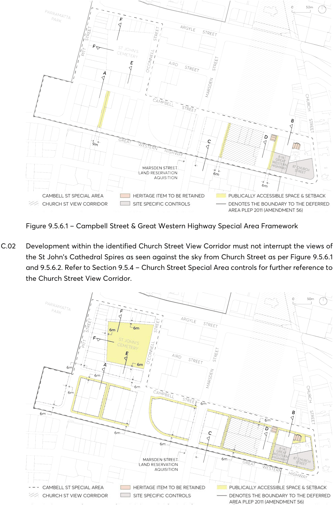
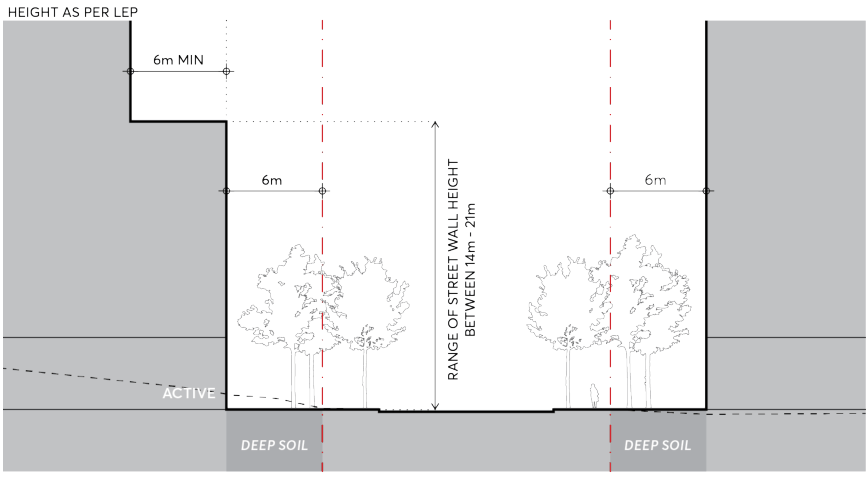
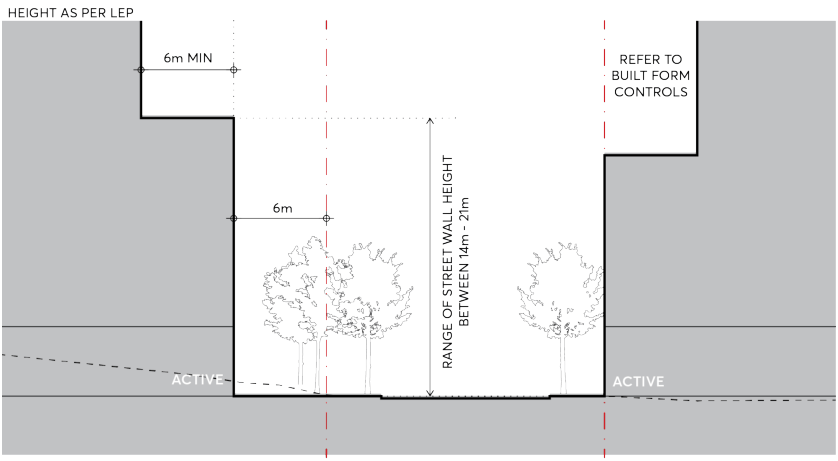
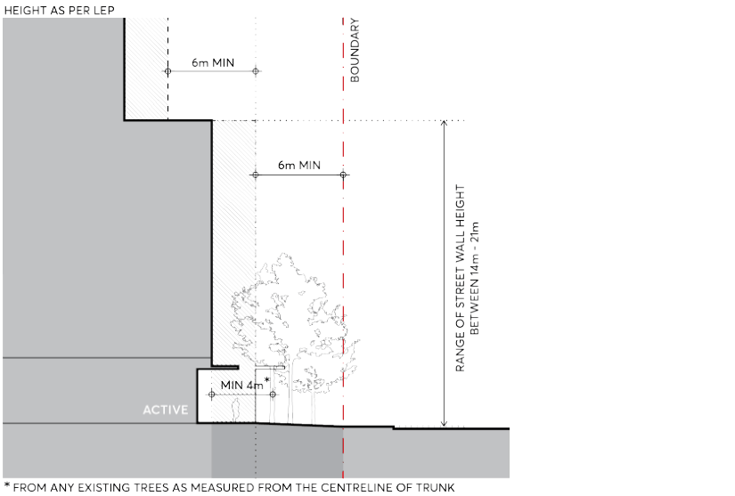
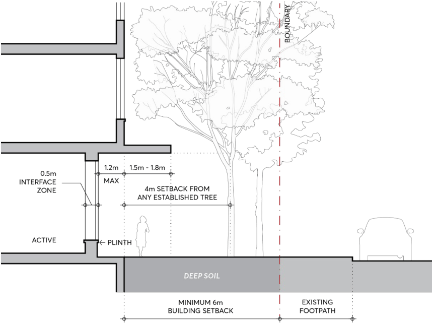
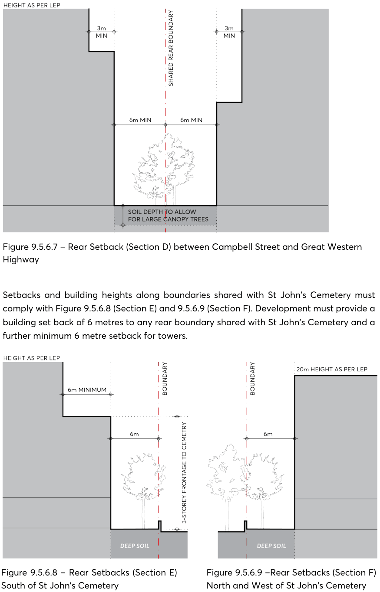

#### 9.5.6 CAMPBELL STREET & GREAT WESTERN HIGHWAY

The Campbell Street & Great Western Highway Special Area is located on the south-western edge of the City Centre, encompassing the state significant heritage grounds of St John’s Cemetery. The area is characterised by its position at the periphery of the City Centre, proximity to Parramatta Park, diverse commercial and residential usage, and natural topographical cross-fall from the natural ridgeline of Great Western Highway. Campbell Street is differentiated into two sections. Commercial development to the east between O’Connell and Church Street, and medium density residential blocks populate the western end of Campbell Street between O’Connell and Pitt Street. Campbell Street itself presents as a suburban street and most existing development has maintained 6m residential setbacks. Future built form must also provide a measured response to the Church Street View Corridor (see Section 9.5.4 – Church Street Special Area for greater detail). State and local heritage listed items located within the precinct, as well as the established canopy trees located in the generous street setbacks of buildings fronting onto Campbell Street and Great Western Highway– regardless of their ground floor usage - constitutes a uniquely vegetated setback character to be preserved.

Objectives

O.01 Preserve and reinforce the large canopy street trees and established planting character of the front setback zone of Campbell Street, Great Western Highway, Pitt Street and the perimeter of St John’s Cemetery.

O.02 Improve pedestrian amenity and public domain quality, acknowledging any potential street widening that may occur into the future.

O.03 Apply an appropriate spatial definition on Campbell Street through a large building setback character to the street which recognises the increase in density.

O.04 Conserve heritage items to the highest standard and ensure future built form does not adversely impact the amenity of St John’s Cemetery, protecting its access to sunlight.

O.05 Maintain a defined street wall for future development through consistent setbacks and strong sense of enclosure to St John’s Cemetery.

O.06 Elevate the spatial significance of Church Street and protect the silhouette of St John’s Cathedral spires as seen against the sky from Church Street by delivering low, modest development within the identified Church Street View Corridor.

O.07 Achieve an appropriate consolidation pattern that allows the objectives of the Campbell Street Special Area to be integrated into development proposals.

Controls

Unless modified or specifically excluded below, all controls in Sections 9.1 – 9.4 and Sections 9.6 – 9.9 of the City Centre controls apply to development within the Campbell Street and Great Western Highway Special Area. C.01 Site consolidation must allow for the realisation of the objectives of the Campbell Street Special Area and delivery of desired publicly accessible through site links as per Figure 9.5.6.1.

SPECIAL AREAS

> [Picture on page 102: a picture, saved as a picture (images/part-09-parramatta-city-centre-page-102-2.gif, 150 dpi).]

Figure 9.5.6.1 – Campbell Street & Great Western Highway Special Area Framework

C.02 Development within the identified Church Street View Corridor must not interrupt the views of the St John’s Cathedral Spires as seen against the sky from Church Street as per Figure 9.5.6.1 and 9.5.6.2. Refer to Section 9.5.4 – Church Street Special Area controls for further reference to the Church Street View Corridor.

SPECIAL AREAS

Figure 9.5.6.2 – Campbell Street & Great Western Highway Special Area Required Setbacks

C.03 Development must comply with the following street wall and setback controls: Street setbacks and heights on Campbell Street, west of O’Connell Street, must comply with Figure 9.5.6.3 (Section A). The street wall must be set back 6 metres from the street boundary and, on the southern side of Campbell Street, the tower must be set back a minimum 6 metres from the street wall.

> [Picture on page 103: a picture, saved as a picture (images/part-09-parramatta-city-centre-page-103-8.gif, 150 dpi).]

Figure 9.5.6.3 – Campbell Street (Section A) Setbacks and Street Wall Height

Street setbacks and heights on Campbell Street, east of O’Connell Street, must comply with Figure 9.5.6.4 (Section B). On the southern side of Campbell Street, the street wall must be set back 6 metres from the street boundary and the tower must be set back a minimum of 6 metres from the street wall. On the northern side of Campbell Street, development may defer to Section 9.3 – Built Form section in this Part.

> [Picture on page 103: a picture, saved as a picture (images/part-09-parramatta-city-centre-page-103-15.gif, 150 dpi).]

Figure 9.5.6.4 – Campbell Street (Section B) Setbacks and Street Wall Height

SPECIAL AREAS

Street setbacks and heights on Great Western Highway must comply with Figure 9.5.6.5 (Section C). The street wall must be set back a minimum of 6 metres from the street boundary and the tower must be set back a minimum of 6 metres from the street wall. Where an established tree is located within the front setback zone, development must ensure the street wall is set back a minimum of 4 metres from the centreline of trunk.

> [Picture on page 104: a picture, saved as a picture (images/part-09-parramatta-city-centre-page-104-7.gif, 150 dpi).]

Figure 9.5.6.5 – Great Western Highway (Section C) Setbacks and Street Wall Height

Development on Great Western Highway must provide a 6 metre landscaped setback to the street as detailed in Figure 9.5.6.6. This privately owned publicly accessible setback zone adjacent to active uses at ground is to be relatively level with existing kerb lines.

SPECIAL AREAS

> [Picture on page 105: a picture, saved as a picture (images/part-09-parramatta-city-centre-page-105-2.gif, 150 dpi).]

Figure 9.5.6.6 – Great Western Highway Ground Floor Interface

A shared planting zone must be provided to the rear of lots between Campbell Street and Great Western Highway to comply with Figure 9.5.6.7 (Section D). A minimum 6 metre rear setback and soil depth allowance clear of any basement structure must be provided to Council’s satisfaction to facilitate planting of large canopy trees. Towers must be setback a minimum of 9 metres from the rear boundary and comply with the building separation requirements in Section 9.3.3 of this Part of the DCP.

SPECIAL AREAS

> [Picture on page 106: a picture, saved as a picture (images/part-09-parramatta-city-centre-page-106-2.gif, 150 dpi).]

Figure 9.5.6.7 – Rear Setback (Section D) between Campbell Street and Great Western Highway

Setbacks and building heights along boundaries shared with St John’s Cemetery must comply with Figure 9.5.6.8 (Section E) and 9.5.6.9 (Section F). Development must provide a building set back of 6 metres to any rear boundary shared with St John’s Cemetery and a further minimum 6 metre setback for towers.

Figure 9.5.6.8 – Rear Setbacks (Section E) South of St John’s Cemetery

Figure 9.5.6.9 –Rear Setbacks (Section F) North and West of St John’s Cemetery

Street setbacks on Pitt and Argyle Street must comply with Figure 9.9.6.2 and defer to Section 9.3.3 in this Part of the DCP.

SPECIAL AREAS

C.04 Deep soil is to be delivered within street setback zones and rear setbacks adjoining St John’s Cemetery, provided with a minimum width of 6 metres.

C.05 Where the street setback adjoins active uses, the setback zone is to be provided as a publicly accessible space, as per Figure 9.5.6.2. All stairs and ramps on active frontages must be internalised to ensure the public domain and front setback zones are kept relatively level, accessible and uncluttered.
