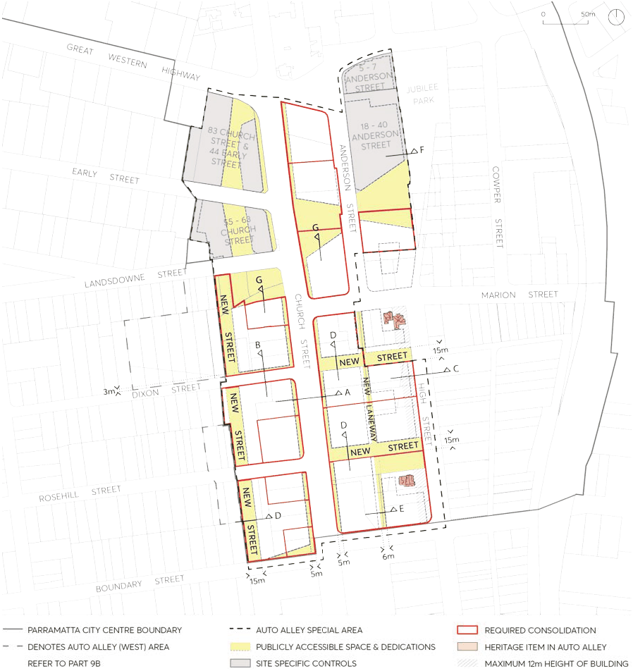
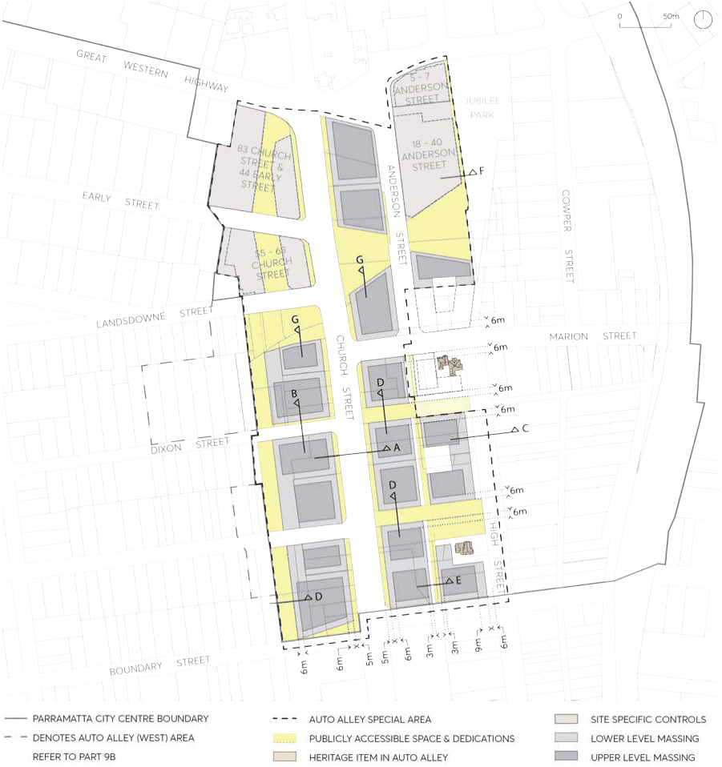
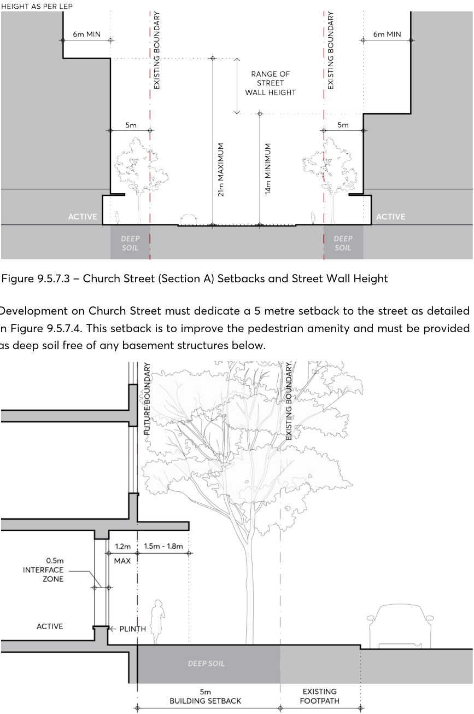
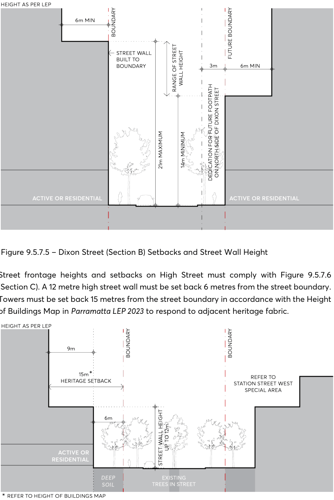
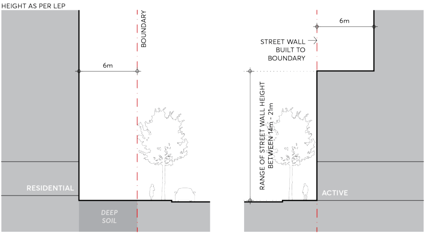
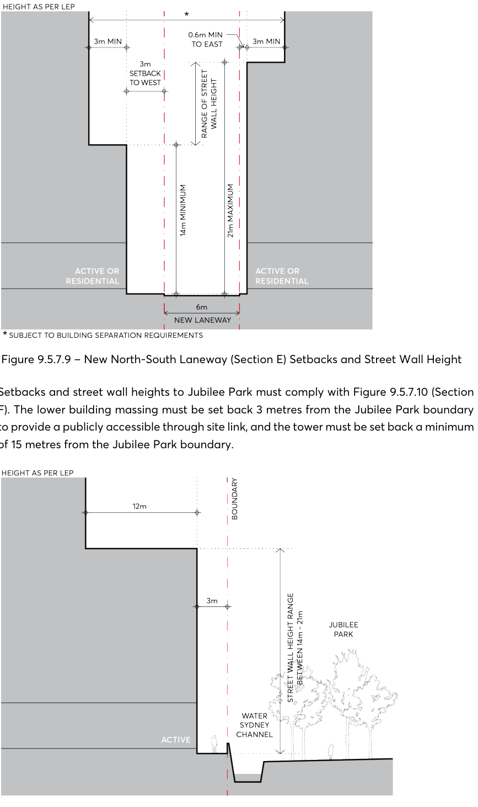
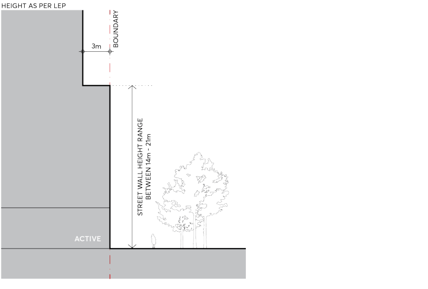

#### 9.5.7 AUTO ALLEY

The Auto Alley Special Area has been identified as a long-term growth area for the City. The future form of Auto Alley is proposed to retain the existing large retail tenancies on the street for automotive uses, while also providing an opportunity for commercial redevelopment in the long

term. The controls for this precinct ensure a more localised response to the specific character established by the historical usage of south Church Street and the remnant commercial occupancies. The Auto Alley Special Area must also deliver future open space for the City Centre and improve pedestrian connectivity in the south of the city. Approximately 1 hectare of park and plaza must be delivered alongside the redevelopment of Auto Alley. Several new streets must be provided: a north-south street is provided at the western boundary of the precinct; two east-west streets extend Dixon Street and Rosehill Street from Church Street to High Street; and a north-south lane extends Anderson Street from Marion Street to Raymond Street. Built form must also consider the potential future development and public domain expected in the adjacent Marion Street Special Area to the north, and in the Station Street Special Area to the east. Specifically, the mixed-use eastern portion of the precinct must be considered as a transition area, as reflected in the lower building heights and FSR requirements in the Parramatta LEP 2023. The controls for Auto Alley (West) which is made up of the land zoned E3 Productivity Support are contained in Part 9B.

Objectives

O.01 Achieve an appropriate site consolidation that allows the Parramatta LEP 2023 controls to be realised with appropriate built form and allows the best response to the existing heritage items and surrounding street and site geometries.

O.02 Promote diverse commercial activity creating a complementary commercial core for the City Centre.

O.03 Provide new open spaces to service the needs of resident and worker populations anticipated in the precinct.

O.04 Enable large canopy trees to be planted in Church Street, enhancing the southern approaches to the City Centre, and improving the pedestrian environment along this busy section of the street.

O.05 Increase precinct permeability with the delivery of new public streets, through site links and appropriate servicing commensurate with the density of the precinct.

SPECIAL AREAS

> [Picture on page 108: a picture, saved as a picture (images/part-09-parramatta-city-centre-page-108-2.gif, 150 dpi).]

Figure 9.5.7.1 – Auto Alley Special Area Public Domain & Consolidation

Controls

Unless modified or specifically excluded below, all controls in Sections 9.1 - 9.4 and Sections 9.6 - 9.9 of the City Centre controls apply to development within the Auto Alley Special Area. C.01 Site consolidation must comply with Figure 9.5.7.1 – Auto Alley Special Area Public Domain & Consolidation.

C.02 Delivery, location and dedication of new streets, lanes and open spaces in the Auto Alley precinct must comply with Figure 9.5.7.1.

C.03 Where specified, building envelopes must comply with Figure 9.5.7.2 to achieve the objectives highlighted for the Auto Alley Special Area.

SPECIAL AREAS

> [Picture on page 109: a picture, saved as a picture (images/part-09-parramatta-city-centre-page-109-2.gif, 150 dpi).]

Figure 9.5.7.2 – Auto Alley Setbacks and Indicative Built Form

C.04 Future development must comply with the following street setback controls: Street setbacks and street wall heights on Church Street must comply with Figure 9.5.7.3 (Section A). The street wall must be set back a minimum of 5 metres from the street boundary, and towers must be set back a minimum 6 metres from the street wall.

SPECIAL AREAS

> [Picture on page 110: a picture, saved as a picture (images/part-09-parramatta-city-centre-page-110-2.gif, 150 dpi).]

Figure 9.5.7.3 – Church Street (Section A) Setbacks and Street Wall Height

Development on Church Street must dedicate a 5 metre setback to the street as detailed in Figure 9.5.7.4. This setback is to improve the pedestrian amenity and must be provided as deep soil free of any basement structures below.

Figure 9.5.7.4 – Church Street Ground Floor Interface

Street setbacks and street wall heights on Dixon Street must comply with Figure 9.5.7.5 (Section B). On the southern side of Dixon Street, the street wall must be built to the boundary and the tower set back a minimum of 6 metres from the street wall. On the

SPECIAL AREAS

northern side of Dixon Street, the street wall must be set back 3 metres from the boundary and the tower set back a minimum of 6 metres from the street wall.

> [Picture on page 111: a picture, saved as a picture (images/part-09-parramatta-city-centre-page-111-4.gif, 150 dpi).]

Figure 9.5.7.5 – Dixon Street (Section B) Setbacks and Street Wall Height

Street frontage heights and setbacks on High Street must comply with Figure 9.5.7.6 (Section C). A 12 metre high street wall must be set back 6 metres from the street boundary. Towers must be set back 15 metres from the street boundary in accordance with the Height of Buildings Map in Parramatta LEP 2023 to respond to adjacent heritage fabric.

Figure 9.5.7.6 – High Street (Section C) Setbacks and Street Wall Height

SPECIAL AREAS

Where residential uses are being provided at ground on new streets identified in Figure 9.5.7.1, street setbacks and street wall heights of development must comply with Figure

9.5.7.7 (Section D). The building must be set back 6 metres from the street boundary to provide for private and communal landscaping, consistent with Section 9.3.5 – The Ground Floor. Where active uses are being provided at ground on new streets identified in Figure 9.5.7.1, street setbacks and street wall heights of development must comply with Figure 9.5.7.8 (Section D). The street wall must be built to the boundary and the tower must be set back a minimum of 6 metres from the street wall, consistent with Section 9.3.5 – The Ground Floor.

> [Picture on page 112: a picture, saved as a picture (images/part-09-parramatta-city-centre-page-112-12.gif, 150 dpi).]

Figure 9.5.7.7 – New Streets (Section D) Setbacks and Street Wall Height Residential Ground Floor

Figure 9.5.7.8 – New Streets (Section D) Setbacks and Street Wall Height Active Ground Floor

Street setbacks and street wall heights on the future laneway connecting Marion Street to Boundary Street, as identified in Figure 9.5.7.1, must comply with Figure 9.5.7.9 (Section E). To the west, the street wall must be set back 3 metres from the future boundary and the tower set back a minimum of 3 metres from the street wall. To the east, the street wall must be set back 0.6 metres from the future boundary and the tower must be set back a minimum of 3 metres from the street wall.

SPECIAL AREAS

> [Picture on page 113: a picture, saved as a picture (images/part-09-parramatta-city-centre-page-113-2.gif, 150 dpi).]

Figure 9.5.7.9 – New North-South Laneway (Section E) Setbacks and Street Wall Height

Setbacks and street wall heights to Jubilee Park must comply with Figure 9.5.7.10 (Section F). The lower building massing must be set back 3 metres from the Jubilee Park boundary to provide a publicly accessible through site link, and the tower must be set back a minimum of 15 metres from the Jubilee Park boundary.

Figure 9.5.7.10 – Jubilee Park Edge (Section F) Setbacks and Street Wall Height

SPECIAL AREAS

Setbacks and street wall heights to any new parks or plaza spaces must comply with Figure

9.5.7.11 (Section G). The lower building massing must be built to the boundary a minimum of 14 metres and maximum of 21 metres above the park or plaza level, and the tower must be set back 3 metres from the boundary.

> [Picture on page 114: a picture, saved as a picture (images/part-09-parramatta-city-centre-page-114-6.gif, 150 dpi).]

Figure 9.5.7.11 – New Civic Space or Park Edge (Section G) Setbacks and Street Wall Height

C.05 Driveways servicing new development are not permitted on Church Street and High Street. Future driveways must be minimised and provided on future servicing streets or laneways.

C.06 Tenancy widths on the ground floor in Church Street must allow for automotive or other large commercial uses.

C.07 Where necessary, proposals must consider how safe pedestrian movement may be reasonably provided within the Auto Alley Special Area.

SPECIAL AREAS
