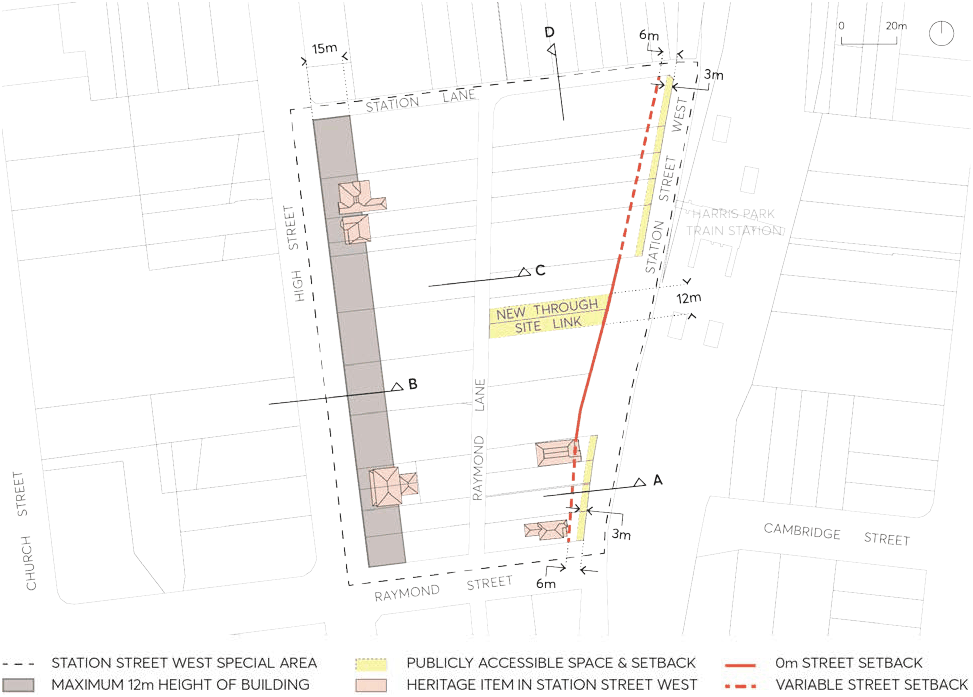
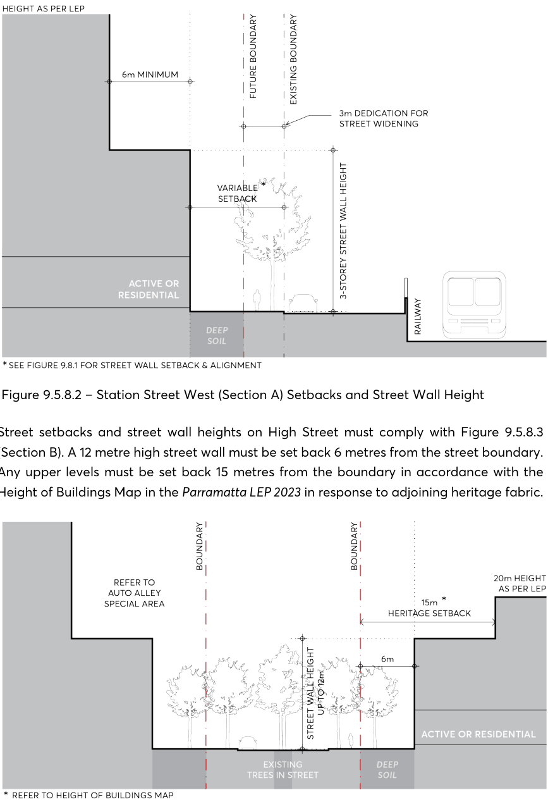
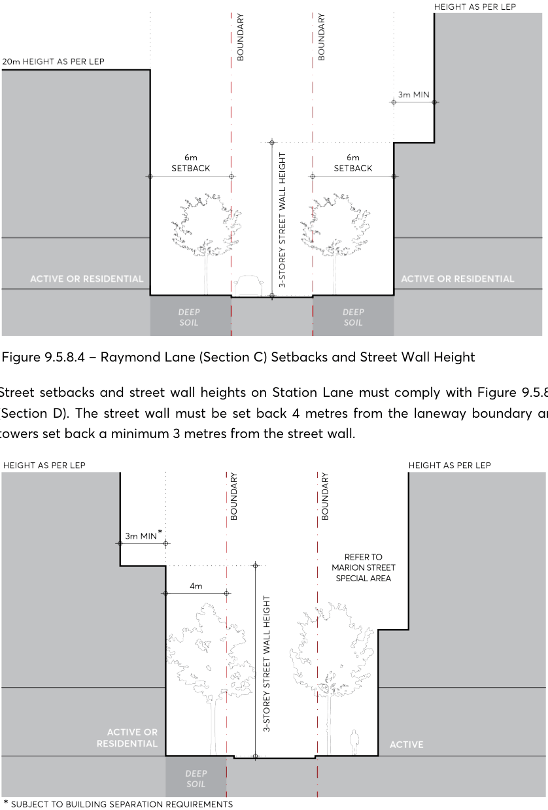

#### 9.5.8 STATION STREET WEST

The Station Street West Special Area is located on the southern edge of the City Centre, characterised by its proximity to the railway line and high instance of built heritage, both in and around the precinct. The controls for this precinct ensure a more localised and heritage led response to the specific character established by these items, as well as setting a more defined edge to Station Street West as the precinct redevelops. Future built form must consider the potential future development and public domain expected in the adjacent Marion Street Special Area to the north, and Auto Alley to the west. As a transition area, all development in the Station Street West Special Area must consider an expected massing of surrounding sites to ensure an appropriate response to future context. Development must also provide a measured response to the Tottenham Street Heritage Conservation Zone located to the south, ensuring future outcomes do not negatively impact the amenity of the Federation Period cottages in this location.

Objectives

O.01 Encourage respectful built form that relates to the existing subdivision, material, and scale of the area. Conserve heritage cottages to the highest standard and encourage the adaptive reuse of heritage items to maintain their importance into the future.

O.02 Ensure future built form does not adversely impact the solar amenity of the Tottenham Street Heritage Conservation Zone to the south.

O.03 Increase precinct permeability with the delivery of new, publicly accessible through site links in desired locations.

O.04 Create a consistent edge to Station Street West that adjusts the street boundary, providing a more contiguous street frontage which follows the alignment of the street.

O.05 Minimise tower floorplates to encourage compliant separation distances and maximise amenity on narrow, east-west sites.

O.06 Improve the pedestrian amenity and legibility of Station Street West through an expanded public domain and dedicated easement for future footpath widening.

O.07 Create a scale transition corridor along High Street that enhances solar access and views to sky by ensuring tower components are set back as reinforced by 12 metres maximum building heights in the Parramatta LEP 2023.

SPECIAL AREAS

> [Picture on page 116: a picture, saved as a picture (images/part-09-parramatta-city-centre-page-116-2.gif, 150 dpi).]

Figure 9.5.8.1 – Station Street West Public Domain & Alignment

Controls

Unless modified or specifically excluded below, all controls in Sections 9.1 - 9.4 and Sections 9.6 - 9.9 apply to development within the Station Street West Special Area. C.01 Future development must create a consistent edge to Station Street West that follows the alignment of the rail corridor and comply with the street setback line as per Figure 9.5.8.1. This alignment must facilitate a potential footpath widening on Station Street West to accommodate increased pedestrian traffic from Harris Park Train Station.

C.02 The delivery and location of new publicly accessible through site links in the Station Street Special Area must comply with Figure 9.5.8.1.

C.03 Future development must comply with the following envelope controls: Street setbacks and street wall heights on Station Street West must comply with Figure

9.5.8.2 (Section A). A 3-storey street wall must be built to follow the variable street setback as per Figure 9.5.8.1, and towers must be setback a minimum of 6 metres from the street wall.

SPECIAL AREAS

> [Picture on page 117: a picture, saved as a picture (images/part-09-parramatta-city-centre-page-117-2.gif, 150 dpi).]

Figure 9.5.8.2 – Station Street West (Section A) Setbacks and Street Wall Height

Street setbacks and street wall heights on High Street must comply with Figure 9.5.8.3 (Section B). A 12 metre high street wall must be set back 6 metres from the street boundary. Any upper levels must be set back 15 metres from the boundary in accordance with the Height of Buildings Map in the Parramatta LEP 2023 in response to adjoining heritage fabric.

Figure 9.5.8.3 – High Street (Section B) Setbacks and Street Wall Height

Street setbacks and street wall heights on Raymond Lane must comply with Figure 9.5.8.4 (Section C). The building is to be set back 6 metres from the laneway boundary to provide private landscape, and towers on the eastern side of Raymond Lane set back a minimum 3 metres from the street wall.

SPECIAL AREAS

> [Picture on page 118: a picture, saved as a picture (images/part-09-parramatta-city-centre-page-118-2.gif, 150 dpi).]

Figure 9.5.8.4 – Raymond Lane (Section C) Setbacks and Street Wall Height

Street setbacks and street wall heights on Station Lane must comply with Figure 9.5.8.5 (Section D). The street wall must be set back 4 metres from the laneway boundary and towers set back a minimum 3 metres from the street wall.

Figure 9.5.8.5 – Station Lane (Section D) Setbacks and Street Wall Height

Street setbacks and street wall heights on Raymond Street must comply with Section 9.3.3

– The Building Envelope.

SPECIAL AREAS
