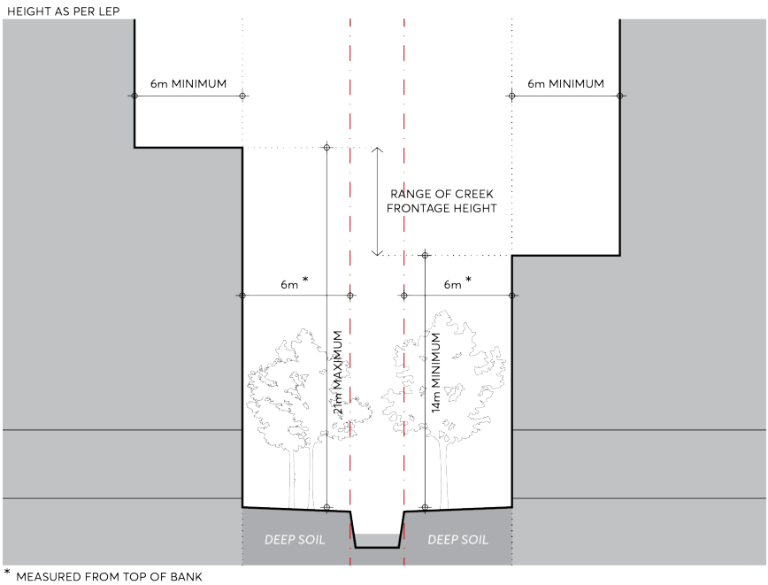

#### 9.5.9 CREEK CORRIDORS

The Parramatta River and its tributaries have been a place of cultural significance for first nations peoples for thousands of years. The land beside the stream now known as Clay Cliff Creek was a vital source of food and living resources, where fresh water met the ebb and flow of tidal water in the River. The land also played a critical role in the survival of Sydney, with well documented post-colonial occupation. Development along the edges of Clay Cliff Creek and other creek corridors traversing the City must recognise their cultural and historical values as a shared public resource. While some significant development has already occurred through part of the City’s creek corridors, the remaining open space must be enhanced to create a collective landscape corridor and flood mitigation element for the City. By utilising a consistent deep soil setback to any development along the City’s creek corridors, future development must create a highly visible, vegetated, and functional connection between existing green spaces, heritage destinations and transport nodes along creek corridors.

Objectives

O.01 Establish Clay Cliff Creek and other tributaries of the Parramatta River as priority green corridors for ecological protection, flood sensitive strategies and future landscape improvements.

O.02 Develop creek corridors as landscape and cultural assets, protecting landscape setbacks and biodiversity, and contributing to ecological resilience.

O.03 Protect and enhance local and regional biodiversity, maximising the extent and integrity of aquatic and natural land areas along creek corridors in the City Centre.

O.04 Employ Water Sensitive Urban Design strategies to limit pollutants entering Parramatta River and its associated waterways.

O.05 Utilise a deep soil setback zone to create a contiguous landscape along creek corridors with the intention of leaving space for a publicly accessible movement corridor in the future.

O.06 Identify opportunities for interpreting cultural and environmental values in the adjoining landscape, built form and lighting subject to Council’s strategies.

Controls

Unless modified or specifically excluded below, all controls in Sections 9.1 - 9.4 and Sections 9.6 - 9.9 apply to development within the Creek Corridors Special Area. C.01 Creek frontage heights and building setbacks on any creek corridor must comply with Figure 9.5.9.1.

C.02 Development must provide a minimum building setback of 6 metres to any creek corridor, as measured from the top of bank, delivered as deep soil. The extent of open to sky deep soil adjacent to any creek corridor must be designed to the satisfaction of Council’s flood engineers. In some instances, the minimum 6 metre building setback from top of bank may be inadequate for meeting Council’s flood mitigation requirements.

SPECIAL AREAS

C.03 Development must provide a minimum 6 metre tower setback to support views to sky from a creek corridor and natural daylighting to deep soil and vegetation.

> [Picture on page 120: a picture, saved as a picture (images/part-09-parramatta-city-centre-page-120-4.gif, 150 dpi).]

Figure 9.5.9.1 – Creek Corridor Setbacks and Street Wall Height

C.04 Protect existing vegetation that supports the ecological function of creek corridors. Future landscaping facing any creek corridor must be flood resilient and demonstrate its compatibility with the relevant riverine, estuarine or forest ecosystem.

C.05 Provide a sense of address to creek corridors, particularly where a future public connection may be provided, and follow design principles of The Street Wall contained within Section 9.3 – Built Form. Where above ground carparking is included, commercial or residential sleeving must be provided for passive surveillance to landscaped areas.

C.06 Creek corridor setback zones must be free of ancillary elements, servicing, and other structures.

SPECIAL AREAS
