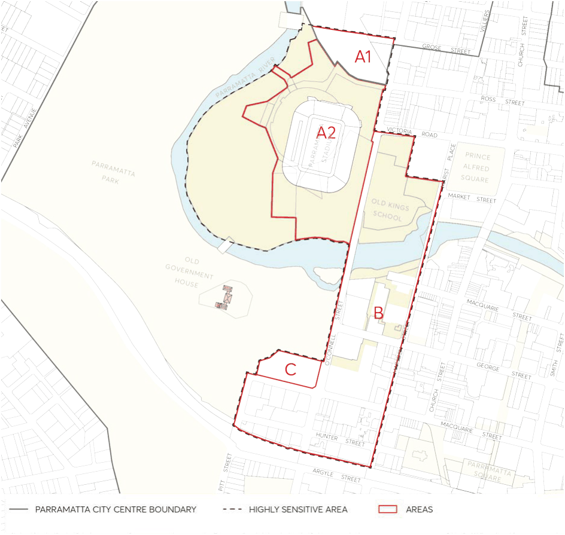
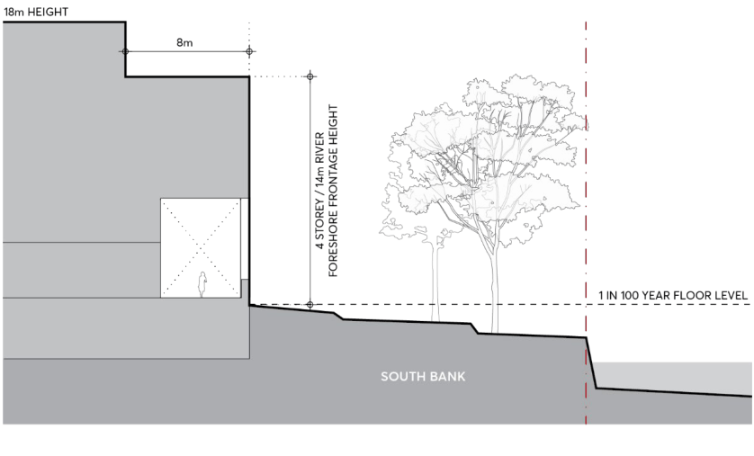
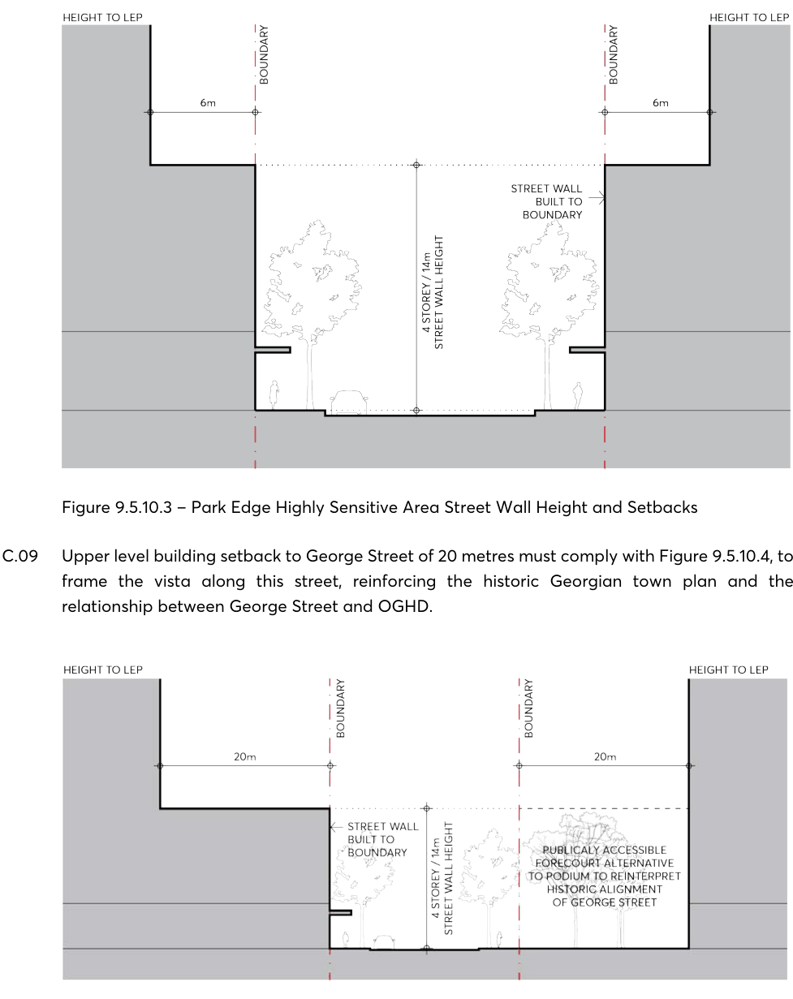
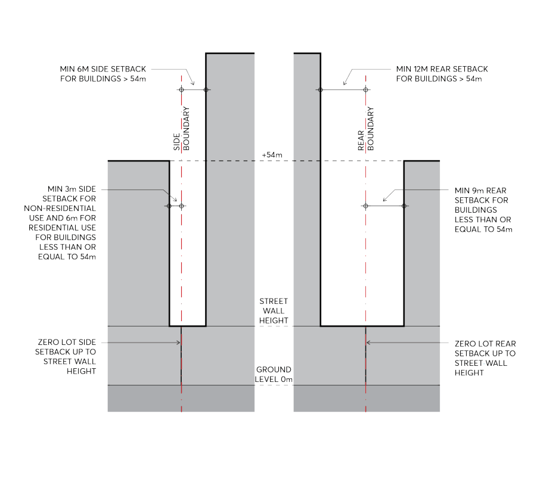
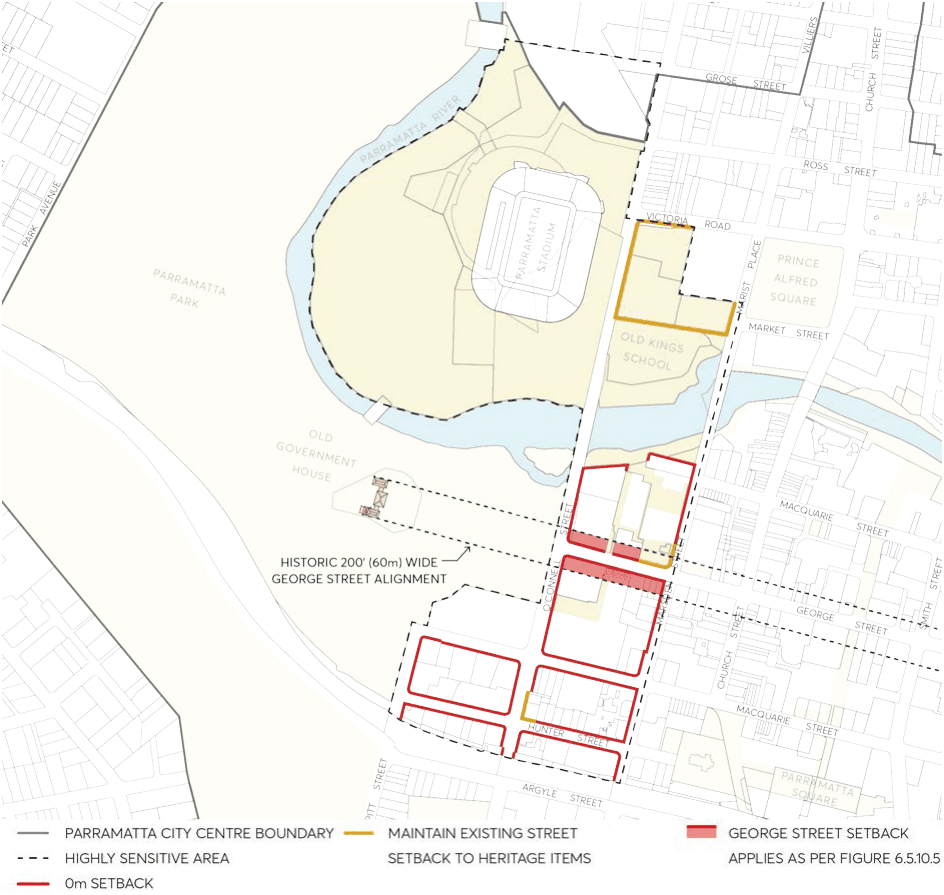
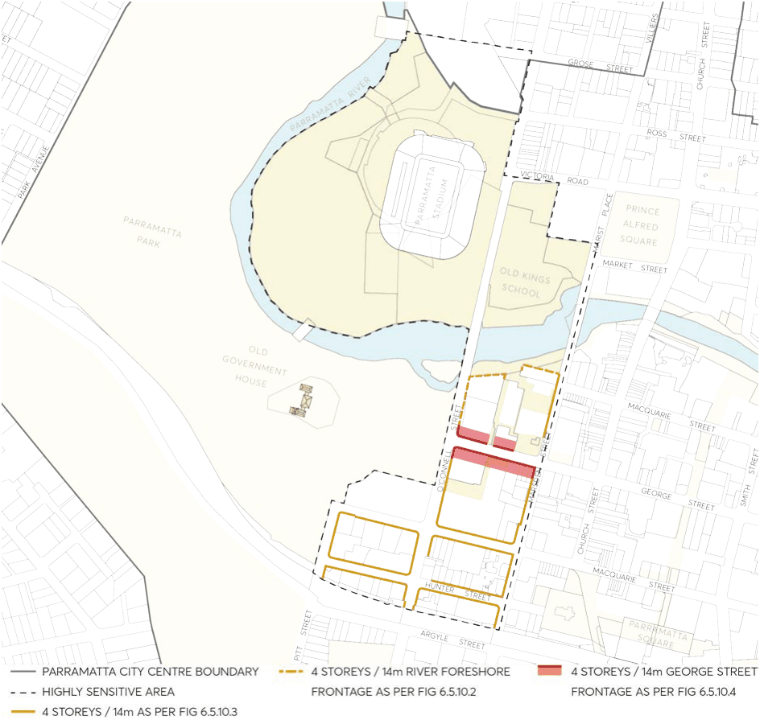
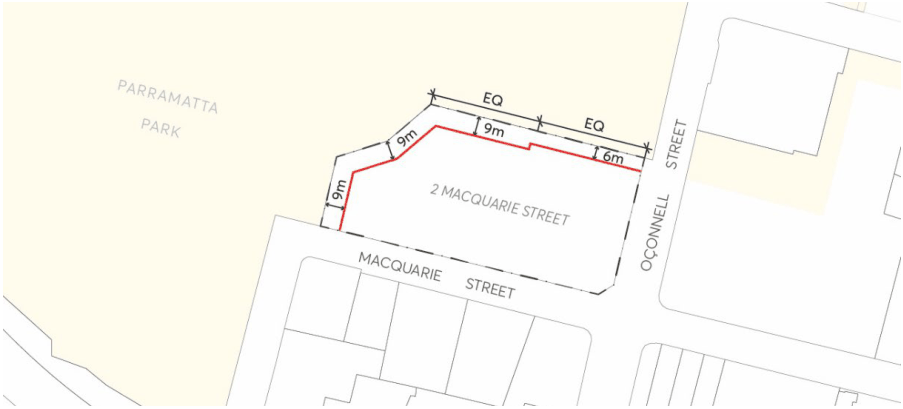
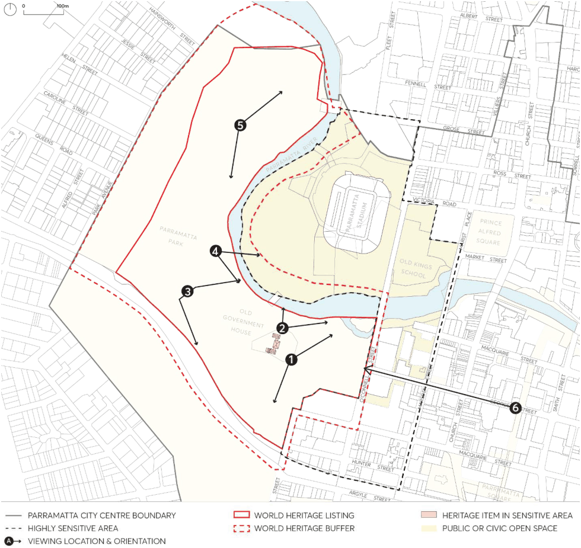

#### 9.5.10 PARK EDGE HIGHLY SENSITIVE AREA

The Park Edge Highly Sensitive Area is located at the western edge of the Parramatta City Centre adjacent to and including part of Parramatta Park (see Figure 9.5.10.1). Buildings within this area form a backdrop to Parramatta’s Old Government House and Domain (OGHD). OGHD is one of eleven sites in a group forming the Australian Convict Sites on the UNESCO World Heritage List. OGHD is also on the National Heritage List. The Park Edge Highly Sensitive Area has been identified in the study Development in Parramatta City and the Impact on Old Government House and Domain’s World and National Heritage Listed Values Planisphere 2012, as an area where development is likely to have a significant impact on the world and national heritage values of OGHD, unless it is designed to mitigate potential impact to below a significant impact threshold. In this study, the key determinants of whether development will have a significant impact on the world and national heritage values of OGHD are the view sheds of the highly significant views from and of OGHD, the proximity of the development to OGHD and topography. Under the Commonwealth Environment Protection and Biodiversity Conservation (EPBC) Act 1999, development that is likely to have a significant impact on the world and national heritage values of OGHD must be referred to the Australian Government Department of Sustainability, Environment, Water, Populations and Community for approval from the Australian Government Environment Minister. As this requirement has led to uncertainty and additional assessment processes, Council has worked with the Commonwealth and State Governments to enter into a Conservation Agreement. This agreement is made under the EPBC Act and removes the need for Commonwealth referrals of developments within the Park Edge Highly Sensitive Area under the EPBC Act, so long as the proposed development complies with the specified planning controls in the agreement. Compliance with these specified planning controls will mitigate significant impacts of development on the values of OGHD under its world and national heritage listing. The planning controls include the applicable maximum building height and floor space ratio controls in the Parramatta City Centre LEP 2007 as Annexed to the Conservation Agreement (which are translated into Parramatta LEP 2023) as well as the controls outlined in this section (which include are a graphical improvement of the supporting figures in the DCP control figures also Annexed to the Conservation Agreement). When development complies with these controls, applications will not need to be referred to the Commonwealth Government for approval under the EPBC Act.

SPECIAL AREAS

> [Picture on page 122: a picture, saved as a picture (images/part-09-parramatta-city-centre-page-122-2.gif, 150 dpi).]

Figure 9.5.10.1 – Park Edge Highly Sensitive Area including sub areas

Controls

The Park Edge Highly Sensitive Area is divided into four sub areas as shown in Figure 9.5.10.1 above, with specific controls relating to each sub area as follows:

Area A1 - Parramatta Leagues Club Site

Development within Area A1 must comply with the following:

C.01 At least 80% of the building height must be contained below the level of the surrounding established tree canopy of Parramatta Park when viewed from any of the key viewing locations from OGHD shown in Figure 9.5.10.9. Any building element must be oriented to minimise the visual impact from these viewing locations.

C.02 External building materials must be muted in colour with matt finishes to minimise contrast with the park surrounds and be complementary to its setting.

SPECIAL AREAS

C.03 Signage on the upper level of buildings must not face the Domain of Parramatta Park.

Area A2 – Western Sydney Stadium and Car Park

C.04 At least 80% of the building height (other than lighting towers for Western Sydney Stadium) must be contained below the surrounding established tree canopy of Parramatta Park when viewed from any of the key viewing locations from OGHD shown in Figure 9.5.10.9. Buildings must be oriented to minimise the visual impact from these viewing locations.

C.05 External building materials must be muted in colour with matt finishes to minimise contrast with the park surrounds and be complementary to its setting.

C.06 Signage on the upper level of buildings must not face the Domain of Parramatta Park.

Area B -

C.07 The street frontage height for podiums, setbacks to the street, side and rear boundaries must comply with Figures 9.5.10.5, 9.5.10.6 and 9.5.10.7.

C.08 Upper level building setbacks must contribute to spaces between buildings and an openness in the city skyline, with upper level setbacks of: 8 metres at the river foreshore as shown in Figure 9.5.10.2; and 6 metres at the street frontage as shown in Figure 9.5.10.3; except for George Street (see C.09)

> [Picture on page 123: a picture, saved as a picture (images/part-09-parramatta-city-centre-page-123-19.gif, 150 dpi).]

Figure 9.5.10.2 – River Foreshore Frontage Height and Building Setbacks

SPECIAL AREAS

> [Picture on page 124: a picture, saved as a picture (images/part-09-parramatta-city-centre-page-124-2.gif, 150 dpi).]

Figure 9.5.10.3 – Park Edge Highly Sensitive Area Street Wall Height and Setbacks

C.09 Upper level building setback to George Street of 20 metres must comply with Figure 9.5.10.4, to frame the vista along this street, reinforcing the historic Georgian town plan and the relationship between George Street and OGHD.

Figure 9.5.10.4 – George Street west of Marsden Street – Street Wall Height and Building Setbacks

C.10 Upper level side and rear building setbacks must comply with Figure 9.5.10.5 to contribute to spaces between buildings and an openness in the city skyline.

SPECIAL AREAS

> [Picture on page 125: a picture, saved as a picture (images/part-09-parramatta-city-centre-page-125-2.gif, 150 dpi).]

Figure 9.5.10.5 – Park Edge Highly Sensitive Area Side and Rear Setbacks

C.11 Where reasonably practicable, having regard to the orientation of the development parcel, buildings must be oriented with their narrow end not exceeding 30 metres in width facing the Domain.

C.12 External building materials must reduce visibility against the sky, for example, use of light colours or reflective surfaces.

C.13 Signage on the upper level of buildings must not face the Domain of Parramatta Park.

Note – Minor departures exceeding the above built form controls (by up to 5%) for Area B will only be permitted where the consent authority is satisfied that the visual impact of the proposed development will not visually dominate OGHD as a result of any such variation when the proposed development is viewed from any of the key viewing locations from OGHD shown in Figure 9.5.10.9.

SPECIAL AREAS

> [Picture on page 126: a picture, saved as a picture (images/part-09-parramatta-city-centre-page-126-2.gif, 150 dpi).]

Figure 9.5.10.6 – Building Alignment and Front Setbacks (to streets, public domain and water courses)

SPECIAL AREAS

> [Picture on page 127: a picture, saved as a picture (images/part-09-parramatta-city-centre-page-127-2.gif, 150 dpi).]

Figure 9.5.10.7 – Street Wall / River Frontage Heights (Podiums)

Area B - Building Height and Floor Space Ratio controls

The Parramatta LEP 2023 specifies the applicable maximum building height and floor space ratio controls for Area B within the Park Edge Highly Sensitive Area. Bonus height and floor space ratio provisions under the LEP apply when the development exhibits design excellence as judged under an architectural design competition.

When a design competition is carried out for development within the Park Edge Highly Sensitive Area, the brief for the design competition will specify that consideration must be given to the protection of the world and national heritage values of OGHD from significant impacts when the proposed development is viewed from any of the key viewing locations shown in Figure 9.5.10.9 and that development complies with the specific requirements of this section of the DCP.

In Area B, minor variations to building height such as for architectural roof features, or minor variations in floor space ratio of up to 5%, will only be permitted where the consent authority is satisfied that the visual impact of the proposed development will not visually dominate OGHD as a result of any such

SPECIAL AREAS

variation when the proposed development is viewed from any of the key viewing locations from OGHD shown in Figure 9.5.10.9.

Area C – Lot 362 DP 752058, No. 2 Macquarie Street Parramatta (RSL Site)

C.14 Built form is to provide minimum setbacks to Parramatta Park as indicated in Figure 9.5.10.8. The setbacks are to provide a transition from built form to the soft landscaping in Parramatta Park and are to be predominantly landscaped.

> [Picture on page 128: a picture, saved as a picture (images/part-09-parramatta-city-centre-page-128-8.gif, 150 dpi).]

Figure 9.5.10.8 – Setbacks to Parramatta Park at 2 Macquarie Street Parramatta

C.15 Buildings are to be sited to enable the retention and protection of the heritage fence at the O’Connell Street and Macquarie Street frontages. The siting and spacing of buildings across the site shall also respect the important relationship of the RSL site to the landscape setting of Parramatta Park, including the park entrance from Macquarie Street and the George Street Gatehouse at this entrance.

C.16 The maximum building height is 10 metres. C.17 External building materials must be muted in colour with matt finishes to minimise contrast with the park surrounds and be complimentary to its setting.

C.18 Signage on the upper level of buildings must not face the Domain of Parramatta Park.

Protection of important views to and from Old Government House and Domain

Within the Park Edge Highly Sensitive Area, development must not be carried out that obstructs the sight lines between Old Government House and the Old Kings School site and the spire of St Patrick’s Cathedral.

Note – Parramatta Park is also listed on the NSW State Heritage Register and as an item of State Heritage significance in Schedule 5 of Parramatta LEP 2023. These listings mean that the provisions of the Heritage Act 1977 and the heritage clauses of Parramatta LEP 2023 must be complied with for development on or within the vicinity of OGHD. These considerations do not impact on the referral requirements of the EPBC Act.

SPECIAL AREAS

> [Picture on page 129: a picture, saved as a picture (images/part-09-parramatta-city-centre-page-129-2.gif, 150 dpi).]

| View | Description |
|---|---|
| 1 | From lawns east and south of Old Government House towards the City |
| 2 | From the north-east corner of Old Government House to Old Kinds School |
| 3 | From Bath House area west of Old Government House to the City |
| 4 | Parramatta River views towards city from road within Parramatta Park on the west side of river. |
| 5 | From Diary Precinct within Parramatta Park looking north-east and south-east towards the City |
| 6 | West along George Street towards the George Street Gatehouse of Old Government House |

Figure 9.5.10.9 – OGHD Viewing Locations

SPECIAL AREAS
