#### 9.5.11 CHURCH STREET NORTH

The Church Street North Special Area as delineated in Figure 9.5.11.1 forms part of the northern extension of the Parramatta City Centre and is located between Victoria Road, Belmore Park and two highly sensitive heritage areas - the North Parramatta Heritage Conservation Area (HCA) to the west and the Sorrell Street HCA to the east. The Parramatta Light Rail runs along Church Street and serves the area with a stop between Harold and Fennell Streets. The future character of the area continues the high street functionality of Church Street to the south of the Parramatta River with street defining buildings and active uses at lower levels (see Section 9.5.4 Church Street).

As the area is largely confined to urban blocks along the axis of Church Street, there is a need to provide a transition in use and form to the surrounding low scale, largely residential setting of North Parramatta. On the eastern side of the Special Area, transition to the Sorrell Street HCA is achieved across blocks as building forms step up from a lower scale along Sorrell Street to towers along Church Street. East west view corridors between towers, mid-block tree planting, and street setbacks aligned to heritage buildings contribute to the transition. On the western side of the Special Area, Villiers Street separates future development from the North Parramatta HCA. Additional transition is achieved with a step in building height from Villiers Street to Church Street and with a generous street setback along Villiers Street with canopy tree planting forming a direct visual interface to the heritage area.

A number of buildings of heritage significance are located along Church Street and are contributing to the streetscape and human scale of the area. These buildings are of 1-2 storeys and have varied settings that require a bespoke design response. Some items contribute to an aligned street wall edge, while others are set back from the street and sit in space.

To unify development across the Special Area and respond to the broader heritage setting, consistent building setbacks along east-west streets are defined by prevailing heritage building frontage alignments. This not only allows heritage items to form a dominant part of the streetscape, but also provide opportunities to extend the vegetated character of North Parramatta by creating additional space for street tree planting within front gardens.

A new civic square, co-located with the light rail stop, provides much needed open space and opportunities for supporting multi-purpose community facilities that can be used for a range of programs and activities to serve the local community as identified in Council’s Parramatta Community Infrastructure Strategy. New pedestrian through site links provide improved permeability and fine grain activity that complements Church Street. Communal open spaces within private development complement the public domain with landscaped courtyards and generous tree canopy in deep soil.

Church Street North Special Area controls aim to realise a mixed-use area of the City Centre with retail and commercial spaces at lower levels and predominantly residential uses within street edge podium and tower forms, arranged along green streets and around landscaped courtyards with increased tree canopy.

SPECIAL AREAS

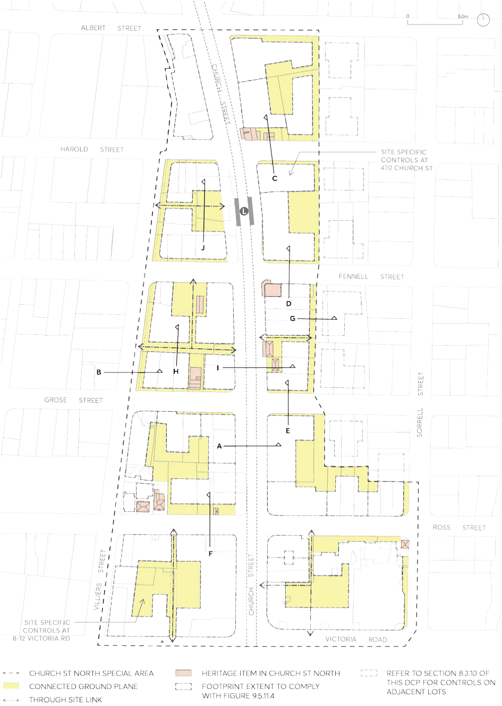

> [Picture on page 131: a picture, saved as a picture (images/part-09-parramatta-city-centre-page-131-2.gif, 150 dpi).]

Figure 9.5.11.1 – Church Street North Special Area Framework

SPECIAL AREAS

Objectives

O.01 Conserve heritage buildings to the highest standard and activate street frontages through both the adaptive reuse of heritage items as well as the provision of active ground floor spaces within and around the heritage buildings in the Church Street North Special Area.

O.02 Integrate heritage buildings as part of an overall site development strategy that achieves pedestrian connectivity and site permeability around the heritage buildings, resulting in a fine network of intimate streets and through site links in the area.

O.03 Allow heritage items, including those in the adjacent HCAs, to be the dominant features of the streetscape and create defined view corridors along east-west streets from HCAs up to Church Street and visa versa.

O.04 Maintain the vegetated character of North Parramatta by enabling large canopy trees in deep soil within the front setbacks, public domain and communal open spaces at ground.

O.05 Extend the fine-grain high-street character of Church Street from south of the River, northwards towards Belmore Park to create continuity between the north and south of the City Centre.

O.06 Provide building forms and communal open spaces that are appropriately proportioned for residential uses.

O.07 Encourage slender tower forms and generous separation between towers to create views to sky between towers when observed from both the North Parramatta HCA and Sorrell Street HCA’s.

O.08 Orientate building forms to minimise their impact on HCAs and create consistent spacing between towers that aligns tower development across the block increasing views to sky.

O.09 Locate towers to protect view corridors of historical and cultural value such as the views along the Church Street axis, views to Prince Alfred Park, and views along east-west streets.

O.10 Protect solar access to significant public open spaces, the public domain, and adjacent. O.11 Ensure new publicly accessible spaces, such as through site links and civic squares, are suitable distributed, adequately sized, integrated with the broader public domain network, and designed to Council’s standards.

O.12 Improve legibility, pedestrian connections and enable transition between lots on Church Street, neighbouring lots, and HCAs through a permeable ground plane with visual and/or physical connectivity through the blocks in accordance with Figure 9.5.11.1 – Church Street North Special Area Framework.

Controls

Unless modified or specifically excluded below, all controls in Sections 9.1 to 9.4 and Sections 9.6 to 9.9 of this Part apply to development within the Church Street North Special Area. C.01 Site consolidation must comply with Figure 9.5.11.2 – Church Street North Special Area Public Domain and Consolidation Plan to realise the objectives of the Church Street North Special Area.

C.02 New through site links and civic square identified in Figure 9.5.11.1 – Church Street North Special Area Framework and Figure 9.5.11.2 – Church Street North Special Area Public Domain and

SPECIAL AREAS

Consolidation Plan must be delivered through development or dedicated to Council for delivery in a coordinated manner.

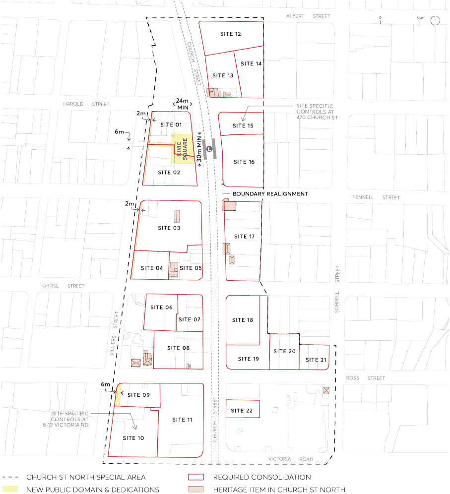

> [Picture on page 133: a picture, saved as a picture (images/part-09-parramatta-city-centre-page-133-4.gif, 150 dpi).]

Figure 9.5.11.2 – Church Street North Special Area Public Domain & Consolidation Plan

C.03 Development within the Church Street Special Area must comply with the building setbacks specified in Figure 9.5.11.3 – Church Street North Special Area Building Setbacks.

SPECIAL AREAS

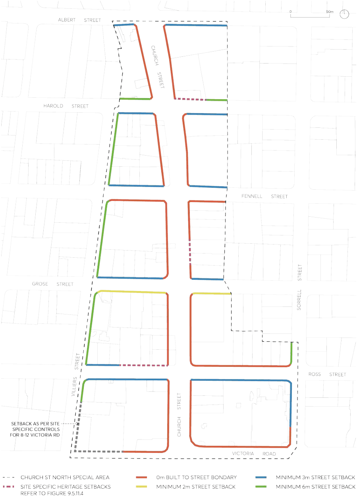

> [Picture on page 134: a picture, saved as a picture (images/part-09-parramatta-city-centre-page-134-2.gif, 150 dpi).]

Figure 9.5.11.3 – Church Street North Special Area Building Setbacks

C.04 Development within the Special Area must comply with the setback and envelope controls specified in Figure 9.5.11.4 – Church Street North Special Area Required Setbacks and Built Form.

SPECIAL AREAS

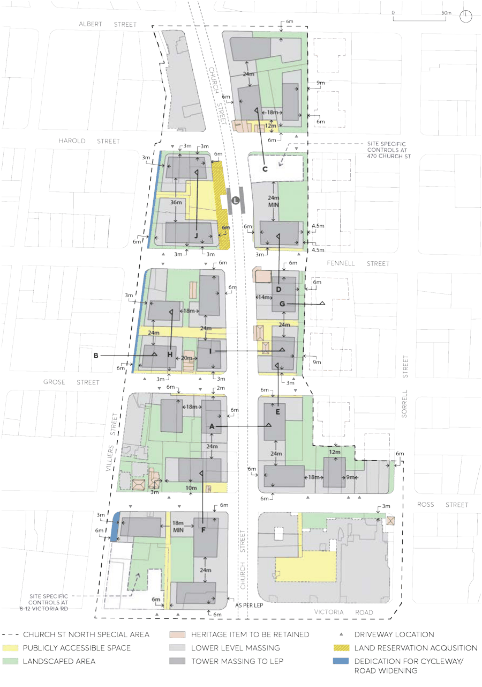

> [Picture on page 135: a picture, saved as a picture (images/part-09-parramatta-city-centre-page-135-2.gif, 150 dpi).]

Figure 9.5.11.4 – Church Street North Special Area Required Setbacks & Built Form

SPECIAL AREAS

C.05 Development within the Special Area must comply with the following specified envelope controls:

a) On Church Street, the street wall must be built to boundary as per Figure 9.5.11.5 unless otherwise specified in Figure 9.5.11.3 and Figure 9.5.11.4 to provide new civic square or curtilage to heritage items.

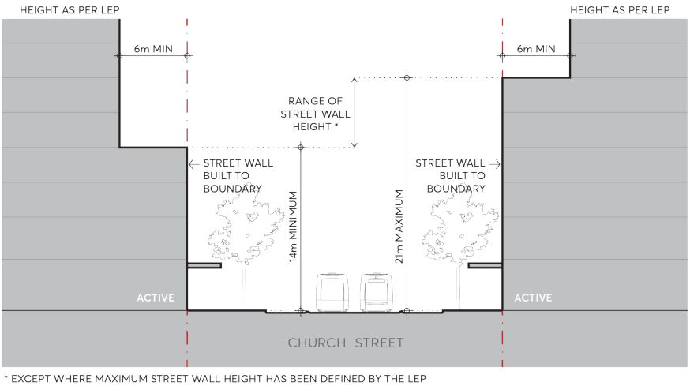

> [Picture on page 136: a picture, saved as a picture (images/part-09-parramatta-city-centre-page-136-7.gif, 150 dpi).]

Figure 9.5.11.5 – Typical Setbacks and Street Wall Height on Church Street (Section A)

b) On the eastern side of Villiers Street, a minimum 6m street setback must be provided of which 2m is to be dedicated to street widening for the Marsden Street Cycleway project as per Figure 9.5.11.6.

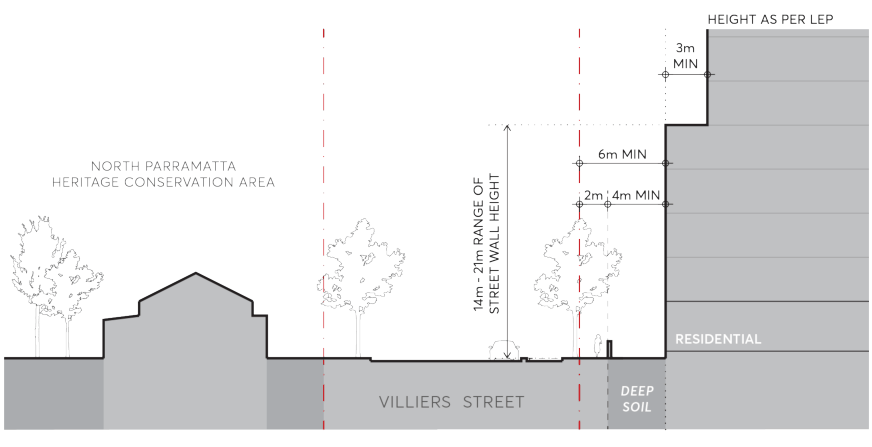

> [Picture on page 136: a picture, saved as a picture (images/part-09-parramatta-city-centre-page-136-12.gif, 150 dpi).]

Figure 9.5.11.6 – Typical Setback and Street Wall Height on Villiers Street (Section B)

c) Street setbacks and street wall heights on Harold Street must comply with Figure 9.5.11.7 (Section C). Development on the northern side of Harold Street must provide a 12 metre building setback to provide curtilage to the heritage item at 476 Church Street. The street

SPECIAL AREAS

wall must be set back a minimum 3 metres from the street boundary on the southern side of Harold Street with the tower set back a minimum of 3 metres from the street wall.

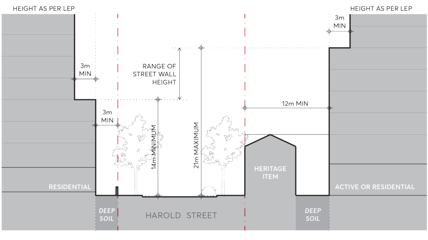

> [Picture on page 137: a picture, saved as a picture (images/part-09-parramatta-city-centre-page-137-4.gif, 150 dpi).]

Figure 9.5.11.7 – Typical Setbacks and Street Wall Height on Harold Street (Section C)

d) Street setbacks and street wall heights on Fennell Street must comply with Figure 9.5.11.8 (Section D). Development on the northern side of Fennell Street must provide a 3 metre building setback to align with the prevailing setback defined by heritage items on the street, and towers set back a minimum of 3 metres from the street wall. Development on the southern side of Fennell Street may be built to the street boundary with towers set back a minimum of 6 metres from the street wall.

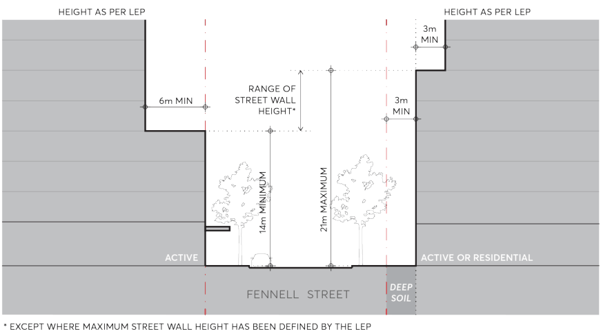

> [Picture on page 137: a picture, saved as a picture (images/part-09-parramatta-city-centre-page-137-12.gif, 150 dpi).]

Figure 9.5.11.8 – Typical Setbacks and Street Wall Height on Fennell Street (Section D)

e) Street setbacks and street wall heights on Grose Street must comply with Figure 9.5.11.9 (Section E). Development on the northern side of Grose Street must provide a 3 metre building setback to align with the prevailing setback defined by heritage items on the street, and towers set back a minimum of 3 metres from the street wall. Development on the

SPECIAL AREAS

southern side of Grose Street must provide a 2 metre building setback with towers set back a minimum of 6 metres from the street wall.

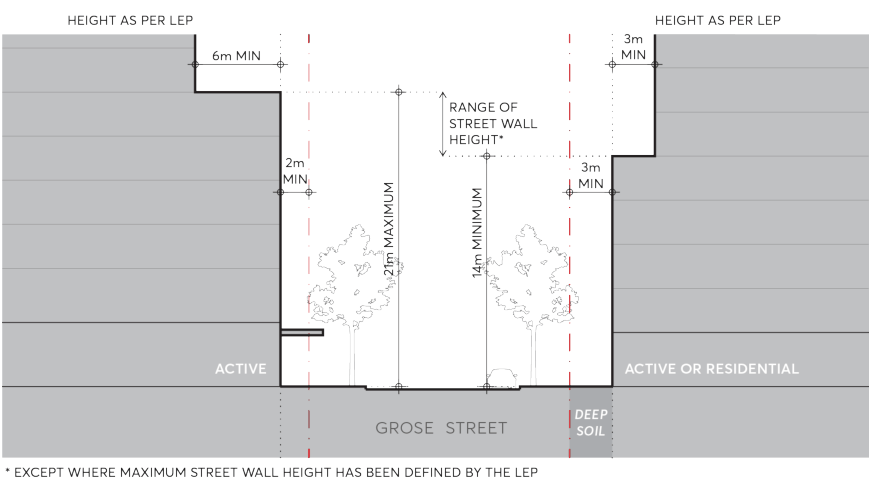

> [Picture on page 138: a picture, saved as a picture (images/part-09-parramatta-city-centre-page-138-4.gif, 150 dpi).]

Figure 9.5.11.9 – Typical Setbacks and Street Wall Height on Grose Street (Section E)

f) Street setbacks and street wall heights on Ross Street to the west of Church Street must comply with Figure 9.5.11.10 (Section F). Development on the northern side of Ross Street must provide a 10 metre building setback to provide curtilage around the heritage item at 387 Church Street. This space is to be provided as deep soil landscape to support large canopy tree planting. Development on the southern side of Ross Street may be built to the street boundary with towers set back a minimum of 6 metres from the street wall.

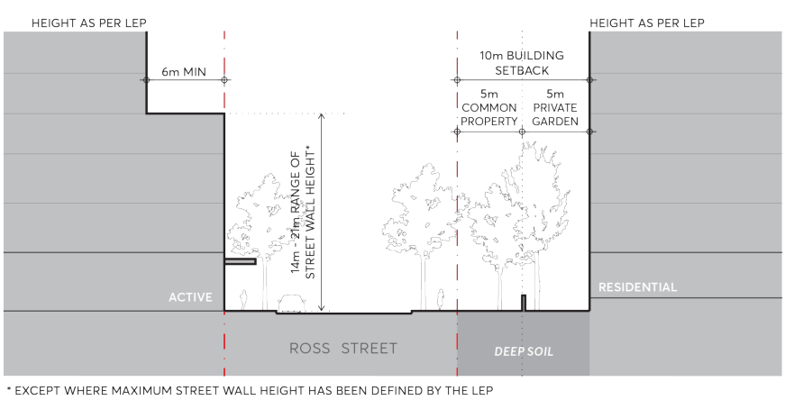

> [Picture on page 138: a picture, saved as a picture (images/part-09-parramatta-city-centre-page-138-12.gif, 150 dpi).]

Figure 9.5.11.10 – Typical Setbacks and Street Wall Height on Ross Street (Section F)

g) Buildings must provide a vegetated set back that is a minimum of 6 metres from the common boundary shared with lots to the east of the Church Street North Special Area, and towers set back a minimum of 9 metres from the common boundary as per Figure 9.5.11.11 (Section G), subject to building separation controls specified in C.07.

SPECIAL AREAS

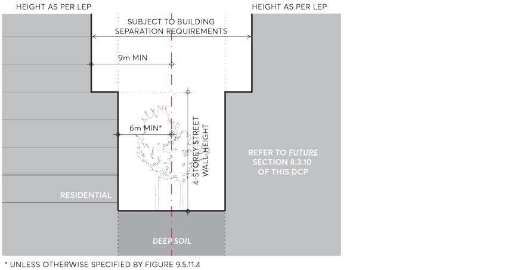

> [Picture on page 139: a picture, saved as a picture (images/part-09-parramatta-city-centre-page-139-2.gif, 150 dpi).]

Figure 9.5.11.11 – Setbacks and Street Wall Height to boundary shared with mid-block properties to the east (Section G)

h) Setbacks and street wall heights on east-west through site links must comply with Figure

9.5.11.12 (Section H). Development must provide a through site link that is a minimum of 6 metres wide. Tower setbacks are to be determined by building separation requirements.

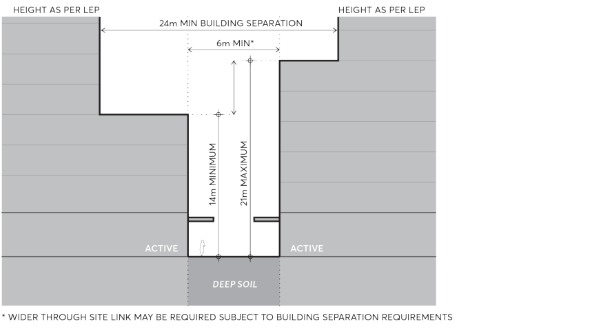

> [Picture on page 139: a picture, saved as a picture (images/part-09-parramatta-city-centre-page-139-8.gif, 150 dpi).]

Figure 9.5.11.12 – East West (Section H) Through Site Link Setbacks and Street Wall Height

i) Setbacks and street wall heights for any part of development at 440-444 to 458 Church Street must comply with Figure 9.5.11.13 (Section I). Development on these sites must provide a building set back of 14 metres from the street boundary to create curtilage around the heritage items. This set back must be open to sky and no part of the building may overhang heritage. Development on the western side of Church Street must be built to the street boundary with towers set back a minimum of 6 metres from the street wall.

SPECIAL AREAS

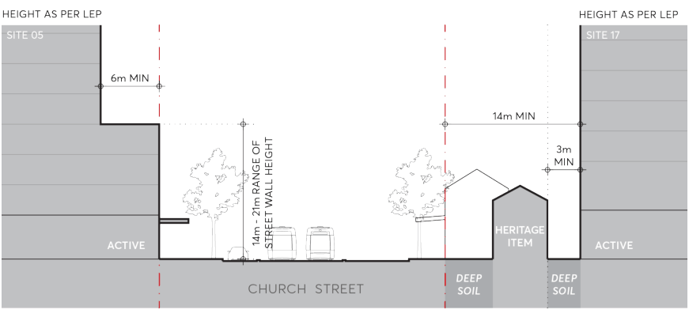

> [Picture on page 140: a picture, saved as a picture (images/part-09-parramatta-city-centre-page-140-2.gif, 150 dpi).]

Figure 9.5.11.13 – Site 17 (Section I) Setbacks and Street Wall Height

j) Setbacks and street wall heights on the future civic space must comply with Figure 9.5.11.14 (Section J). The civic space must have a minimum dimension of 30 metres in a north-south direction, and 24 metres in an east-west direction. The street wall height may be provided within the range of 14 metres to 21 metres, and towers set back a minimum of 3 metres from the street wall.

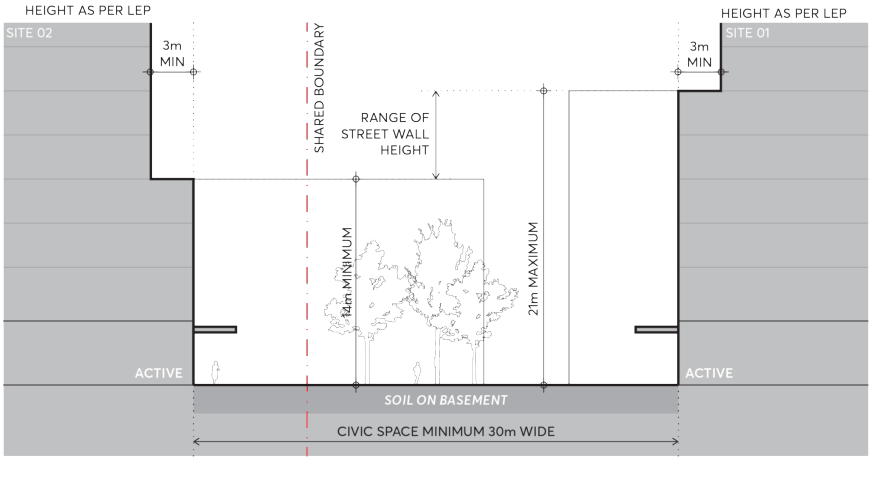

> [Picture on page 140: a picture, saved as a picture (images/part-09-parramatta-city-centre-page-140-9.gif, 150 dpi).]

Figure 9.5.11.14 – Civic Space (Section J) Setbacks and Street Wall Height

C.06 Development on the eastern side of Church Street must provide a setback to neighbouring properties within the North-East Parramatta Precinct (refer to future Section 8.3.10 of this DCP). Side setbacks must comply with Figure 9.5.11.4 - Church Street North Special Area Required Setbacks and Built Form and ensure consistency with building separation objectives of the Apartment Design Guide.

C.07 Where possible, buildings should be designed so that the short edge of towers may be orientated towards the North Parramatta HCA and Sorrell Street HCA to minimise their impact on these areas of heritage significance. Where possible, towers should be aligned across the block to create generous views to sky between towers when observed from either HCA, as per Figure 9.5.11.15.

SPECIAL AREAS

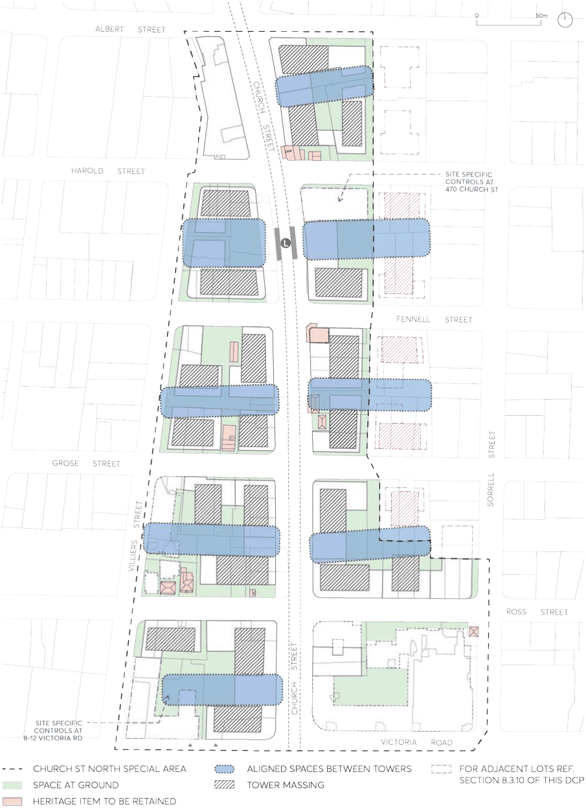

> [Picture on page 141: a picture, saved as a picture (images/part-09-parramatta-city-centre-page-141-2.gif, 150 dpi).]

Figure 9.5.11.15 – Spaces between towers to enable views to sky

C.08 Towers must have a minimum separation of:

a) 18 metres between primarily east-west facing facades as per Figure 9.5.11.16 and

b) 24 metres between primarily north-south facing facades as per Figure 9.5.11.17.

SPECIAL AREAS

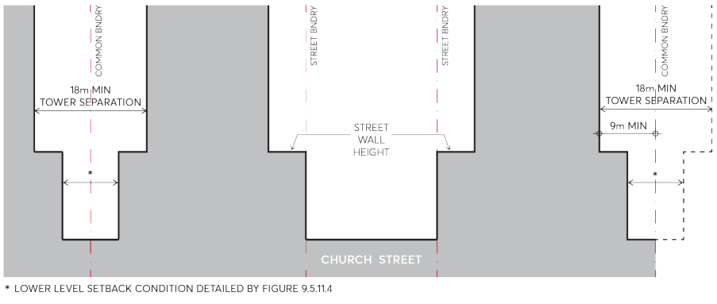

> [Picture on page 142: a picture, saved as a picture (images/part-09-parramatta-city-centre-page-142-2.gif, 150 dpi).]

Figure 9.5.11.16 – Tower separation between primarily east-west facing facades

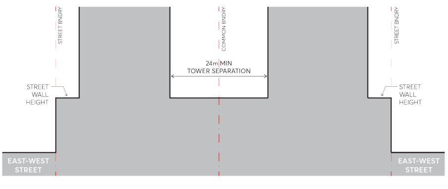

> [Picture on page 142: a picture, saved as a picture (images/part-09-parramatta-city-centre-page-142-4.gif, 150 dpi).]

Figure 9.5.11.17 – Tower separation between primarily north-south facing facades

C.09 All development containing a residential component must provide a minimum deep soil area equal to 7% of the total site area. All deep soil zones must have a minimum dimension of 6 metres x 6 metres.

C.10 Where green coloured areas are shown in Figure 9.5.11.4 - Church Street North Special Area Required Setbacks and Built Form it is desirable that these areas be used as a communal courtyard and/or landscaped area.

C.11 Deep soil is to be delivered primarily within the street setback zones and mid-block locations where they will be collocated with communal open space at ground.

C.12 Where the street setback adjoins active uses, the setback zone is to be provided as publicly accessible space and designed as an extension of the footpath. All stairs and ramps on active frontages must be internalised to ensure the public domain and front setback zones are kept relatively level, accessible and uncluttered.

C.13 Driveways servicing new development are not permitted on Church Street and Villiers Street. C.14 Pedestrian and vehicle conflict are to be minimised with limited vehicle crossings to the public domain. Crossings are to be generally in accordance with Figure 9.5.11.4 - Church Street North Special Area Required Setbacks and Built Form.

HERITAGE
