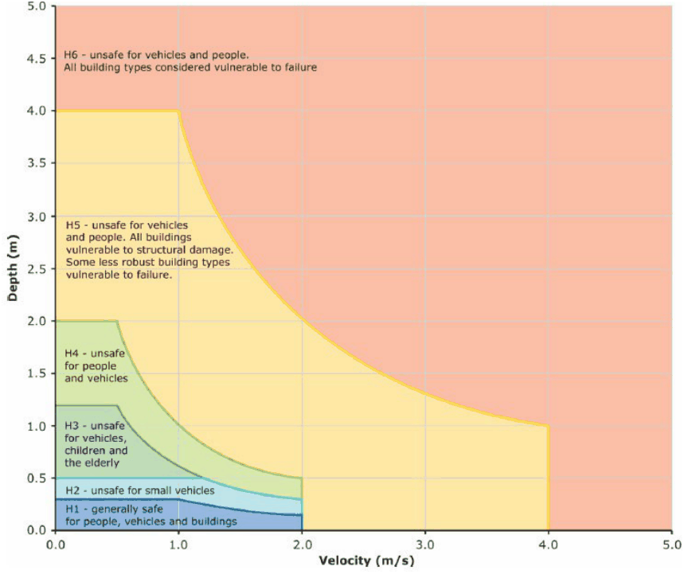

#### 9.7.1 ASSESSMENT AND MINIMISATION OF FLOOD HAZARDS, RISKS AND

#### POTENTIAL FOR HARM

Risk and Merit Assessment The NSW Floodplain Development Manual (FPDM) requires councils and consent authorities to adopt a ‘risk-based approach’ to floodplain development and mitigation of potential harm. This is based on a ‘merit assessment’. The FPDM sets out guidelines for this process and Council follows this approach. The FPDM defines merit approach as: “The merit approach weighs social, economic, ecological and cultural impacts of land use options for different flood prone areas together with flood damage, hazard and behaviour implications and environmental protection and well-being of the State’s rivers and floodplains. “The merit approach operates at two levels. At the strategic level it allows for the consideration of social, economic, ecological, cultural and flooding issues to determine strategies for the management of future flood risk which are formulated into Council plans, policy and Environmental Planning Instruments (EPIs). At a site specific level, it involves consideration of the best way of conditioning development allowable under the floodplain risk management plan, local flood risk management policy and EPIs. ”

“Risk of harm” is the product of likelihood and consequence. The likelihood is usually 1% AEP; and the consequence or harm describes the impact of the flow of floodwaters on people, property, buildings, etc, and the environment. Development proposals that significantly increase risk of harm to occupants and other people, or to property within or off the development site, or to the environment will not be supported. Hazard or ‘hydraulic hazard’ describes the behaviour of floodwaters and particularly the amount of flow, the extent, velocity and depth of that flow. This is primarily modelled for 1% AEP floods but may also be required for PMF conditions particularly in regard to shelter in place planning and for risk assessment of ‘sensitive’ and ‘critical’ uses.

FLOOD RISK MANAGEMENT

The hazard categories H1-H6 briefly describe these impacts (see below) and shows the relationships between floodwater velocity and depth and consequent hazard for each level. This methodology also summarises the risk of harm for each hazard level. Such hazard, risk and safety assessments will underpin Development Application assessment by Council and must be adequately addressed in any DA submission affected by mainstream or overland flow flooding. Often more detailed examination of hazard, risk and potential harm for a specific site and its proposed development will be required.

Objectives

O.01 Hazard, risk and safety assessments are required to demonstrate how risk and potential for harm to people, property, buildings, and the environment from floodwaters will be mitigated.

O.02 A risk-based approach to floodplain development and mitigation of potential harm based on a merit assessment consistent with the Flood Plain Development Manual (2005 or as updated) is required.

Controls

C.01 All development involving the construction of a new building or significant alterations to an existing building, and or intensification of a use must be supported by flood hazard modelling that is: based on the ‘General Flood Hazard Vulnerability Curves’ in Figure 9.7.1.1 for the 1% AEP flood and the PMF. is assessed in terms of the following hazard categories and risks of harm:

• H1 – generally safe for people vehicles and buildings.

• H2 – unsafe for small vehicles.

• H3 – unsafe for vehicles, children and the elderly. This includes all  floodwaters greater than 0.5m depth.

• H4 – unsafe for people and vehicles.

• H5 – unsafe for vehicles and people. All buildings vulnerable to structural  damage. Some less robust building types vulnerable to failure.

• H6 – unsafe for vehicles and people. All building types considered vulnerable to failure.

FLOOD RISK MANAGEMENT

> [Picture on page 157: a picture, saved as a picture (images/part-09-parramatta-city-centre-page-157-2.gif, 150 dpi).]

Figure 9.7.1.1 – General flood hazard vulnerability curves 2

2 Source: Australian Disaster Resilience Guideline 7‐3 Flood Hazard (AIDR 2017) See also: Australian Rainfall and Runoff (2017, 2019)

C.02 All development involving the construction of a new building or significant alterations to an existing building, and or intensification of a use is to be supported by a merit-based flood hazard and risk assessment that: Presents evidence-based analysis of the hazard, risk and harm to occupants and those in the surrounds and demonstrates how harmful factors will be mitigated. Includes information on the following aspects as necessary, to enable Council to assess risk and potential for harm.

• 1% AEP and 5% AEP and PMF flood levels, flood extents, flow rates, depths and velocities and hazard conditions for mainstream and overland flow floods.

• Modelled hydraulic hazard levels, (H1-H6), extent and behaviour for 1% AEP mainstream and overland flow floods.

• Warning times and duration of flooding.

• Available warning systems (if any).

• Characteristics and vulnerabilities of future occupants.

• Likelihood of multiple storms – and multiple flood peaks.

• ‘Horizontal’ evacuation pathways including accessibility considerations.

FLOOD RISK MANAGEMENT

• ‘Vertical’ evacuation opportunities and shelter in place facilities above the PMF.

• Emergency services access availability.

• Local terrain.

• The development in context.

• The proposed use and occupation of the development.
