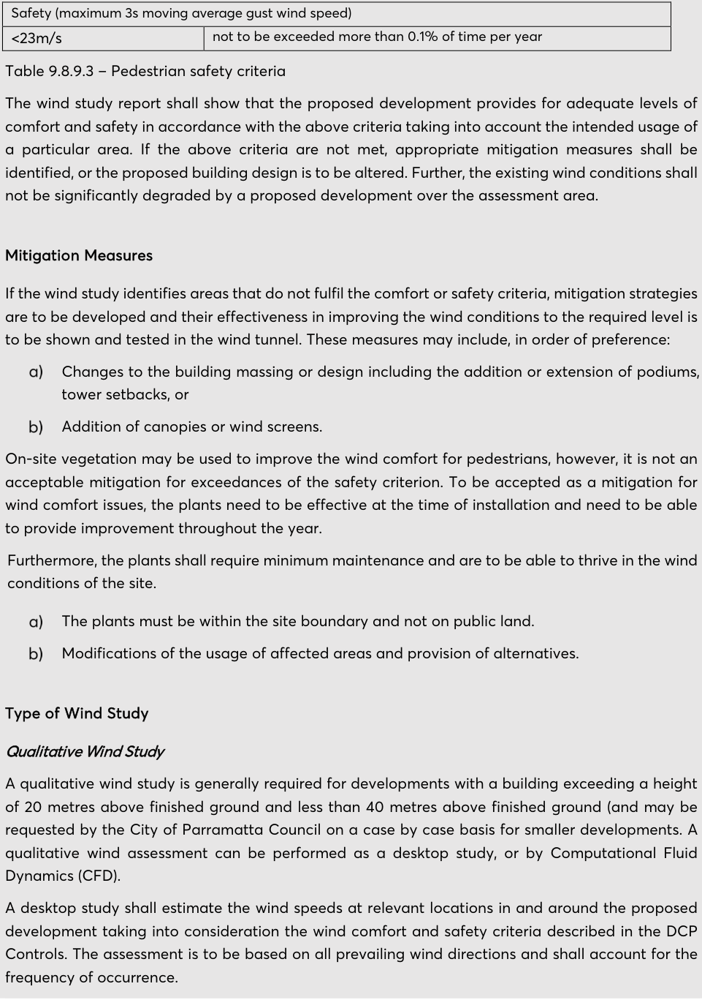
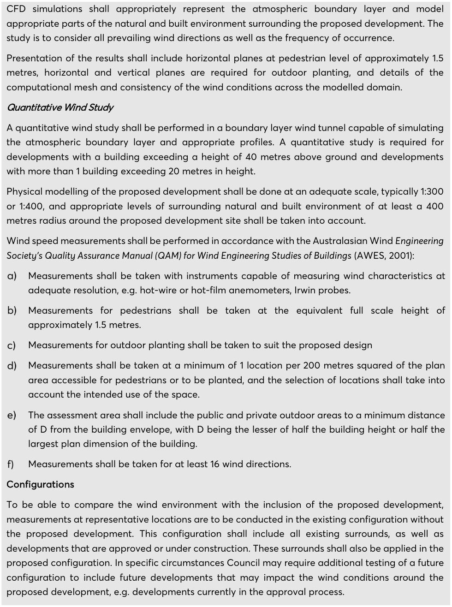

#### 9.8.9.2 TECHNICAL REQUIREMENTS – WIND MITIGATION PERFORMANCE

METHODOLOGY

These technical requirements are based on: CCP Wind Assessment for: City of Parramatta November 2016 CCP Project 9776.

Expertise

A wind study shall be performed by a professional wind engineer with experience in wind issues in the built environment. The applicant or the wind engineer is to consult the City of Parramatta’s Planning Department prior to lodging the development application to agree on the type and approach of the wind study required for the proposed development.

Wind data

Historical data of wind speed and direction collected over a minimum of 10 years shall be used as the basis of a pedestrian level wind study. Data from the Bankstown Airport Bureau of Meteorology anemometer starting earliest in 1993 shall be used and adequately corrected for the effects of differences in roughness of the surrounding natural and built environment. The use of wind data for daytime hours between 6am and 9pm is generally recommended and may be specifically requested by the City of Parramatta, however, wind data for all hours may be used as well, where appropriate. Climate data are to be presented in the wind study report.

Criteria

The criteria for pedestrian level wind comfort are based on published research, particularly on the criteria developed Lawson in The Determination of the wind environment of a building complex before construction, Department of Aerospace Engineering, University of Bristol, Report Number.  Pedestrian safety is affected by both the mean and the gust wind speed. The criteria in Table 9.8.9.2 below are to be applied to both the mean wind speed and the Gust Equivalent Mean (GEM), i.e. the 3 s gust wind speed in an hour divided by 1.85.

| Comfort (maximum of mean and gust equivalent mean (GEM*) wind speed exceeded 5% of the time) |  |
|---|---|
| < 2 m/s | Outdoor restaurant dining |
| 2-4 m/s | Sitting (such as café style dining), or scheduled outdoor events |
| 4-6 m/s | Standing, generally supports outdoor planting |
| 6-8 m/s | Walking in retail areas / active street frontages |
| 8 - 10 m/s | Walking / non-active street frontages (objective walking from A to B or for cycling) |
| > 10 m/s | Uncomfortable |
| Distress (maximum of mean or GEM wind speed exceeded 0.022% of the time) |  |

Table 9.8.9.2 – Mean wind speed Note – *The gust equivalent mean (GEM) is the peak 3 s gust wind speed divided by 1.85.

ENVIRONMENTAL SUSTAINABILITY

The criterion in Table 9.8.9.3 below for pedestrian safety is based on the Guidelines of the Australian Wind Engineering Society (2014).

> [Picture on page 187: a picture, saved as a picture (images/part-09-parramatta-city-centre-page-187-4.gif, 150 dpi).]
> Words printed on the picture (copied from the PDF):
> Safety (maximum 3s moving average gust wind speed)
> <23m/s
> not to be exceeded more than 0.1% of time per year
> Mitigation Measures
> Type of Wind Study

Table 9.8.9.3 – Pedestrian safety criteria

The wind study report shall show that the proposed development provides for adequate levels of comfort and safety in accordance with the above criteria taking into account the intended usage of a particular area. If the above criteria are not met, appropriate mitigation measures shall be identified, or the proposed building design is to be altered. Further, the existing wind conditions shall not be significantly degraded by a proposed development over the assessment area.

If the wind study identifies areas that do not fulfil the comfort or safety criteria, mitigation strategies are to be developed and their effectiveness in improving the wind conditions to the required level is to be shown and tested in the wind tunnel. These measures may include, in order of preference: Changes to the building massing or design including the addition or extension of podiums, tower setbacks, or Addition of canopies or wind screens.

On-site vegetation may be used to improve the wind comfort for pedestrians, however, it is not an acceptable mitigation for exceedances of the safety criterion. To be accepted as a mitigation for wind comfort issues, the plants need to be effective at the time of installation and need to be able to provide improvement throughout the year. Furthermore, the plants shall require minimum maintenance and are to be able to thrive in the wind conditions of the site.

The plants must be within the site boundary and not on public land. Modifications of the usage of affected areas and provision of alternatives.

Qualitative Wind Study A qualitative wind study is generally required for developments with a building exceeding a height of 20 metres above finished ground and less than 40 metres above finished ground (and may be requested by the City of Parramatta Council on a case by case basis for smaller developments. A qualitative wind assessment can be performed as a desktop study, or by Computational Fluid Dynamics (CFD). A desktop study shall estimate the wind speeds at relevant locations in and around the proposed development taking into consideration the wind comfort and safety criteria described in the DCP Controls. The assessment is to be based on all prevailing wind directions and shall account for the frequency of occurrence.

ENVIRONMENTAL SUSTAINABILITY

> [Picture on page 188: a picture, saved as a picture (images/part-09-parramatta-city-centre-page-188-2.gif, 150 dpi).]

CFD simulations shall appropriately represent the atmospheric boundary layer and model appropriate parts of the natural and built environment surrounding the proposed development. The study is to consider all prevailing wind directions as well as the frequency of occurrence. Presentation of the results shall include horizontal planes at pedestrian level of approximately 1.5 metres, horizontal and vertical planes are required for outdoor planting, and details of the computational mesh and consistency of the wind conditions across the modelled domain. Quantitative Wind Study A quantitative wind study shall be performed in a boundary layer wind tunnel capable of simulating the atmospheric boundary layer and appropriate profiles. A quantitative study is required for developments with a building exceeding a height of 40 metres above ground and developments with more than 1 building exceeding 20 metres in height. Physical modelling of the proposed development shall be done at an adequate scale, typically 1:300 or 1:400, and appropriate levels of surrounding natural and built environment of at least a 400 metres radius around the proposed development site shall be taken into account. Wind speed measurements shall be performed in accordance with the Australasian Wind Engineering Society’s Quality Assurance Manual (QAM) for Wind Engineering Studies of Buildings (AWES, 2001): Measurements shall be taken with instruments capable of measuring wind characteristics at adequate resolution, e.g. hot-wire or hot-film anemometers, Irwin probes. Measurements for pedestrians shall be taken at the equivalent full scale height of approximately 1.5 metres. Measurements for outdoor planting shall be taken to suit the proposed design Measurements shall be taken at a minimum of 1 location per 200 metres squared of the plan area accessible for pedestrians or to be planted, and the selection of locations shall take into account the intended use of the space. The assessment area shall include the public and private outdoor areas to a minimum distance of D from the building envelope, with D being the lesser of half the building height or half the largest plan dimension of the building. Measurements shall be taken for at least 16 wind directions. Configurations To be able to compare the wind environment with the inclusion of the proposed development, measurements at representative locations are to be conducted in the existing configuration without the proposed development. This configuration shall include all existing surrounds, as well as developments that are approved or under construction. These surrounds shall also be applied in the proposed configuration. In specific circumstances Council may require additional testing of a future configuration to include future developments that may impact the wind conditions around the proposed development, e.g. developments currently in the approval process.

VEHICULAR ACCESS, PARKING AND SERVICING
