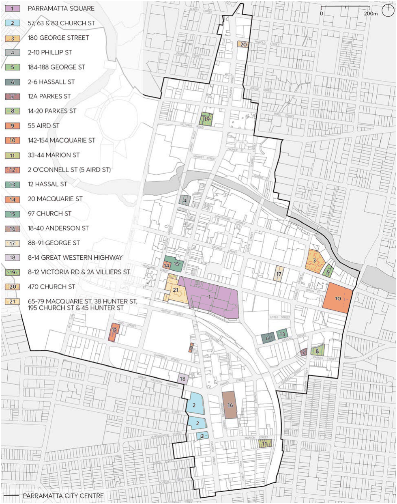

### 9.10 SITE SPECIFIC CONTROLS

This section contains development controls for specific sites in the City Centre as identified in Figure 9.10.

> [Picture on page 195: a picture, saved as a picture (images/part-09-parramatta-city-centre-page-195-4.gif, 150 dpi).]

Figure 9.10 – Land parcels with Site Specific Controls

PARRAMATTA SQUARE
