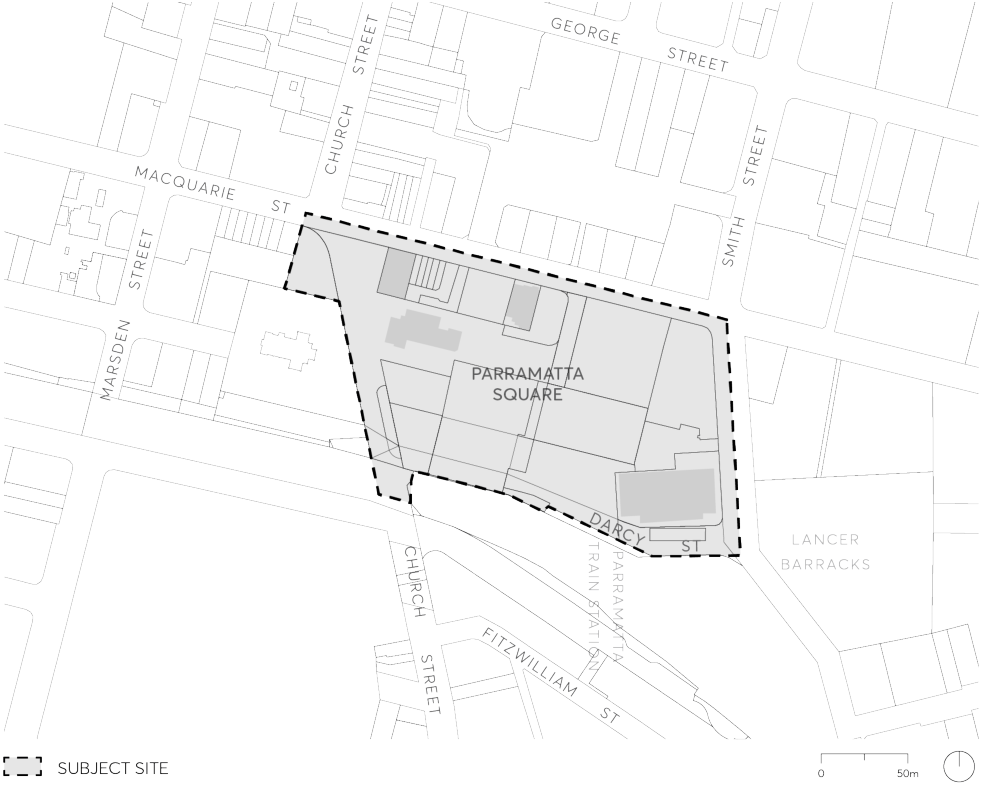

#### 9.10.1 PARRAMATTA SQUARE

This Section applies to Parramatta Square which is bounded by Macquarie, Smith, Darcy and Church Streets, Parramatta as shown in Figure 9.10.1.

> [Picture on page 196: a picture, saved as a picture (images/part-09-parramatta-city-centre-page-196-5.gif, 150 dpi).]

Figure 9.10.1 – Land application map

This Section must be read in conjunction with other parts of Parramatta DCP 2023 and the Parramatta LEP 2023. If there is any inconsistency between this Section and other Sections of the Parramatta DCP 2023, this Section prevails.
