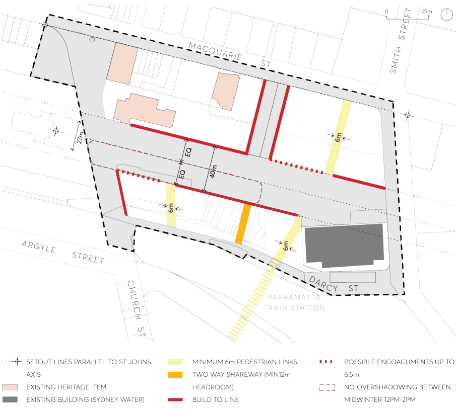
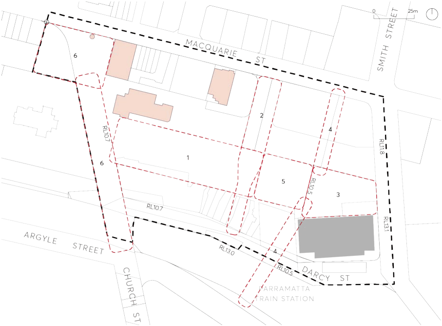

#### 9.10.1.3 BUILDING FORM

The development provisions on building form in this section are intended to encourage high quality design for new buildings, balancing the character of Parramatta with innovation and creativity. The resulting built form and character of new development should contribute to an attractive public domain in central Parramatta and produce a desirable setting for its intended uses.

Objectives

O.01 Establish high quality architectural and urban design for public spaces and buildings. O.02 Design buildings with high level of environmental performance to encourage comfort and full occupation.

O.03 Incorporate noise attenuation features in buildings to minimise the effects of noise generated by activities in adjacent open space and the nearby railway line.

O.04 Design buildings and open space to minimise wind generation and effects through building form, articulation, screening, galleries and the like.

Controls

C.01 The pattern of buildings on the site is to create a central public open space generally at existing ground level with a direct connection to the adjacent transport interchange as shown in Figures

9.10.1.2 and 9.10.1.3.

C.02 New buildings are to have street frontages predominantly built to the street and public domain alignment.

C.03 Provide for additional footpath width at the corner of Macquarie and Smith Streets to accommodate pedestrian intensity in this location.

C.04 Development on land fronting Macquarie Street must recognise the heights of the heritage buildings and reflect the predominant datums (5-6 storey podiums and 2-3 storey heritage buildings) within this part of the street, through a recessed podium, colonnade, strong shadow lines or similar.

C.05 Commercial towers on land fronting Macquarie Street may be built to the street frontage to limit overshadowing to the public space to the south.

C.06 Residential towers on land fronting Macquarie Street require a podium and setback to the tower for amenity reasons.

C.07 Overshadowing is to be minimised within the area outlined in red in Figure 9.10.1.2. Individual buildings shall be designed so that no single point of the area outlined in red is in shadow for a period greater than 45 minutes between 12pm-2pm mid-winter.

C.08 All development is to implement:

a) heritage conservation principles,

b) sustainable development principles, particularly in regards to energy and water minimisation, waste minimisation and adapting to the impacts of climate change,

PARRAMATTA SQUARE

c) safety by design principles, and

d) equal access to all facilities as required by legislation.

> [Picture on page 201: a picture, saved as a picture (images/part-09-parramatta-city-centre-page-201-4.gif, 150 dpi).]

Figure 9.10.1.2 – Public Space Set Out

PARRAMATTA SQUARE

> [Picture on page 202: a picture, saved as a picture (images/part-09-parramatta-city-centre-page-202-2.gif, 150 dpi).]

Figure 9.10.1.3 – Public Space Principles

C.09 The detailed requirements in Figure 9.10.1.3 - Public Space Principles are provided below:

1\. Main Square:

i. Main Civic Space

ii. Minimum 3,000 sqm with minimum dimension 40 metre with consistent edge alignment

iii. Ceremonial public area designed to be the symbolic centre of Parramatta

iv. Accommodate a rich program of events

v. Limited vehicle access

2\. Leigh Place:

i. Main northern entrance to Parramatta Square from the River Link and Macquarie Street

ii. Accommodate vehicle and service access

3\. Eastern Square:

i. Provides address to Smith Street, 169 Macquarie Street and the Sydney Water building

ii. Must integrate with raised forecourt of Sydney Water

4\. Pedestrian Lanes:

PARRAMATTA SQUARE

i. Activated lanes between the railway station, Station Square and Macquarie Street

ii. Direct connection to station concourse

iii. No vehicles

5\. Station Square:

i. The hub where the railway station meets the square; a front door to Parramatta City

ii. An activated space that facilitates easy pedestrian access, orientation and seamless choice of desired routes and destinations

iii. No vehicles

6\. Church Street Mall and Centenary Square:

i. Retain as Parramatta’s most enduring public space, including landscaping and heritage buildings and monuments

ii. Ensure access for potential future light rail along Church Street
