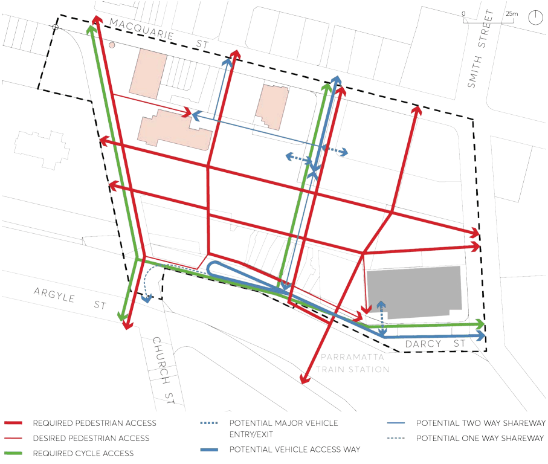

#### 9.10.1.5 ACCESS, PARKING AND SERVICES

A street network appropriate for purpose is critical for a functioning City Centre. Giving frontage to buildings need to be balanced with creating a public domain that prioritises pedestrian movement.

Objectives

O.01 Ensure that new development in Parramatta Square addresses the street. O.02 Provide for limited vehicular access into the centre of the site. O.03 To support the reduction of car trips and encourage the use of sustainable transport. O.04 Ensure that Parramatta Square functions as the northern gateway to the Parramatta Railway Station and Bus Interchange.

PARRAMATTA SQUARE

Controls

C.01 New streets, lanes, public spaces and vehicles access points to buildings in Parramatta Square are to be consistent with the pedestrian and vehicle access principles in Figure 9.10.1.4 and the public spaces principles shown on Figure 9.10.1.2.

C.02 Allow for a possible shared access and servicing zone along the length of the Parramatta Station entrance frontage along Darcy Street.

C.03 Consideration should be given for the provision of electric vehicle charging stations on the site. C.04 Provide adequate public access and sunlight along Darcy Street. C.05 Commuter bicycle parking (short and long term) is to be provided on the site. C.06 Individual developments will be required to provide car-share parking spaces that are available for use by the public and car share members.

C.07 Written evidence must be provided with the development application demonstrating that offers of a car space to car-share providers have been made together with the outcome of the offers or a letter of commitment to the service.

C.08 Ensure that the following on-street parking uses are accommodated: pick up/set down for rail passengers; taxis; rail replacement buses; the loop bus; buses for special events at Rosehill Racecourse and UWS; coaches for any hotel or tourist facility in the precinct; maintenance of the precinct and rail assets; and short stay parking for loading, library use, and couriers.

C.09 Detailed public domain designs should include shared pedestrian and cycle access. C.10 Development Applications are to be informed by a precinct-wide traffic management study.

PARRAMATTA SQUARE

> [Picture on page 206: a picture, saved as a picture (images/part-09-parramatta-city-centre-page-206-2.gif, 150 dpi).]

Figure 9.10.1.4 – Pedestrian and Vehicle Access Principles
