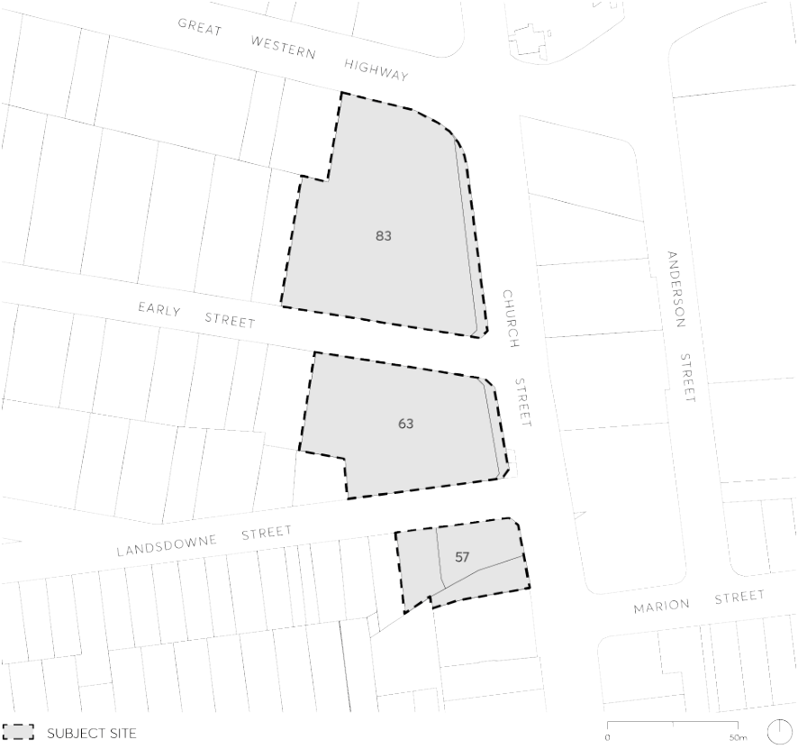

#### 9.10.2 57, 63 AND 83 CHURCH STREET

This Section applies to land at 57, 63 and 87 Church Street, Parramatta. The subject land comprises 3 parcels fronting Church Street and the Great Western Highway, Early Street and Lansdowne Streets, as shown in Figure 9.10.2.

> [Picture on page 209: a picture, saved as a picture (images/part-09-parramatta-city-centre-page-209-6.gif, 150 dpi).]

Figure 9.10.2 – Land application map

This Section must be read in conjunction with other Sections of this DCP and Parramatta LEP 2023.  If there is any inconsistency between this Section and other Sections of Parramatta DCP 2023, this Section prevails.

This Section establishes objectives and controls to be interpreted during preparation and assessment of development applications and supports the objectives of the LEP.
