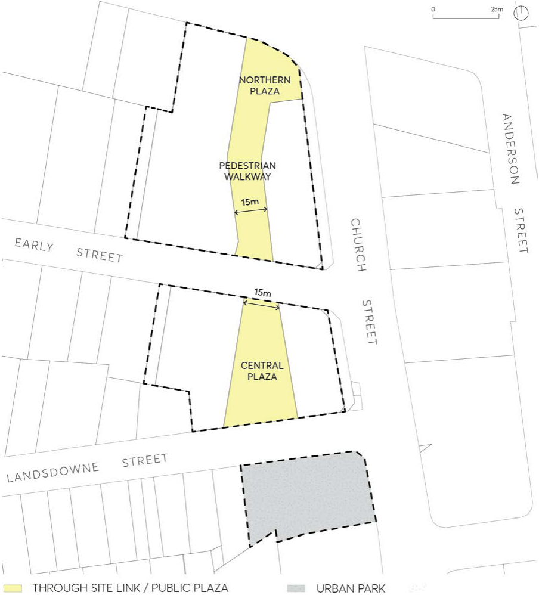

#### 9.10.2.3 PUBLIC DOMAIN

The site offers an opportunity to enhance the public domain through improvements to streets, lanes, plazas and urban parks.

Objectives

O.01 Create an environment that is comfortable for pedestrians. O.02 Ensure a high level of pedestrian amenity, safety and security through the inclusion of weather protection, lighting and safety by design principles.

O.03 Ensure pedestrian walkway areas are formed from a sequence of spaces and plazas running north-south, connecting all 3 parcels of land.

O.04 Facilitate and establish social uses of public plaza space and walkways such as cafes, restaurants, bars, markets, with public seating areas.

O.05 Ensure that where utilities are visible from the public domain, that their appearance and design is of the highest quality.

O.06 Provide for effective linkages and interfaces between public space and private land and provide a high quality physical setting and surrounds for buildings.

Controls

C.01 New pedestrian walkways, park and plazas shall be provided in accordance with Figure 9.10.2.2 and should be no less than minimum size indicated in the control table below:

| Public Domain | Minimum Size in Sqm (m2) |
|---|---|
| Northern Plaza/Pedestrian Walkway | 1,600 |
| Central Plaza | 1.350 |
| Urban Park | 1,790 |

C.02 Public street frontages are to comply with the Parramatta Public Domain Guidelines and are to have:

a) appropriate paving and urban elements;

b) Public Art suitable for the site; and

c) appropriate spaces for outdoor trading and outdoor dining.

C.03 Pedestrian walkways are to comply with Section 6.3 – Laneways in Parramatta Public Domain Guidelines.

C.04 Pedestrian walkways are to be generally 15m wide, with a 4m zone clear of obstructions to movement to allow for sufficient space for outdoor trading and dining.

C.05 Awnings and colonnades are to be provided along building frontages along public domain to provide shade and shelter.

C.06 Where colonnades are provided, they must:

57, 63 AND 83 CHURCH STREET

a) be continuous for the entire public domain frontage or link with awnings;

b) have a minimum width of 4.5m between columns; and

c) a minimum height of 4.5m to the underside of soffit.

C.07 The southern site is to be provided as an Urban Park in accordance with Figure 9.10.2.2. The design of this park will balance public access and amenity with safety with water management objectives.

> [Picture on page 212: a picture, saved as a picture (images/part-09-parramatta-city-centre-page-212-8.gif, 150 dpi).]

Figure 9.10.2.2 – Public Domain

57, 63 AND 83 CHURCH STREET
