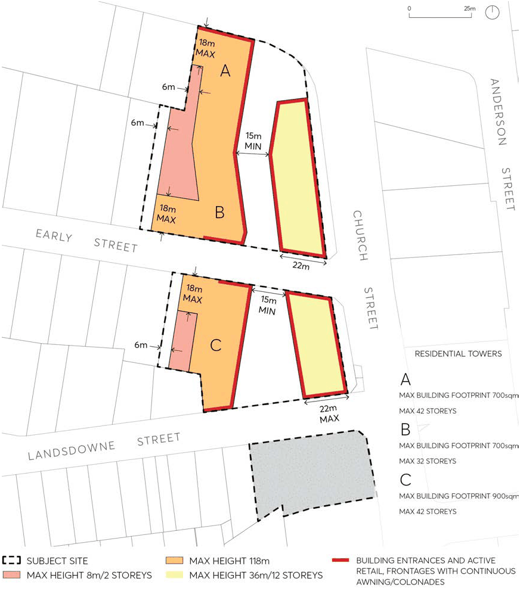
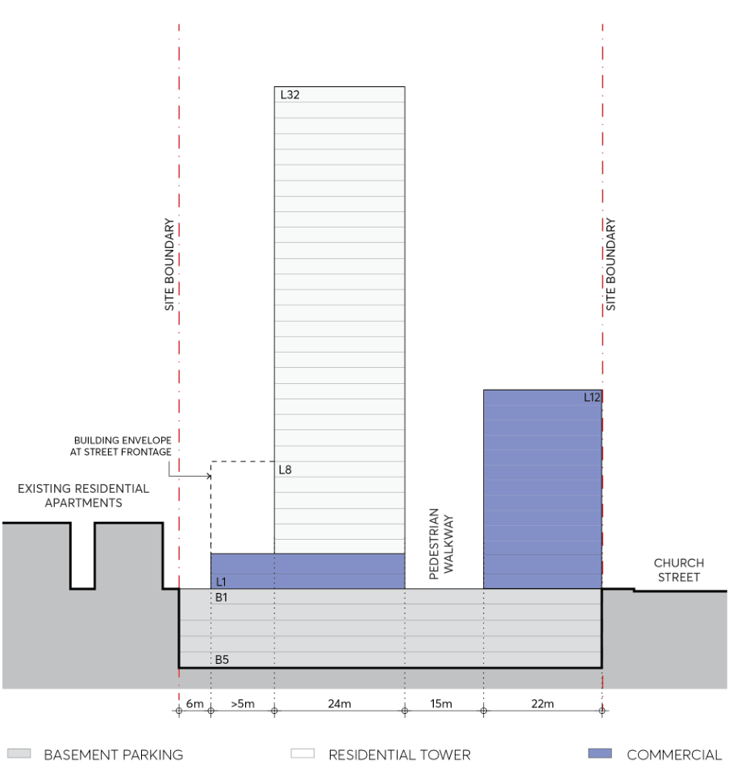

#### 9.10.2.4 BUILDING FORM

The development provisions on building form in this section are intended to encourage high quality design for new buildings. The resulting built form and character of development should contribute to an attractive public domain and produce a desirable setting for its intended uses.

Objectives

O.01 Establish high quality architectural and urban design for buildings. O.02 Locate high density housing with good access to retail, employment, transport, and high quality public domain and open space.

O.03 Provide for a variety of retail experiences by way of new format automotive retail, specialty shops, and supermarket.

O.04 Provide appropriate articulation of building form that is responsive to street address, microclimate and pedestrian-orientated environment.

O.05 Ensure that new development minimises and mitigates adverse overshadowing and privacy impact on adjoining public domain and land uses.

O.06 Ensure the setback of residential towers is at an appropriate distance from heavily used streets of Church Street and the Great Western Highway.

O.07 Create active streets and plazas by locating fine grain shop fronts at the ground floor with all fronts and entrances at street level.

Controls

Building Envelopes C.01 Future built form should be consistent with the building envelopes shown at Figure 9.10.2.3 and Figure 9.10.2.4

C.02 New buildings along Church Street should not exceed the maximum building depth of 22m, shown on Figure 9.10.2.3 and Figure 9.10.2.4.

C.03 Residential towers should not exceed the maximum building internal floor plate requirement, shown on Figure 9.10.2.3.

Building Height C.04 Building heights shall be in accordance with Figure 9.10.2.3 and Figure 9.10.2.4 to respond to the context, to provide visual interest and to minimise and mitigate adverse overshadowing and privacy impact to adjoining public domain and land use.

C.05 Additional storeys above 32 storeys on 63 Church Street must be reasonably modulated and stepped in on a smaller floor plate.

Building Setbacks C.06 Building setbacks are to be in accordance with Figure 9.10.2.3 and Figure 9.10.2.4. C.07 Provide 6m building setback in key locations along the western boundaries of the site as shown on Figure 9.10.2.3 and Figure 9.10.2.4.

57, 63 AND 83 CHURCH STREET

C.08 Where a zero allotment setback is provided a merit assessment will be undertaken with consideration given to the amenity impact on adjacent properties. Consideration should be given to the provision of articulation and high-quality architectural treatment and materials to avoid bland, imposing expanses of wall to neighbouring properties.

> [Picture on page 214: a picture, saved as a picture (images/part-09-parramatta-city-centre-page-214-6.gif, 150 dpi).]

Figure 9.10.2.3 – Building Form Control Plan

Building Separation C.09 Minimum separation between buildings should be in accordance with Figure 9.10.2.3 and Figure 9.10.2.4.

Frontage, activities and entries C.10 Continuous active frontages are to be in accordance with Figure 9.10.2.3 This should include retail and commercial spaces.

57, 63 AND 83 CHURCH STREET

C.11 Access to residential use and commercial use above ground level should be provided directly from plaza or pedestrian walkway.

> [Picture on page 215: a picture, saved as a picture (images/part-09-parramatta-city-centre-page-215-4.gif, 150 dpi).]

Figure 9.10.2.4 – Building Form Control Section (Northern Side)
