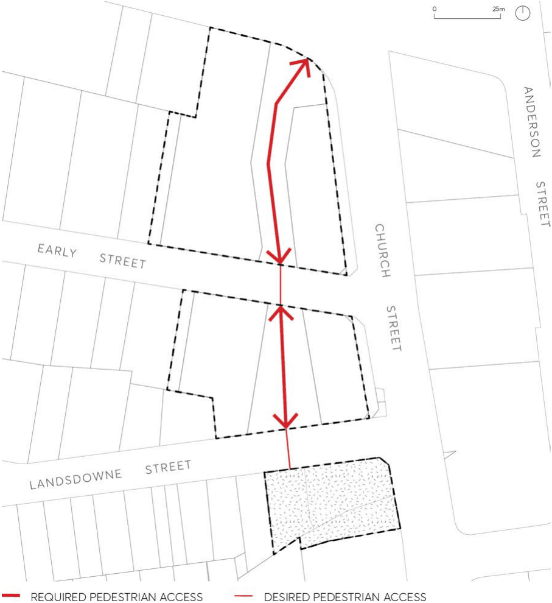

#### 9.10.2.6 ACCESS, PARKING AND SERVICING

Provide access for vehicles to the site balanced with pedestrian amenity, access, and safety.

Objectives

O.01 Provide for safe and easy access for all pedestrians, cyclists, vehicles to buildings and public domain.

O.02 Locate vehicle access points into buildings to minimise pedestrian and cycle conflicts. O.03 Ensure that service vehicle access points are concealed as far as possible on major pedestrian routes.

O.04 Provide all parking underground for residents and visitors to ensure an active, vibrant, and car-free public domain.

O.05 Implement appropriate traffic management measures on Early and Lansdowne Streets. O.06 Encourage an improved level of pedestrian connectivity of the site to the City Centre.

Controls

C.01 Footpaths, cycle links, pedestrian walkways, plazas and vehicle access points to buildings are to be consistent with the pedestrian and vehicle access principles as shown on Figure 9.10.2.5.

57, 63 AND 83 CHURCH STREET

> [Picture on page 217: a picture, saved as a picture (images/part-09-parramatta-city-centre-page-217-2.gif, 150 dpi).]

Figure 9.10.2.5 – Access and Servicing

C.02 Service vehicle access points and utilities are to be minimised along pedestrian routes and adjacent public open space. Where necessary, utilities are to be incorporated into building design.

C.03 Locate public bicycle racks on ground level, on the street and within the pedestrian walkways linking to key destinations within the development and the cycle network.

C.04 Locate traffic management measures and pedestrian crossings on Early and Lansdowne Streets to enable the continuation of the pedestrian walkway and priority access for pedestrians.

C.05 The development of the northernmost site should not preclude future pedestrian connection across (over or under) Church Street or Great Western Highway.

180 GEORGE STREET
