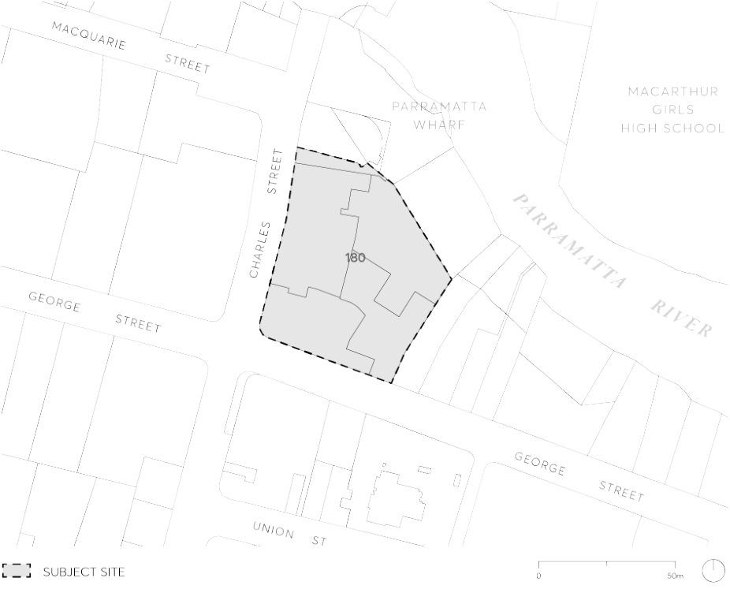

#### 9.10.3 180 GEORGE STREET

This Section applies to 180 George Street, Parramatta situated at the intersection of George and Charles Street. The site comprises Lots 201-204 in deposited plan 1082194 and SP74916 as illustrated in Figure 9.10.3.

> [Picture on page 218: a picture, saved as a picture (images/part-09-parramatta-city-centre-page-218-6.gif, 150 dpi).]

Figure 9.10.3 – Land application map

This Section is to be read in conjunction with other Sections of Parramatta DCP 2023 as well as the relevant provisions in Parramatta LEP 2023. If there is any inconsistency between this section and other sections of the DCP, this section prevails.
