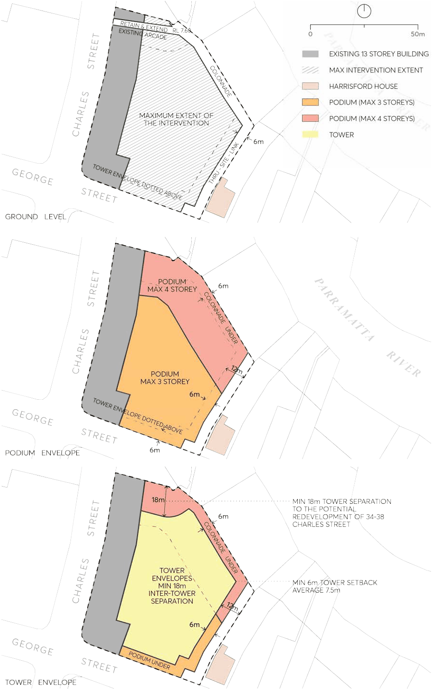

#### 9.10.3.1 DESIRED FUTURE CHARACTER

New development supports the Parramatta City Centre in its role as a Metropolitan Centre with easy access to public transport, entertainment and recreational facilities. New development is to respond to the site’s unique setting adjacent to the Parramatta River and open space. New development provides a design response that is sensitive to the adjoining heritage context whilst responding to the future envisaged scale of the City Centre. Harrisford House, a state heritage listed item, is situated immediately to the east. Minimum setback distances between the heritage item and new development are observed.

180 GEORGE STREET

The redevelopment of the site establishes active edges for the ground level of retail/serviced apartments and other non-residential uses to the surrounding streets and the river, whilst integrating with its immediate context. Slender articulated tower forms of varying heights are realised with a podium of above ground car parking. George Street and Charles Street which form the major frontages to the site. Design is to encourage activation to these streets through the provision of non-residential uses at ground floor level. The river frontage and eastern edge of the development at ground level (interface with Harrisford House) forms secondary frontages with public access links and activation through the provision of childcare facilities, retail uses, serviced apartments or other non-residential uses. A high level of connectivity through and around the site is achieved. Future redevelopment is provides an “open air” through site link along the site’s eastern boundary adjacent to Harrisford House which opens up a secondary access corridor from George Street to and from the river foreshore reserve. A public access link along the river frontage provides a continuous public connection above the flood level and increases pedestrian access to the surrounding street network.

Site Objectives

O.01 Ensure future development of the site respects the curtilage of the adjoining heritage item (Harrisford House).

O.02 Maintain the site through link along the site’s eastern and northern boundary to and from the river foreshore reserve to George Street at this side.

O.03 Redevelop the site to allow for a high quality development comprising a mix of uses including high density residential, retail and community facilities.

O.04 Deliver a design approach that adds visual interest and diversity to the city skyline. O.05 Integrate new built form with existing development in the subject block. O.06 Integrate new site linkages with surrounding development context and topography.

Controls

C.01 Street Wall and Building Height

a) Figure 9.10.3.2 illustrates the maximum permitted podium heights for the development:

• A maximum street wall height of 3 storeys to George Street to provide an interface with the adjoining heritage item to the east.

• Provide a minimum 6 metre tower setback from the edge of George Street.

b) Where new development involves the demolition of the existing serviced apartment building fronting Charles Street, a maximum street wall height of 6 storeys to the Charles Street frontage will apply.

c) Where more than one tower form is proposed variable building heights should be developed to add visual interest to the skyline. A minimum height variation of 10 storeys between the towers is required.

180 GEORGE STREET

C.02 Building Setbacks and Envelopes

a) Building setbacks and envelopes are to be in accordance with Figure 9.10.3.2.

b) At street level open pedestrian path is to be provided along the full length of the eastern boundary of the site adjacent to Harrisford House as shown in Figure 9.10.3.2 consisting of a minimum 6 metre setback to the site’s boundary with Harrisford House. The setback zone will be occupied by a through-site link between George Street and the river foreshore reserve.

c) Encroachments into the 6 metre setback along the site’s eastern boundary in the form of balconies and other projecting elements are not supported.

d) Above podium level, a minimum setback requirement of 12 metres applies to the eastern boundary adjacent to Harrisford House.

e) A 6 metre ground level setback along the northern boundary is required to facilitate a public access link comprising minimum of 4.5 metre for a public walkway and 1.5 metre for retail activation.

f) Where a colonnade is constructed along the northern boundary it should be double storey in height

C.03 Building Separation and integration

a) The existing serviced apartment building fronting Charles Street may be retained where fully integrated with new development.

b) The finished levels and design of the through site links are to provide:

• an appropriate continuity with the finished levels of Harrisford House and its curtilage; and

• an accessible connection: between the pedestrian links at the site, to the start of a future public link to the Parramatta River foreshore and to the pedestrian links on neighbouring sites and adjoining streets.

C.04 Building Articulation

a) The floor lines and heights of Harrisford House are to be used as a reference point for the articulation of the adjoining lower levels of new development on the subject site.

b) Muted façade treatments sympathetic to the heritage item adjacent are to be provided to the new development’s eastern elevation.

C.05 Street Activation

a) Active uses are required at ground level along Charles and George Streets.

b) A high level of permeability through and around the site is to be achieved.

C.06 Parking Where above ground parking is provided it must be well integrated into the overall façade design and not be visible from the public domain without sleeving or appropriate architectural screening.

180 GEORGE STREET

> [Picture on page 221: a picture, saved as a picture (images/part-09-parramatta-city-centre-page-221-2.gif, 150 dpi).]

Figure 9.10.3.2 – Building heights, setbacks and envelopes

2-10 PHILLIP STREET
